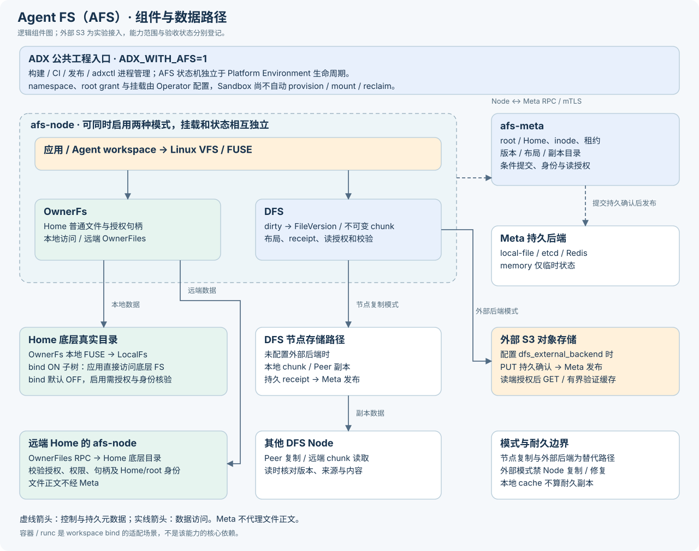
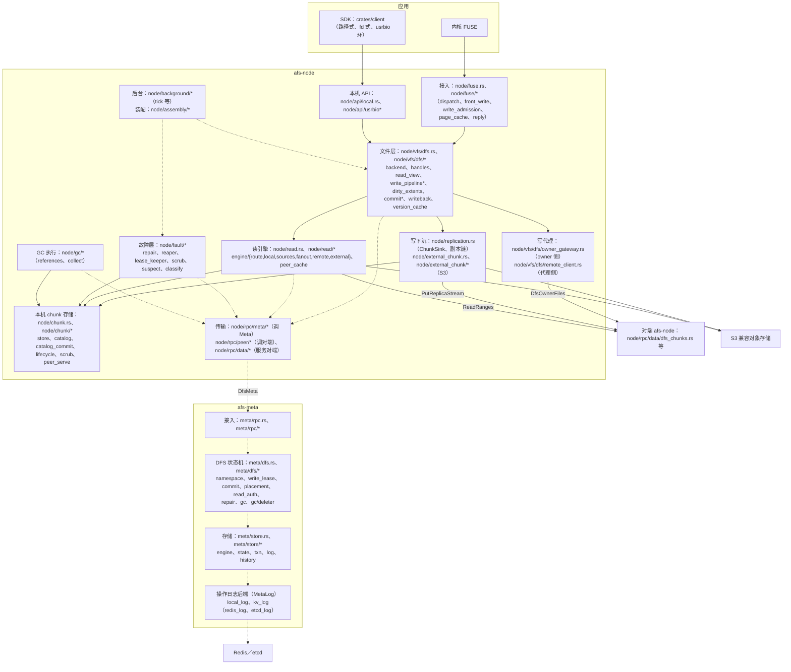
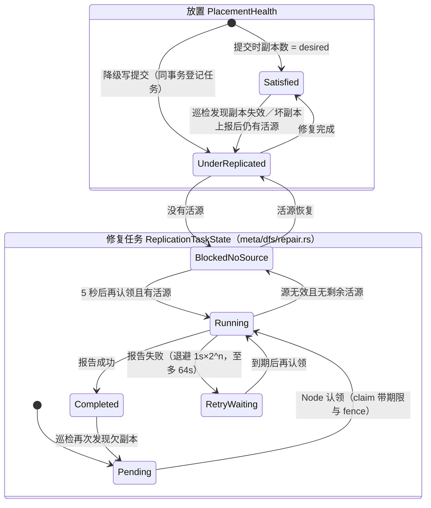
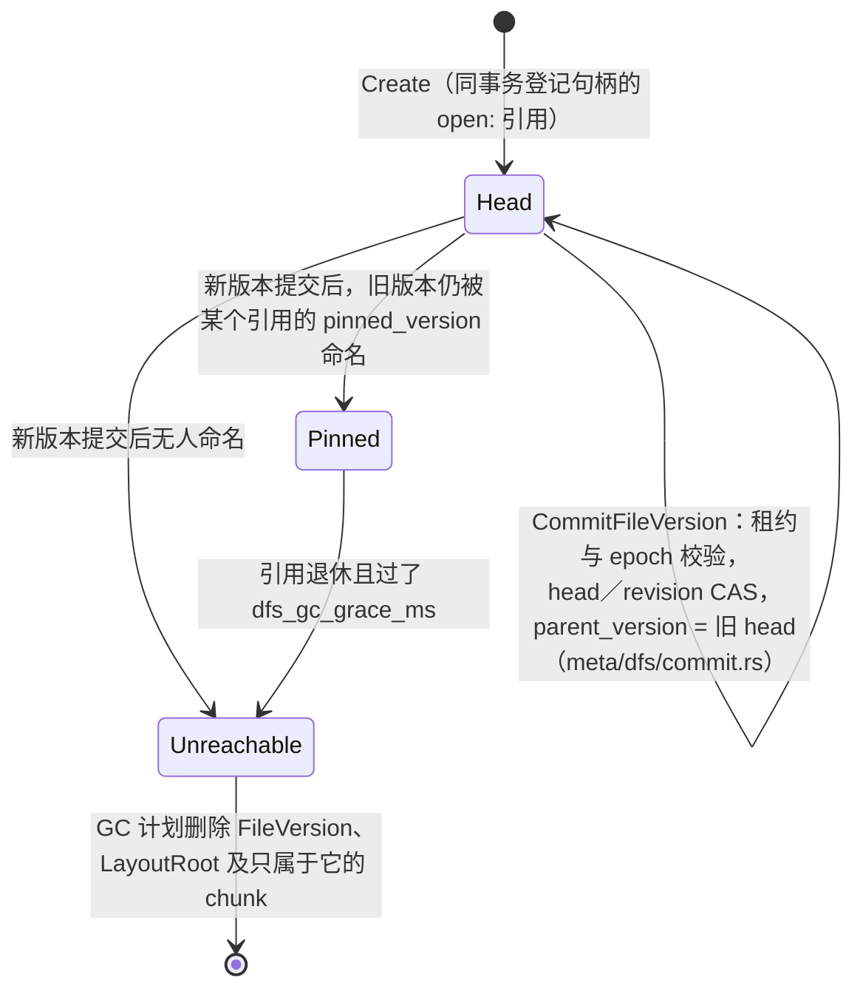
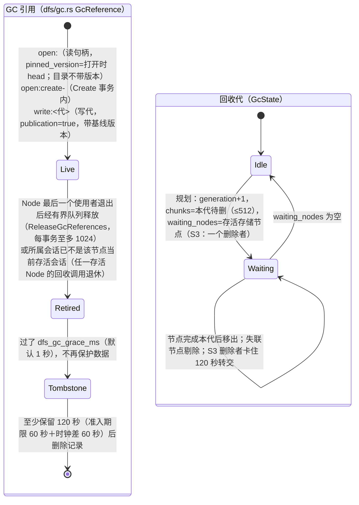
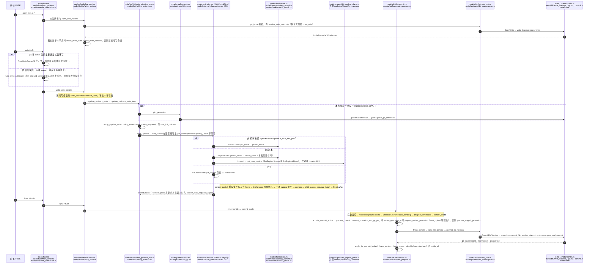
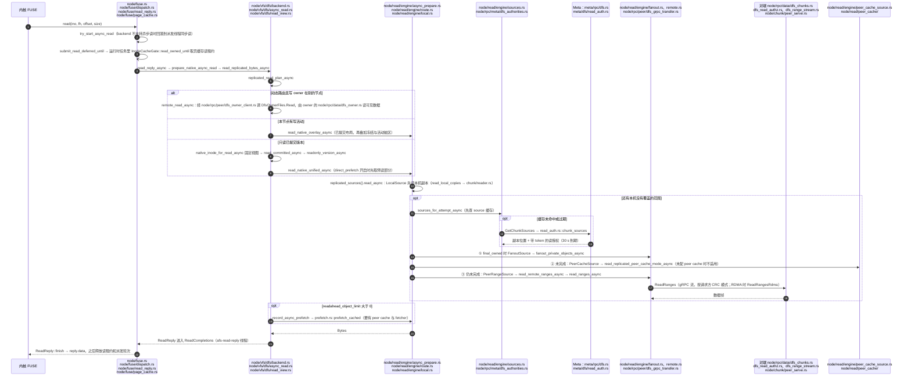
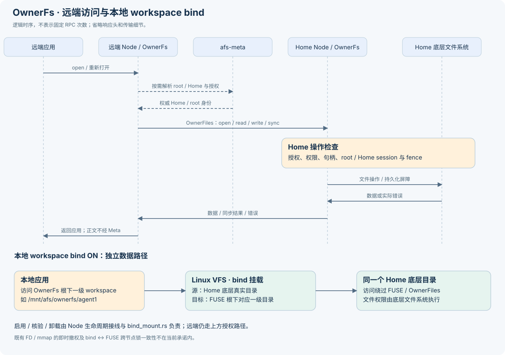
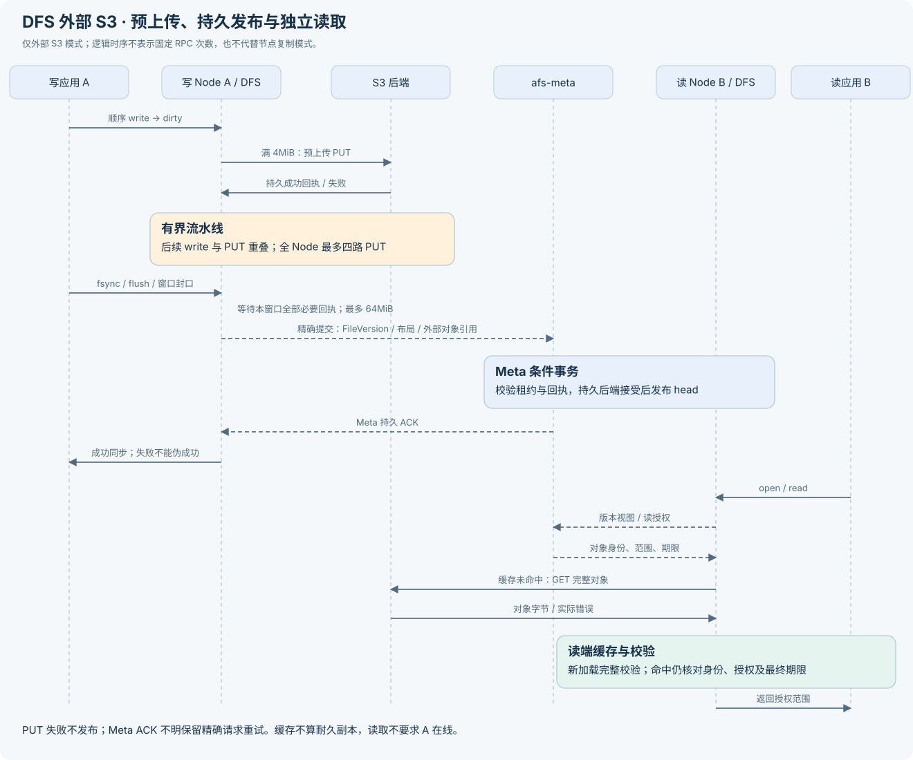

# Agent FS（AFS） 架构边界

Agent FS（AFS） 是 Agent DX 的可选文件系统子系统。它位于根级 `afs/`，
只在显式设置 `ADX_WITH_AFS=1` 时进入文件系统专用构建、测试、带组件发布包
和部署入口；默认 Agent DX 构建、包和部署不包含 `afs-meta`、`afs-node`
或 FUSE 专属系统依赖。

## 架构总览



OwnerFs 与 DFS 是平级模式。虚线箭头表示控制与持久元数据，实线表示数据访问；
`afs-meta` 不转发文件正文。DFS 节点复制与外部 S3 是替代路径，不能把图中两条
路径理解为外部模式同时保留 Node 耐久副本。上图是逻辑总览；逐框对应源码模块的组件图见下文
[组件与源码模块](#组件与源码模块)。支持范围与已验证的组合见[支持边界与已知限制](afs-support-boundary.md)。

## 组件职责

AFS 把用户可见的文件语义和文件字节搬运分开：

| 组件 | 职责 |
| --- | --- |
| `afs-meta` | 命名空间、inode、写租约、文件版本、布局、放置、副本目录和幂等提交结果 |
| `afs-node` | FUSE 会话、OwnerFs Home 访问、DFS dirty 状态、本地 chunk 存储、复制执行、远端读、验证缓存和卸载排空 |
| `afs/crates/*` | AFS 域内共享的错误、日志、指标、协议、追踪和传输 crate |
| `afs/crates/client` | DFS 客户端 crate；不作为 Agent DX 平台内部 RPC 适配层 |
| `afs/tools` | 度量工具与诊断探针（`afs-tools`），不进发布包 |

`afs/crates/*` 是 AFS 域内共享层，不纳入 Agent DX 根级产品基础设施。
Agent DX 平台内部 gRPC 仍按 Environment、Runtime、Snapshot、Route 和 Node
责任拆分；AFS 不把 POSIX/Frontend 适配器接入 Platform 内部 RPC。

## 组件与源码模块

下图是 DFS 模式的组件与依赖方向，每个框写出 `afs/src/` 下对应的模块（`crates/` 指 `afs/crates/`）。
实线是数据与调用，虚线是控制与元数据；依赖方向为"接入 → 文件层 → 数据层 → 共享类型"，
违规依赖边由 `afs/scripts/dep_edges.py` 检查（登记例外 1 处：`node/fuse` ↔ `node/vfs/ownerfs/fuse_policy`）。



| 框 | 职责 | 主要模块 |
| --- | --- | --- |
| 接入（FUSE） | 接收线程、callback worker、同 inode 读写门、前台写队列与准入、页缓存版本复用、失败分级 | `node/fuse.rs`、`node/fuse/{dispatch,front_write,write_admission,page_cache,read_reply,reply,policy}.rs` |
| 本机 API（SDK） | UDS 上的 gRPC 控制面；memfd 共享内存环数据面；客户端进程退出回收 | `node/api/local.rs`、`node/api/usrbio.rs`、`node/api/usrbio/{fd,owner}.rs` |
| 文件层 | `Backend` 实现、句柄与读视图、写流水线（唯一写路径）、唯一提交入口、后台写回、版本缓存 | `node/vfs/dfs.rs`（`DistributedFs`，13 个按职责的字段）、`node/vfs/dfs/{backend,handles,read_view,write_pipeline,write_pipeline_ops,dirty_extents,write_state,commit,commit_prepare,writeback,meta_port,version_cache}.rs` |
| 写代理 | 写租约在别的节点时，代理侧经 `DfsOwnerFiles` 把写交给 owner；owner 侧幂等表与回收 | `node/vfs/dfs/remote_client.rs`（`WriteCoordinator`）、`node/vfs/dfs/owner_gateway.rs`（`OwnerGateway`）、`node/vfs/dfs/owner_op_table.rs` |
| 读引擎 | 固定版本读：本机副本 → 扇出 → Peer 缓存 → 远端范围读；S3 外部读 | `node/read/engine.rs`、`node/read/engine/*`、`node/read/peer_cache/` |
| 写下沉 | `ChunkSink`：本机快路径、副本链（链头持久化后转发、收对端持久 ACK、降级写）、S3 上传 | `node/replication.rs`、`node/replication/acks.rs`、`node/external_chunk.rs`、`node/external_chunk/{store,worker,cache,verifier}.rs` |
| 本机 chunk 存储 | 暂存 → 持久化（正文、目录、catalog 屏障）→ ACK；校验读；副本生命周期（`CopyLifecycle`）；巡检读盘；服务对端读 | `node/chunk/{store,staged,catalog,catalog_commit,lifecycle,reader,scrub,peer_serve,sidecar_install}.rs` |
| 故障层 | 修复循环（上报隔离、认领、复制、报告）、GC 回收循环、写租约续期、后台巡检、接收方校验失败的复核 | `node/fault/{repair,reaper,lease_keeper,scrub,suspect,classify}.rs` |
| GC 执行（Node） | GC 引用（`open:`、`write:`）的建立与有界释放队列；一次回收（本机副本或 S3 对象） | `node/gc/references.rs`、`node/gc/collect.rs` |
| 后台与装配 | 后台 tick（写回推进等，串行）；装配按后端与职责拆分，后台组件各自有名字与关闭顺序 | `node/background/tick.rs`、`node/assembly/{mod,common,dfs,ownerfs,grpc,shutdown}.rs` |
| 传输（Node） | 调 Meta 的 `DfsMeta` 客户端；对端读写的 gRPC／RDMA 客户端与连接池；服务对端的 `DfsChunks`、`DfsOwnerFiles` | `node/rpc/meta/*`、`node/rpc/peer/*`、`node/rpc/data/*` |
| Meta 接入 | gRPC 服务、证书到 Node ID 的绑定校验 | `meta/rpc.rs`、`meta/rpc/{dfs,node}.rs` |
| Meta DFS 状态机 | 命名空间（含 readdir 分页）、写租约、版本提交、放置与副本写授权、读授权、修复任务与巡检、GC 规划与删除者 | `meta/dfs.rs`、`meta/dfs/{namespace,write_lease,commit,placement,read_auth,repair,gc}.rs`、`meta/dfs/gc/deleter.rs` |
| Meta 存储 | 单写者提交、派生索引、有界历史、读视图、checkpoint | `meta/store/{engine,state,txn,history,read_view}.rs`、`meta/store/state/*` |
| Meta 操作日志后端 | `MetaLog` 通用合同（比较追加、恢复、checkpoint 安装、term fencing） | `meta/store/log.rs`、`meta/store/local_log.rs`、`meta/store/kv_log.rs`（`redis_log.rs`、`etcd_log.rs`） |
| 共享类型 | chunk、副本、放置、修复任务、GC 引用、降级策略等跨 Meta／Node 的类型；持久格式登记 | `dfs.rs`、`dfs/{gc,cow,replica_failure}.rs`、`format.rs` |

## 语义

本节是 DFS 对应用的承诺，与代码一一对应；POSIX 逐项行为见 [POSIX 支持边界](afs-posix-boundary.md)，
限制见 [支持边界与已知限制](afs-support-boundary.md)。

### 可见性（决策 4、4a）

DFS 对齐 close-to-open：

| 事件 | 保证 | 代码 |
| --- | --- | --- |
| `write` 返回 | 数据已被接纳（进入前台写队列或写流水线），本节点的读者立即可读；不保证他人可见，不保证持久 | `node/fuse/front_write.rs`、`node/vfs/dfs/write_pipeline_ops.rs` |
| 他人可见 | `FileVersion` 提交到 Meta 之后，对**之后新 open** 的读者可见。提交入口只有一个（`node/vfs/dfs/commit.rs`）：前台的 fdatasync、fsync、close（flush）、Node 排空，以及后台提交 | `CommitReason`（`node/vfs/dfs/commit.rs`） |
| 已打开的读者 | open 时取定版本，到 close 固定（Node 用 `open:` GC 引用加 `pinned_version` 保护这个版本，`node/vfs/dfs/handles.rs`）；**本节点自己的写入对本节点的读者始终可见**，与打开顺序无关 | `node/vfs/dfs/write_state.rs`；特征测试 `dfs.semantics.open_reader_after_commit` |
| 后台提交 | 每 `dfs_background_commit_ms`（默认 5000）把有脏数据或在途上传的文件标为到期并提交；写流水线有压力（描述符满、正文须保留到发布）时提前提交。这是调度周期，不是可见性期限，忙时延后；close 前新 open 的读者可能看到某个完整的中间版本，不会看到撕裂内容 | `node/background/tick.rs`、`node/vfs/dfs/writeback.rs` |
| 已 unlink 的打开文件 | 读者继续读打开时的版本；引用保护 `nlink = 0` 的 inode 及其固定版本 | `meta/dfs/gc.rs`；特征测试 `dfs.semantics.unlink_open_file`、POSIX 边界第 38 项 |

### fsync、close 与 SDK（决策 5、12）

| 操作 | 提交 | 返回时保证 |
| --- | --- | --- |
| `fdatasync` | DataOnly：换 head（新长度与布局），不写 mtime／ctime | 此前接纳的写已达到当前存储模式的持久要求（见[可靠性](#可靠性)）并提交到 Meta |
| `fsync` | Full：数据提交后循环到元数据（mtime、ctime）也落到 Meta | 同上，另含元数据 |
| `close`（FUSE flush） | 先排空并重试该文件在前台写队列里的条目，再做一次 DataOnly 同步提交；提交失败作为 `close(2)` 的错误返回 | 数据已持久并提交；**他人新 open 或 `stat` 立即看到新长度**。mtime 由最后一个写者 release 时立即触发的后台 Full 元数据提交带上（不等 5 秒定时器）：S0 特征测试 `dfs.semantics.close_mtime` 实测他人 `stat` 立即看到新 size 与 mtime（Q03 不成立），但严格说 `close(2)` 返回与 mtime 提交之间有一个短窗口，只有 size 由 close 本身保证 |
| FUSE release | 不提交数据；最后一个写者离开且仍有脏数据或元数据时请求后台提交，并交付该句柄尚未收到的后台错误（内核忽略 release 的返回值） | — |
| SDK 路径式 `close` | 与 FUSE close 同语义（决策 12，按 3FS 对齐接口行为）：先 flush（DataOnly 同步提交）再释放；flush 失败也释放，返回 flush 的错误 | 同 FUSE close；close 返回后新 open 能读到 |
| SDK `sync` | Full 提交 | 回复带 Meta 中该 inode 的 head `file_version_id` 与本句柄已确认的 `durable_write_seq` |
| SDK fd 式（`register_fd`） | 走 FUSE 的 flush＋release，与 FUSE 相同 | — |

代码：`node/vfs/dfs/backend.rs`（`flush`、`fsync`、`release`）、`node/vfs/dfs/commit.rs`（`sync_handle`、DataOnly／Full）、
`meta/dfs/commit.rs`（DataOnly 不改 mtime／ctime）、`node/api/usrbio.rs`（SDK close）。

**错误一定经 fsync 或 close 返回**（R03）。没有调用者在等的写失败（后台提交、上传）记在 inode 上一次，
按 Linux errseq 语义交付：每个打开的写句柄在下一次 write／flush／fsync 收到一次；只写不同步的句柄在 release
收到（SDK close 与 owner RPC 会返回它）；最后一个写者关闭后才出现的错误交给下一个写者的第一次屏障。
上传失败由下一次屏障重传同一不可变对象。Meta 确定性拒绝提交（冲突等）时错误在写者打开期间是粘性的；
所有写者关闭后，下一次可写打开丢弃这批写，从 Meta 已提交版本重新开始（与 Linux 写回失败后丢脏页一致）。
代码 `node/vfs/dfs/writeback.rs`、`node/vfs/dfs/commit_prepare.rs`、`node/vfs/dfs/write_state.rs`；测试
`node/vfs/dfs/tests/error_delivery.rs`。

### 写接纳与背压合同

写入在资源用满时**等待（背压），不报错**；只有下表列出的情况才向应用返回错误。

| 资源 | 上限 | 满时 | 返回错误的情况 | 代码 |
| --- | --- | --- | --- | --- |
| 前台写队列（每 DFS 挂载） | `dfs_write_queue_bytes`（默认 2GiB）；已确认条目 4096 | 扣住回复等待额度（接收回调先返回） | 等待空间（额度的 1/8，至多 32MiB）或等待条目（65536）也耗尽：`EAGAIN`；单次写大于队列额度：`E2BIG`；别的文件的失败条目本身就占满额度：`EAGAIN`；挂载正在关闭：`EIO` | `node/fuse/front_write.rs` |
| 写流水线正文 | `dfs_dirty_budget_bytes`（默认 64MiB，Node 级） | 施加提交压力并等待 | 单次分配超过上限：`ENOSPC`。**上传持续失败时这里的等待没有截止时间**（R84，已知限制） | `node/chunk/payload_live.rs`、`node/vfs/dfs/write_pipeline_ops.rs` |
| 未发布描述符、在途上传 | `dfs_unpublished_descriptors`（1024，另受 4MiB 元数据总额）；`dfs_upload_inflight_chunks`（8，S3 下 4） | 施加提交压力并等待 | — | `node/vfs/dfs/write_pipeline.rs` |
| 副本接收槽（每 Node） | 8 个，前台写与修复共用 | 接收端在本次传输的总期限内排队；写端遇 `ResourceExhausted` 在自己的总期限内退避重试（5ms 起倍增，至多 200ms） | 总期限到：`ETIMEDOUT` 类；真实磁盘满（`IO_CAPACITY`）不重试：`ENOSPC` | `node/rpc/data/dfs_chunks.rs`、`node/rpc/peer/dfs_replica_plane.rs` |
| Meta 输入队列 | 1024 槽、128MiB；后台（GC）只能用一半 | 等待至多 3 秒（短于 Node 默认 5 秒的 Meta RPC 期限） | 仍满：`META_STORE_BUSY` → `EAGAIN`（可重试，请求未执行）；单次请求超过额度：`ENOSPC` | `meta/store/admission.rs` |

errno 映射（`afs/src/error.rs`）：`ResourceExhausted` 中 `IO_CAPACITY` 为 `ENOSPC`、其余为 `EAGAIN`；`FailedPrecondition`
（含 `META_DFS_CONFLICT`、`META_LOG_FENCED`）为 `EBUSY`；`Unavailable` 为 `EHOSTUNREACH`；`DeadlineExceeded` 为 `ETIMEDOUT`；
只有 `Internal`、`DataLoss`、`Unknown` 为 `EIO`。

### 写者与 owner（决策 4b、Q06）

每个文件同一时刻只有一个写者节点（写租约，30 秒，`DFS_WRITE_LEASE_SECONDS`）。租约在别的节点时，本节点的写经
`DfsOwnerFiles` 交给 owner 执行（`node/vfs/dfs/remote_client.rs` → owner 的 `node/vfs/dfs/owner_gateway.rs`）。
租约由故障层后台续期（每秒检查，剩余不到 2/3 时续），提交、可写 open、`copy_file_range` 在剩余不到 5 秒时同步续期
（`node/fault/lease_keeper.rs`）。

**owner 崩溃时**（Q06）：代理方的远端写会话绑定 owner 的节点、会话与租约代际，没有重连或迁移
（`node/vfs/dfs/remote_client.rs`）。owner 已接受但尚未提交的写随 owner 进程丢失，代理方之后的 write、fsync、close
返回错误；已经 fsync 或 close 成功的数据不受影响（已提交到 Meta）。新的写者要等原租约过期（至多 30 秒）才能取得租约
（`meta/dfs/write_lease.rs`）。这与本地写者进程崩溃时未同步数据丢失的语义一致；仓库里没有针对这一路径的专门用例
（读代码得出）。

### 目录列举与 rename

- **readdir 分页**（R72）：`DfsMeta.ReadDir` 带名字游标与 `limit`，每页至多 1024 项（`READ_DIR_PAGE_MAX`）。
  每页一个一致视图，跨页由名字游标续接：打开期间未被修改的项恰好出现一次，期间增删的项可出现可不出现。
  句柄缓存已取的条目，`seekdir` 在已取范围内精确定位；`rewinddir`（cookie 0）重读句柄缓存，不重新向 Meta 取。
  详见下文"FUSE 接收与页缓存"。
- **rename**：支持替换与 `RENAME_NOREPLACE`（目标存在时 `EEXIST`）；其他 flags 回 `EINVAL`（不回 ENOSYS，以免内核让
  整个挂载失去 `RENAME_NOREPLACE`）；把目录移进自己的子树回 `EINVAL`。Meta 在读与提交之间发现源或父目录变化时回
  `META_DFS_CONFLICT`，Node 用同一操作 ID 重发至多 4 次（R83，`node/vfs/dfs/backend.rs`）；仍冲突时应用看到 `EBUSY`。

## 可靠性

### 持久性按存储模式

| 存储模式 | fsync／close 成功时数据在哪里 | 代码 |
| --- | --- | --- |
| 本地盘 1 副本 | 本机 chunk 正文、目录与 catalog 均已 fsync | `node/chunk/store.rs`（`persist_batch`） |
| 本地盘多副本 | 链头持久化后转发，收到 `dfs_sync_required_copies` 份持久 ACK；`degrade` 下不少于 `dfs_min_degraded_copies` 份也成功，缺的副本同事务登记待修复 | `node/replication.rs`、`meta/dfs/commit.rs` |
| S3（外部后端） | S3 PUT 成功且回执经长度与 BLAKE3 校验；本地盘只是缓存 | `node/external_chunk/` |

Meta 状态的持久性取决于 Meta 后端：`local-file` 到本机盘 fsync；`redis` 要求单实例 `appendonly yes`＋`appendfsync always`；
`etcd` 取决于其多数派提交；`memory` 不持久。每次以写者身份打开日志 term 加一，旧 term 的追加返回 `META_LOG_FENCED` 且不写入；
Redis／etcd 在服务端同一原子单元里比较 term 与 tip，`local-file` 以文件锁为互斥、term 为兜底（目录必须在本机独占盘上，
见[已知限制](afs-support-boundary.md#已知限制)）。日志写入结果未知时 Meta 失败关闭，需重启。

### 副本、降级写与修复

- **放置与副本组**由 Meta 下发（`meta/dfs/placement.rs`），随放置快照带"有效 local_copy"（决策 9，写入节点是否必须持有一份）
  与降级策略 `DfsReplicaFailureConfig`（Meta 初始化时固定，不可改）。
- **降级写**（R12，决策 3）：`dfs_replica_failure_policy = "degrade"`（默认）时，链上后面一跳失败（拒绝连接、超时、背压期限到、
  对端授权失败等），只要本机已持有的副本数不少于 `dfs_min_degraded_copies` 且满足本地副本规则，就用这些副本继续提交，日志
  `dfs.replica_write_degraded`；链协议违规与本机请求错误不降级。存活节点不够组成完整副本组时 Meta 发降级组。Meta 提交时
  少于 `dfs_desired_copies` 的放置在**同一事务**里标为 `UnderReplicated` 并登记 Pending 修复任务。本地盘故障时写入照常失败
  （改写远端只留扩展点）。`strict` 下任一同步副本失败即写入失败。详见下文"写与提交"之后的说明。
- **修复**：Node 故障层的修复循环（`node/fault/repair.rs`）上报本机隔离的副本、向 Meta 认领任务、沿链复制、报告结果；
  空闲时每秒轮询一次。Meta 侧（`meta/dfs/repair.rs`）只计可靠副本（`DurableReplica`、`ExternalCommitted`），
  认领事务钉住所读的副本与会话。修复始终按 `strict` 补齐全部副本。
- **Meta 巡检**：放置记录为健康但副本已失效（例如持有节点会话过期）只有看副本才知道。存活会话集合或副本策略变化时
  开一轮巡检，每次认领推进一页（16384 个放置），每 10 分钟兜底一轮；发现的欠副本放置留在内存待办（至多 4096），
  每次认领看 256 个，直到登记成任务。100 万放置时发现约需 1 分钟（外推）。见下文"Meta 每操作成本"。
- **坏副本**：本机读、修复源读校验失败时经 `CopyLifecycle`（`node/chunk/lifecycle.rs`）隔离，由修复循环上报 Meta，
  Meta 把该副本标为 `Corrupt` 并安排修复。远端读（默认 `dfs_read_crc_mode = "receiver"`）在接收方校验失败时换副本读，
  并请持有方复核（`node/fault/suspect.rs`），持有方自己读盘确认坏了才隔离上报。所有副本都坏时读返回 `EIO`。
- **后台巡检读盘**（scrub，S4c）：本机副本模式下，Node 启动 `dfs_scrub_start_delay_seconds`（默认 300）秒后按 chunk id
  顺序逐个完整校验本机持久副本，限速 `dfs_scrub_bytes_per_second`（默认 32MiB/s，0 关闭），两轮开始至少相隔
  `dfs_scrub_round_interval_seconds`（默认 86400）。坏副本走同一隔离 → 上报 → 修复链（日志 `dfs.scrub_corrupt_found`）。
  它补上"只有远端读才校验"的缺口：两副本下写入节点总在本机读，另一份副本从不被读，坏了也没人发现。
  本机读只校验请求覆盖的 32 KiB CRC32C 段（`crc32c-v2` chunk 首次打开只核对身份与 CRC 表摘要，不整块扫描），
  从未被读到的段上的损坏也由巡检发现；读到的坏段照样隔离、上报并换副本读。
  代码 `node/chunk/scrub.rs`、`node/fault/scrub.rs`；配置见[部署说明](../deployment/afs.md#dfs-后台巡检)。

### GC

Meta 判定可达性、Node 删除本机块（S3 模式由一个 Node 删除对象）；详细规则见下文"DFS 历史与数据块回收"。要点：

- 保留根：有链接的 inode 的 head；未退休（或退休后仍在 `dfs_gc_grace_ms` 内）的 GC 引用保护其 inode、head 与引用记录的
  那一个版本（读句柄当前读取的版本、写代开始时的基线版本）；有效写租约保护 inode 与 head。其余旧版本即使文件仍打开也回收（R81 F2）。
  本机提交推进已打开句柄的读取版本时，先建新版本的引用再推进，被替换的引用等在途读结束才释放（R94）。
- 一代回收只等**存活的存储节点**（会话未过期且登记了存储设备）；失联节点被剔除，不再卡住全集群回收（R55）。
- 一个计划分批提交（每批至多 4096 个 key，每代至多 512 个 chunk，被容量拒绝时批大小减半），持续写入下也能推进（R51）。
- S3 模式一代只等一个删除者；删除者失联由会话过期剔除、列举对账找回孤儿对象，卡住 120 秒转交下一个存活 Node（S4-9）。

## 数据与文件状态

下列状态图对应代码里的类型；Meta 与 Node 各自持有对副本的权威，`crate::dfs::CopyPhase`（`afs/src/dfs.rs`）是两边共用的阶段词汇，
不合并成一个状态机。

### chunk 副本（Node 本机副本与 Meta 副本记录）

```mermaid
stateDiagram-v2
    [*] --> Staged: 写流水线封块<br/>node/vfs/dfs/dirty_extents.rs
    Staged --> Durable: persist_batch：正文、目录、catalog fsync 后 ACK<br/>node/chunk/store.rs
    Durable --> Quarantined: 本机读／修复源读／巡检／持有方复核校验失败<br/>CopyLifecycle（node/chunk/lifecycle.rs）
    Quarantined --> Durable: 同 id 重新 persist_batch（修复写回）
    Durable --> Retired: GC 回收本代<br/>CopyLifecycle::retire_generation
    Quarantined --> Retired: GC 回收
    Retired --> [*]
    note right of Durable
        Meta：CopyRecord{role=DurableReplica|ExternalCommitted, state=Ready}
        提交 CommitFileVersion 时与版本同事务登记（meta/dfs/commit.rs）
    end note
    note right of Quarantined
        Meta：修复循环上报 ReportChunkCorruption 后 state=Corrupt
        （meta/dfs/repair.rs，只接受上报者自己设备上的副本）
    end note
```

Node catalog 只记 `LocalChunkState::{Durable, Quarantined}`（`node/chunk.rs`）；Staged 是写流水线里的正文或 `.tmp` 文件，
不进 catalog。Meta 的 `CopyState` 只有 `Ready` 可读；GC 直接删除副本记录，`Deleting` 只保留枚举位置（持久格式）。
Peer 磁盘缓存与 S3 本地缓存是 `VerifiedCache`，不计入可靠副本，也不登记为持久副本。

### 放置健康与修复任务



Running 的认领过期后可被再次认领（调用方核对工人会话）。任务与不健康放置在 `State` 上有派生索引（不落盘、加载时重建），
所以空闲认领不读全部放置。

### 文件版本与写租约



`InodeRecord.head_version` 指向当前版本；`FileVersion{parent_version, length, layout_root}` 只记血缘，不作为保留理由。
写租约（`WriteLease{owner_node_id, owner_session_id, lease_epoch, expires_at}`）由 `meta/dfs/write_lease.rs` 授予：
别人持有有效租约时冲突；换主或过期时 `lease_epoch` 加一；同主续期取较晚到期。提交还要求写代引用 `write:<代>`
属于写者当前会话（写代 fence）。

### GC 引用与回收代



本代待删的 chunk 在全部相关节点确认前不能被新提交引用（`commit references a chunk pending deletion`）。
Node 侧回收循环（`node/fault/reaper.rs`）每 5 秒调用一次 `CollectGarbage`，上一轮回收到 chunk 时改为 1 秒。

## 观测

两个进程都在 `rest_listen`（Meta 默认 `127.0.0.1:7401`，Node 默认 `127.0.0.1:7501`）上提供 `GET /metrics`（Prometheus 文本格式）。
Meta 的 `GET /v1/store` 给出实体计数、历史水位与 GC 摘要（含 `gc.generation_age_seconds`），
`GET /v1/dfs/chunks/<id>/replication` 给出单个 chunk 的放置健康（`Satisfied`／`UnderReplicated`／`BlockedNoSource`）。
未预置标签的指标族在第一次事件之前不出现。

### GC 停滞告警（R85）

**用 `afs_meta_dfs_gc_generation_age_seconds` 告警**：它是 Meta 看到当前一代已等待的秒数（不等待时为 0），在任一存储节点
`CollectGarbage` 调用成功后刷新（每节点每 1–5 秒）。一代一直不结束时它单调增长；而 `afs_meta_dfs_gc_generation_duration_seconds`
只在一代结束时产生样本，这种情况下没有新样本，**不能用直方图告警**。注意它的边界：所有回收调用都失败或没有存活节点调用时，
它停在旧值不再增长；计时从本 Meta 进程第一次看到这一代起算，Meta 重启后归零。配合使用：

- `afs_meta_dfs_gc_waiting_nodes` 与 `afs_meta_dfs_gc_pending_chunks`：当前代还在等多少节点、有多少 chunk；
- `afs_meta_dfs_gc_stalled_seconds`：有死 key 却一直没有回收进展的时长，每次调用都刷新（失败也刷新），越过 60 秒打一次日志
  `dfs.gc_stalled`，可覆盖"调用全部失败"的情况；
- `afs_meta_dfs_gc_dropped_nodes_total`、`afs_meta_dfs_gc_retired_references_total`：因失联被剔除的节点（含 S3 删除者转交，
  日志 `dfs.gc_deleter_handoff`）与被退休的引用。

正常运行时一代在数秒内结束；建议 `afs_meta_dfs_gc_generation_age_seconds` 持续超过数分钟（大于会话期限 30 秒加 S3 转交
120 秒）即告警，阈值按部署的删除规模调整。

### 本轮新增的指标

| 阶段 | 指标 | 进程 | 含义 |
| --- | --- | --- | --- |
| S1 | `afs_meta_rpc_requests_total{method}` | Meta | 按 gRPC 方法计数（结构成本） |
| S1 | `afs_dfs_inode_lock_contended_total`、`afs_dfs_inode_lock_wait_nanoseconds_total` | Node | inode 写状态锁的等待次数与累计时长 |
| S2（R55） | `afs_meta_dfs_gc_generation`、`_waiting_nodes`、`_pending_chunks`、`_generation_age_seconds`、`_dropped_nodes_total`、`_retired_references_total`（前缀 `afs_meta_dfs_gc`） | Meta | 当前代、等待节点、待删 chunk、等待时长、剔除节点与退休引用 |
| S2（R59） | `afs_dfs_peer_read_events_total` 的 `suspect_copy_invalid`、`suspect_copy_not_confirmed` | Node | 持有方复核确认坏副本／未确认（后者持续增长说明链路有问题） |
| S3a（R51） | `afs_meta_dfs_gc_passes_total`、`_attempts_total`、`_conflicts_total`、`_exhausted_passes_total`、`_pass_duration_seconds`、`_generation_duration_seconds`、`_live_references`、`_retired_reference_records`、`_planned_entities`、`_dead_keys`、`_stalled_seconds`、`_rejected_batches_total` | Meta | GC 推进、冲突、分批被拒与停滞 |
| S3a（R61） | `afs_meta_dfs_repair_placements_checked_total` | Meta | 修复认领检查过的放置数（空闲成本不应随放置数增长） |
| S3a（R69） | `afs_dfs_gc_release_pending`、`afs_dfs_gc_released_total`、`afs_dfs_gc_release_failures_total` | Node | GC 引用释放队列 |
| S3b（R66） | `afs_dfs_writeback_passes_total{trigger,outcome}` | Node | 后台写回轮次（notify／timer × committed／idle／error／skipped） |
| S4a（R76） | `afs_fuse_front_write_admissions_total{filesystem,outcome}` | Node | 前台写准入：立即、等待后、各拒绝原因 |
| S4a（R71） | `afs_dfs_peer_admissions_total{operation="replica",outcome}` | Node | 副本接收槽：立即取到、排队后取到、期限到被拒 |
| S4b（R18） | `afs_usrbio_ring_io_total` 的 `reclaimed_ring`、`reclaimed_registration`、`reclaimed_handle`、`reclaimed_iov` | Node | 客户端进程退出后回收的资源（日志 `usrbio.client_reclaimed`） |
| S4c | `afs_dfs_scrub_total{event}` | Node | 巡检：`chunks_verified`、`bytes_verified`、`corrupt_found`、`skipped`、`errors`、`rounds_completed`（仅本机副本模式且巡检开启时注册） |

本轮新增的运维日志：`dfs.replica_write_degraded`（每次降级写，同组后续 chunk 不再重复记录）、`dfs.gc_stalled`、
`dfs.gc_deleter_handoff`、`dfs.scrub_corrupt_found`、`dfs.scrub_round_completed`、`meta.log.etcd_quota_low`、
`config.test_only_option_enabled`。

**没有 Prometheus 指标、只能看日志或 REST 的**：降级写次数（日志 `dfs.replica_write_degraded`）、欠副本数量
（`/v1/store` 的修复任务实体计数与单 chunk 的 replication 查询）、S3 删除对象数（Node 日志 `dfs.gc_collected`）、
`META_STORE_BUSY` 次数、Meta 被 fence 或日志失效（只有 `/health` 503，追加失败时 `afs_meta_wal_failures_total` 加一）。

## Meta 与数据路径

Meta 是可恢复状态的权威，不代理稳定数据流。Meta 校验已提交状态并准备候选状态，只有持久后端接受后才发布提交结果。读请求先固定一致视图，再选择本地副本、远端副本或缓存来源，避免一次复合读混用多个 revision。

Meta 的 `local-file`／`memory` 路径通过 `Store::open_log` 重放确定的提交记录，
再建立一致的已发布视图。提交在私有结构共享状态中准备，记录持久成功后整体切换视图；
查询只固定已确认版本。日志的独立身份、顺序、前置 hash、CRC 和已声明持久尾都参与恢复核验。
本地重开再次同步 WAL／目录，避免把仅在页缓存里可读的旧进程写入当成持久确认。
首次初始化以持久空 `INITIALIZING` 标记保护身份、空 WAL 和初始 CURRENT 的安装；
精确未完成前缀可继续，未知或非空残留仍拒绝。已初始化目录必须有 CURRENT，
未列入恢复／退休清单的非空 WAL 拒绝；仅允许身份与恢复 tip 精确匹配的单个空预备段。
这能检测清单遗漏和留有新日志的回滚，不能检测整目录自洽回滚而无外部见证的情况。
旧 JSON 快照目录拒绝自动接管；日志后端为 local-file、redis、etcd 与易失 memory（redis／etcd 只存操作日志与分块 checkpoint，
term 与 tip 在同一服务端原子单元里比较，见 `meta::store::kv_log`）；旧快照后端已删除；每个 Store
只选择一条权威路径，不双写。`Store::checkpoint` 可捕获同一已发布 State 及日志位置，
在后台任务中编码自包含状态，持久安装带身份、位置、摘要及 CRC 的快照和 `CURRENT`。
`CURRENT` 同时选择快照和连续日志段；每段头绑定原身份、起始位置及前置 hash，
活跃段的已同步尾标记承接后续提交。重启核对保留恢复链后，从有效快照只应用后续记录；
最新快照损坏时，只有上一快照及所需全部已确认历史均有效才回退，否则拒绝。
调用方取消不会释放仍在工作的安装任务额度。写批次不跨段拆开，段按软阈值轮转；
先持久更新恢复清单，再验证并删除两恢复点均不需要的封口段及旧快照。退休清单支持
删除中断后接续，损坏／外来对象保留并计入有限额度；校验旧正文不持写者锁。
恢复链验证后可回收未引用且经身份、完整摘要和 CRC 核验的本库 checkpoint 镜像；
不采用孤儿镜像作为新的恢复权威，不删除未知／损坏／外来镜像。
后台按记录数、保守段字节量或时间软阈值捕获快照，容量压力也可唤醒。只有写前只读准入
确认尚未追加时才做有界等待，超时拒绝该组且不发布；实际追加错误仍失败关闭，不能按
容量错误码重试未知结果。观察超时不取消仍在工作的快照任务或释放其额度。
易失 memory 安装自包含快照后移除覆盖记录，仍不承诺进程退出恢复。
工作集仍是逻辑计账；六点进程故障、捕获超限拒绝和实际槽位压力下继续提交已有有限回归。
确定的历史清理使用独立管理记录或业务记录中的关联清理，保存原请求完成代际及完整事件
revision 水位；不复制实体正文，不伪造用户操作。纯管理记录只推进物理日志位置。
恢复核对并应用这些决定，不按重启时钟重新选择；自包含快照保存原事件完成时间、保留集、
压缩水位及已移除事件总数，避免清理后重置后续 Node 事件序号。旧 watch 游标明确返回
`Compacted` 和重扫位置，有限请求只复制选中的完整 revision。
canonical单写者按实际owned容量及保守结构预留计量历史，派生索引在恢复时重建，
正常提交只增量计入本次新增项。时间／条数／字节任一先到即选择确定清理；业务关联清理
与业务结果同屏障发布，空闲及持续重复请求期间也由独立到期计时推进管理记录。
待处理输入和准备身份有独立的有限字节准入，身份保护覆盖入队至写者处理终态，
调用方取消不能提前退还写者仍持有的额度；清理选择与身份准入在短锁内互斥，
持久 I/O 不持该锁，正在退休的同身份请求在入队前明确拒绝。
未知ACK后的失败关闭同时阻止后续业务和管理追加。
canonical读视图另有数量、所持状态字节和期限准入；同一不可变状态共享计账，
不同代际保守独立计账。过期空闲视图主动解除状态引用，正在执行的读仍持有额度直到结束，
过期或已知权威失效后不交付成功。此约束不改变业务授权或Node／S3预算，也不覆盖
已返回的独立结果对象。LocalLog只允许创建进程使用写者句柄；最后真实持有者显式释放
文件锁，继承的句柄不能读写权威或解开父进程的锁。
运行时清理后checkpoint／重开，以及降额后先持久清理再准入已有有限回归。
watch在复制前按独立条数／owned字节上限选取完整revision；请求limit为0也不取消硬上限。
超限时只返回此前完整revision，首个revision本身超限则明确报容量错误，不修改持久水位、
不伪造Compacted。已有断档仍通过原Compacted和RecoveryCursor重扫。
Meta的watch RPC在取数前取得独立响应额度；流式队列有固定槽位、代际与期限，并由单个
回收任务主动释放无人读取的过期队列。尚未退出的构建请求仍保留额度，旧流不能释放新代际。
正常EOF／取消退账，超时返回错误，不能把不完整流当成已完成批次推进游标。
上述约束不计入Node/S3预算，也不代表整个进程、调用方已取走结果或tonic/h2缓冲的内存保证。
历史策略配置／固定指标已接线，旧Snapshot后端已移除。物理掉电、
大场景资源及完整真实产品验收仍未完成，不能宣称持续增长部署已交付。
配置与当前限制见[部署说明](../deployment/afs.md#meta-操作日志与数据目录)。

Meta WAL 预算枚举与退休回收允许并发：只对 CURRENT 已持久退休、已封存的同名段在枚举后
被删除的 `NotFound` 跳过计费。仍存在的退休文件继续占用容量，活跃/未知文件丢失、非普通
文件及其他 IO 错误仍拒绝；不改变 WAL 容量、退休资格、持久顺序或锁外删除策略。

OwnerFs 面向小规模 Agent workspace。Home 节点把 workspace 保存为普通本地目录；远端节点通过受控 peer 回到 Home 访问文件。远端传输会话本身不授予文件访问权限，每次打开、读写、flush、sync 和 close 都必须校验授权、句柄、权限、root grant、session、Home session 和 fence。

DFS 把已提交数据表示为不可变 chunk。普通写入先进入 inode 的 dirty 状态；sync、同步写标志、close-time flush 或后台策略触发提交，形成新的 `FileVersion`。复制发生在文件布局之下，Meta 只在收到可验证持久 receipt 后提交新版本和副本目录。验证缓存不能自动算作持久副本。

DFS 的 `copy_file_range` 通过元数据 COW 为目标创建独立 FileVersion，重映射指定源范围的不可变 chunk；不读取或重新上传源数据。范围覆盖保留目标其它区域和源稀疏空洞。Meta 核验源与目标属于同一 namespace、布局严格对应声明范围，重试沿用原操作身份。后续写入提交独立 chunk，源目录删除不会使已提交副本失去数据。

文件提交和完整元数据同步遇到事务 CAS 未命中时，会重新验证 head 和写租约身份；同身份续期或并发 inode 属性变化不再永久污染 writer。换主和 head 变化仍拒绝。单次处理的持续竞争返回可重试错误，保留原 operation，避免把暂时竞争带到退出 drain。

所有启用 OwnerFs 或 DFS 权威能力的 Meta 都要求双向证书身份认证和
`trusted_node_certs`。CA 只证明证书链可信；Meta 还把握手得到的叶证书 DER 精确
映射到一个 Node ID，并校验 RPC 中声明的 caller／holder／owner 身份。DFS-only
部署与 OwnerFs 部署执行同一身份绑定，不能用另一张同 CA 证书冒充目标 Node。
读授权按单一信任域（M0）：DFS 元数据读、`Ping` 与 `LookupNode` 只要求受信 Node 证书，
不绑定调用者、会话或 namespace；REST 是只读本机运维面，只监听回环。
Node 的 Meta、peer control 和 data 诊断请求复用同一生产认证及加密配置，诊断不绕过证书认证。
这里的 Node ID 绑定发生在服务端对调用方的校验中；客户端仍按 CA 和
`tls_server_name` 验证服务端，不承诺按目标 Node ID 对服务端证书逐一 pinning。

组件间 TCP/gRPC 统一使用 `tls_encryption_enabled`（默认 false）。配置完整证书时，
false 保留真实 mTLS 身份握手，在受认证的 AFS1 模式协商和 ACK/GO 屏障后传输明文；
true 在握手后继续使用标准 TLS。Node、Meta、读写、副本、控制和诊断复用公共
`afs-transport` 接线；模式不兼容不自动降级，切换配置需要重启。
未配置身份的旧本地诊断模式不能通过现有权威能力启动检查。

关闭持续加密也关闭后续消息的密码学完整性保护；正文、请求头、Meta及控制消息
可被观察或主动修改。初始证书身份不等于明文流的持续防篡改，CRC不能替代该保护。
默认模式适用于受控且无主动攻击者的网络；需要抵抗链路攻击时统一开启加密。

### 持久格式与协议版本规则

每种持久格式或带版本的协议在 `afs/src/format.rs` 有且只有一个 `FormatKind` 及当前版本常量
（Meta：WAL 帧信封、WAL 段头、IDENTITY、CURRENT、checkpoint 文件头、`StateImage`、
`RecordDecision`、namespace 请求摘要；Node：`catalog.wal`、`catalog.snapshot`、CRC32C 段描述、
Bao sidecar、Peer cache 条目与目录标记、外部对象 key 前缀、OwnerFs 本地根记录；Redis／etcd 日志的 key 布局 `MetaKvLayout`；
协议：Node↔Meta、RDMA 握手），共 19 种。读写两端都用这些常量，不再散落 magic／版本字面量。

- **版本先于完整性**：固定头读前 6 字节（`magic` + 大端 u16），postcard 负载读首个 varint，
  JSON 先探测版本字段；版本不符报 `STORAGE_FORMAT_INCOMPATIBLE`（`0x04040001`，
  FailedPrecondition），消息固定含格式名、文件／对象、发现版本、支持版本与处置建议。
  版本相符时其余 CRC、hash、身份与解码检查及其消息不变。版本字段本身被损坏时同样按版本不符报告；
  原文件保留，不影响判断“不迁移、不删除”。
- **权威数据不迁移、不自动删除**：需重建数据目录或换用匹配的二进制。CURRENT 列出的 checkpoint
  版本不符时直接拒绝，不回退到上一快照。
- **派生／可丢弃数据识别后丢弃重建**：Bao sidecar 版本不符仍按损坏类处理（本地读丢弃后全量校验
  并重写，peer 证明拒收）；Peer cache 条目只要是 `AFSPC` 其它版本即删除并释放额度；Peer cache
  目录标记版本不符报格式错误，不自动清空目录。
- **外层容器与内层负载各管一层**：checkpoint 文件头管文件、`StateImage` schema 管负载；WAL 帧信封
  管帧、`RecordDecision` schema 管决策。外层版本在外层完整性之前检查，内层版本在外层完整性之后、
  内层完整解码之前检查。
- **改编码必升版本**：字段或变体增删改序、serde 属性、postcard 升级、hash 域串变化，都必须同时升
  对应版本并重新生成 golden；变体下标表（G1）与 golden bytes（G2）在编码变化时失败。没有版本字段的
  `catalog.wal` 与请求摘要只由 golden 钉住。
- **未上线不做兼容**：旧格式直接拒绝，不提供迁移或旧版本识别分支。
- **协议**：`RegisterNodeRequest.protocol_version` 是集群线协议代际（Node↔Meta 注册、Node↔Node service
  布局），当前为 7（5 为 `ReadDir` 分页，6 为降级写策略，7 为代理同步回执携带代理句柄的已提交版本），定义在 `afs_protocol::CLUSTER_PROTOCOL_VERSION`；由 Node 填当前版本，Meta 在读写任何状态前校验，
  不符（含缺省 0）返回 `META_NODE_PROTOCOL_VERSION`（`0x03050001`，FailedPrecondition）且不登记会话，
  Node 初始注册不重试该错误。DFS 与 OwnerFs Node 走同一注册路径。Node↔Node 通道本身不握手，
  依赖经 Meta 准入的同版本部署，service 布局变化必须升代际；RDMA 握手版本沿用 `NODE_RDMA_HANDSHAKE_VERSION`。

### OwnerFs Root 授权的代际与回收

RootGrant 按 Root、holder node/session 保存。同 session 的重新 acquire 更新原条目；
Root 不存在、epoch/Home session 不匹配或 holder session 被替代时，旧授权不能用于新准入。
新 reservation 使用同一 Meta 写者原子持久分配 epoch：最新分配水位、reservation 和原结果
属于同一事务。分配只取前一水位加一，调用方 expected 不能提高水位；
abort、停用和 grant GC 不回退水位；同 intent 重试保持原 epoch。
此前没有水位的操作日志，从仍保留的 Root/reservation/grant/command/结果引导：
首次分配直接原子保存；若后台维护先运行，则先把已有最大值与本批 grant 清理原子保存。
水位保存前暂停旧结果退休，避免删除最后的 epoch 依据。无法推断旧版本早已删除的历史。
之后水位为独立的 singleton，不为每个已删 Root 保留无界代际列表。

停用精确核对当前 Home grant（包含 Home session/generation），一笔事务移除活动 Root、
写对应撤权命令及原结果，不再枚举全部历史 grant。Root 移除后的 Meta 校验立即拒绝旧授权；
同名新 Root 使用新 epoch，不继承旧权限。Home 的本地拒绝、缓存失效、控制断链处理和
排空顺序保持；这不代表所有 Node 同时收到通知，也不承诺已打开 native FD/mmap 即时撤权。

后台清理在原持久化写者中有界扫描，仅删除已被 Root incarnation、Home 身份或后继
holder session 替代的记录。当前 Root 引用的 Home grant即使到期也保留，以供恢复推进
其 generation；普通 holder 到期可清理，因为现有注册状态机禁止过期 session ID 续回；
不改变该租约合同。选择与准备之间没有 await，删除携带条目 revision
条件，排队的新 acquire/recover/recreate 不能插入其间；后续请求仍按写者顺序执行。
清理也经 canonical 日志、原有历史预算及持久后公开，重启继续收敛。
成功命令及匹配 ACK 只有在 watch／原结果引用已退休、没有 reservation、且不再承担
活动 Root 排空屏障时才成对原子回收；每次最多扫描128条、删除16对，并受原字节预算约束。
NodeSession 保留拒绝过期 session ID 重用所需的记录；待确认、失败、孤立 ACK 及仍有引用
的命令保留。因此有界历史不等于全部权威实体有界，完整生命周期仍有欠账。
逻辑清理不是立即回收旧 WAL 字节，物理回收仍由 checkpoint/退休协议负责。

## DFS 读写时序

下面两张图是 DFS 原生节点的一次写（含提交）和一次读。参与者标注的都是 `afs/src/` 下的模块路径；
跨进程箭头上写的是 proto 方法名（Meta 走 `DfsMeta` 服务，节点之间走 `DfsChunks` 服务）。
图从调用点逐跳核对而来，描述的是调用关系和先后次序，不代表每个分支都有运行验收。

### 写与提交



副本接收端每 Node 8 个副本槽（`node/rpc/data/dfs_chunks.rs`），前台写与修复共用。槽满是背压：接收端在本次副本传输的
总期限内排队等槽，写端的流停在 HTTP/2 流控上；期限到才回 `ResourceExhausted`，写端
（`GrpcReplicaDataPlane::put_peer_replica`）在自己的总期限内退避重试，不把它交给应用。真实磁盘满（`IO_CAPACITY`）
不重试。`afs_dfs_peer_admissions_total{operation="replica",outcome}` 区分立即取到、排队后取到与期限到被拒。

**副本失败时的降级写**（`dfs_replica_failure_policy`，默认 `degrade`；`dfs_min_degraded_copies`，默认 1）。
这两项与副本配置一样是文件系统级不可变合同，Meta 初始化时另存为 `DfsReplicaFailureConfig` 实体（不放进
`ReplicationConfig`），随放置快照和副本写授权下发。`degrade` 下：

- 写端是链头（本机持有副本）时，后面一跳失败（对端拒绝连接、超时、背压期限到、对端授权失败等），只要本机已持有的
  副本数不少于 `dfs_min_degraded_copies` 且满足本地副本规则，就用这些副本继续提交；同一批里后续 chunk 不再等这条链。
  链协议违规（`NODE_STORAGE_INVALID`）和本机请求错误不降级。链中间一跳的失败仍让整条尾巴失败：链回包不带部分前缀。
- 存活存储 Node 不够组成完整副本组时，Meta 发不少于 `dfs_min_degraded_copies` 个目标的降级组；够时始终发完整组。
- Meta 提交时接受不少于 `dfs_min_degraded_copies` 份、含本地副本（`required`）的回执；回执引用的副本组已因对端会话
  过期而消失时，仍逐个按当前存活会话与设备校验 ACK。少于 `dfs_desired_copies` 的放置在**同一事务**里记为
  `UnderReplicated` 并登记 Pending 修复任务，对端恢复或有新 Node 时由修复补齐。降级写不放宽 Node 数和故障域数之外的任何校验。
- 本地盘故障时写入照常失败（决策 3，改写远端只留扩展点）。修复始终按 `strict` 补齐全部副本。

`strict` 下任何一份同步副本失败都让写入失败，与引入降级前一致。`dfs_min_degraded_copies` 必须在
`1..=dfs_sync_required_copies` 内；等于同步副本数时 `degrade` 与 `strict` 相同。日志 `dfs.replica_write_degraded`
记录每次降级的 chunk 和原因；`GET /v1/dfs/chunks/<id>/replication` 的 `health` 显示欠副本与补齐。

### 读



S3 后端不走异步读（`async_read_enabled` 要求没有外部后端）：派发线程里
`backend_read_data` → `node/vfs/dfs/backend.rs::read_reply` → `read_owned` →
`node/read/engine.rs::read_batch` → `node/read/engine/external.rs::read_external_batch`
（`sources_for` 取授权）→ `read_external_authorized_selection` → `node/external_chunk/`。

## DFS 原生写正文所有权

原生本地 owner 的普通 FUSE 写入由前台有界正文队列接住，后台单消费线程依序执行；
内核页写回及兼容路径仍先取得 owned 输入，由有界 callback worker 按同 fh FIFO 执行，
避免单次上传、发布或正文等待直接占住接收线程。执行者将请求正文复制到最终 `ChunkBuilder` 分配。正文准入等待不持 inode 锁或 operation 门禁，
重新取得短操作门禁后复核 generation、序号、位置和 builder，避免等待期间后台提交造成错接。
顺序写优先使用4MiB容量块；满块冻结原分配并排队预上传，不触发 Meta 发布。
提交前仍可原地覆盖可写 builder；已冻结／已提交内容的小覆盖形成普通小 Chunk，
大写不强制按4KiB切分。不拼接正文，也不将 Vec 复制成 Arc 切片。

原生 Node 分开维护 live 正文、未发布描述符和真实在途上传三本账，默认分别为64MiB、
最多1024项且控制元数据总4MiB、8个上传任务。元数据上限含64KiB FIFO／进展预留，
其余容量在接纳前同时覆盖描述符和新增发布工作区；实际保留容量与预留分别观测。
4MiB约束新增W2控制结构，不给既有完整文件布局／标准RPC缓冲增加文件大小硬上限；
已有布局并存份数不增加，其capacity与transport临时分配仍须另行计量，不能宣称全部Node元数据受此限制。
空闲池默认128MiB，独立于 live，不能借作额外接纳额度。共享范围按父分配实际 capacity
计费一次，最后一个读者、上传／复制／RDMA或冻结提交持有者释放后才退账。
兼容路径 FUSE owned 输入使用独立的每 mount 32MiB 预算，复制前取得额度，后端执行结束或未准入
任务丢弃时释放；它不计入原生 ChunkBuilder 的64MiB live账，也不是进程RSS上限。
额度或队列耗尽时接收端仍会背压；worker 排队消除的是单次后端等待直接占用接收线程，
不承诺负载超过限额时仍能立即接纳。关闭时唤醒额度等待者并拒绝新任务。

`afs_fuse_write_duration_seconds{filesystem,source,stage}` 将内核页写回和普通 write 分开（`source`），
`stage` 为 `queue`（含输入复制、准入与排队）与 `execute`（后端执行）的墙钟耗时。并发调用的累计时间不能与
pause 或恢复的总墙钟时间直接相加，也不能将 execute 全部解释为存储 I/O。

每一代在首次接纳时固定 OperationId，按 `through_seq` 冻结提交；准备旧代上传时可接纳
下一代。进入 File／Metadata 或结果未知阶段后，新的 mutation 不能越过；保留原请求、
OperationId、正文与回执，精确重放后才继续。普通 write 可以先报告已接纳；发布入口是
fsync／fdatasync、同步写、可写 flush／close、最后写者退出、后台调度、批准的压力以及
停止排空。原16MiB累计接纳发布阈值退出原生路径，4MiB满块不是发布入口。

DFS FUSE 的本地 owner 普通显式偏移写进一步在前台整笔入有界内存队列后回复，
普通写接纳始终开启。每挂载`dfs_write_queue_bytes`默认2GiB、范围8MiB..1TiB，
额外等待空间自动取正常额度的1/8且至多32MiB；已确认条目至多4096（含失败保留，不含执行中），
正常额度或条目满时都背压（扣住回复），只有等待空间或等待条目（65536）耗尽才返回EAGAIN。一个文件的失败只交给该文件；
其他文件的等待只在失败保留的正文本身就占满正常额度或条目上限、排空健康条目也无法接纳时才返回EAGAIN，允许后续同步或关闭解除占用。
正文由单消费线程按顺序交给原后端；跨句柄的同文件写仍保序。
有额度时接住正文后在当前回调直接回复；无额度时接收回调先返回，待额度晋升后回复。
回复均在正文状态锁外执行，不增加独立回复线程或回复队列。读、截断、元数据、
复制、USRBIO交接和同步先等待相关文件已接纳的正文，正文为空时保持原读并发。
同inode门跨句柄持有至真实完成：读、getattr、getxattr/listxattr、readlink、目录读和只读open共享，
只等该inode已接纳的正文；写、截断、同步、xattr修改等独占，等待中的独占回调挡住新的共享回调。
namespace变更保留全挂载屏障（并等全部在途回调）；路径LOOKUP只与namespace变更互斥并等已接纳正文。
固定本地答复的getxattr（内核每次写前的`security.capability`探测）在接收线程直接回复。fsync/flush/release
通过独立的有界恢复接纳登记续办任务，不占正文额度；正文仍是一条FIFO、一个消费者。
写成功不表示持久化；fsync/flush/close继续执行原同步，追加、O_SYNC/O_DSYNC、
远端owner、内核writeback和OwnerFS保留旧返回点。失败和尾部按inode隔离，关闭仅退役
对应句柄；固定本地答复不等待正文或清除错误。完整边界见[写入接纳合同](../performance/afs-write-owned-admission.md)。

没有调用者在等的写失败（后台提交、上传、已接纳前缀之后的错误）只在 inode 写状态上
记一次，经同一个入口交付：每个已打开的写句柄在下一次 write／flush／fsync 报告一次，
只写不同步的句柄在 release 时得到它（FUSE 内核忽略 release 返回值，SDK close 与
owner RPC release 会返回）；最后写者关闭之后才出现、无人接收的错误交给下一个写者的
第一次屏障（Linux errseq 语义）。已记录的错误不阻止空闲写状态换新租约或刷新已提交视图；
上传失败由下一次屏障精确重传同一不可变对象。Meta 确定性拒绝提交时，写者打开期间错误是粘性的；
所有写者关闭后这批写无法再提交，下一次可写打开丢弃它们，从 Meta 的已提交版本开始。

后台默认5s是调度周期，busy时延后补做，不承诺严格可见期限。成功 fsync 仍等待此前
已接纳序号所需的持久对象回执和 Meta 确认，错误原样传播。

Required 策略且同一权威 placement 的实际本机持久 ACK 已验证时，上传后可释放正文，
未发布的本机读取用本地 store 并对照回执根校验；本机无可靠副本时正文保留至发布，
仍有引用不能退账。只有描述符额度压力，或无本机副本导致 live 满时，才提前后台发布。
原生 dirty 区间仍只保留不重叠的最终范围；截断、覆盖和准备失败恢复保持引用安全。
停止先关闭新接纳并唤醒等待者，排空已接纳上传及有序发布，再关闭 catalog 和空闲池。
远端 owner 与 OwnerFs 保留各自调度；S3 走同一条写流水线，只是上传并发被压到 4、正文保留到发布。
Node负责运行时和后台调度；独立构造的 `DistributedFs` 需外部驱动既有写回入口。
没有运行时／外部驱动且当前请求无法释放live或描述符额度时，返回结构化错误，不以永久等待冒充背压。

Linux `afs-node` 默认使用官方 jemalloc：后台回收开启、dirty decay1000ms、muzzy decay0。
AFS live/idle、allocator allocated/active/resident/retained 与进程 RSS 是不同指标，
保留虚拟映射不等于保留同量物理页。尾块按保留的真实 capacity 计费；本节不引入正文 RAM 内容缓存或变更读授权。

原生管线的 FUSE 路径包含接收缓冲到 owned 输入、再到 ChunkBuilder 的两次复制；
冻结后不复制提交正文。内核、远端接收、读回和完整 hash 另列。
独立构造且未启用管线的本地 Backend 仍可选择借用写，它会占用该回调的 receiver。
接收线程、worker、任务数与输入字节预算均可形成背压，不能声称新请求总能立即接收。
具体功能、回收及平台验证边界见[测试说明](../testing/afs.md#原生写-buffer-验证)。

## DFS 原生节点读取上下文

未配置外部后端时，新open从Meta取得fresh inode，句柄固定这个已提交版本直到close
（决策4a）；其他节点的提交只在新open时可见，本机成功发布或truncate刷新本句柄。
句柄上捕获的读取授权快照（读视图）最多复用5秒供新read开始使用，截止从捕获前的单调
时刻起算，并受Node/session原期限限制；命中和心跳不延长该视图，到期后下一次read在本机
重新捕获，不回Meta取head。rename/unlink沿用inode及版本保留规则，不因视图复用扩展GC
或文件描述符生命周期。

版本新鲜度和授权独立。Node注册、心跳、epoch变化和停止接入同一有界读取授权，
read开始与私有结果交付前检查。交付检查要求的是授权自捕获起从未中断：快照仍有效即交付；
快照的5秒复用期或所带租约期限在读取途中到期时，当前授权仍为同一epoch且未停止即交付
（租约一旦过期即永久停止，重新注册会换epoch，所以同epoch未停止说明从未中断）；
停止或epoch变化仍拒绝交付（EACCES）。读取本身只受读取流水线期限约束，不被视图复用期截短；源元数据缓存默认最多5秒，并受原grant到期减1秒
安全余量约束；A端grant缓存仍最多5秒。源缓存不延长任何grant或已捕获Node／读视图期限。
普通Meta断链只允许继续已获且未到期的上下文；新open、
head/source/授权刷新需要Meta时失败即报错。读取拒绝失效对应上下文，Node级
拒绝或epoch变化才停止共享授权，不能由单个grant到期停止所有合法句柄。

B首次缺源时可从同一已核对版本／布局前瞻最多64个后续chunk ID，与当前mandatory ID
合并为至多128项的已有Meta请求。只拿源元数据和grant，不生成正文ops、不预读对象；
512B以上的可选ID跳过，当前mandatory／本机读行为不因此改变。源缓存仍最多1024项，
另以默认4MiB的保守实际保留估算限制两份key、String／Vec capacity及索引表包络；
当前RPC回复／读取clone另计，不能称为Node RSS上限。命中不续期，慢Meta回复消耗从
发送时开始的期限；外部存储的源准入还夹紧原授权截止，不在安装时重新赠送缓存时间。

明确拒绝清除对应version／layout的预装源；观察到同一远端Node／device的epoch变化，
退休相关旧条目，其他peer／scope不误清。已失效前发出的迟回复及其旧命中克隆不能恢复
缓存或直接交付：最多重新请求一次全部当前mandatory授权，持续变化则报Unavailable。
这不是主动撤销协议；尚未知晓的变化仍受既定期限约束。可选批量请求只有精确的
Meta catalog invalid-request错误才允许一次mandatory-only重新验证，权限、认证、冲突及
传输错误原样传播。最终授权、对应对象格式的完整性校验、fsync及close-to-open合同保持。

句柄表和五个按 inode 热状态表使用64分片；句柄状态独立加锁，读取快照共享
`Arc<InodeRecord>`。反向索引只定位目标 inode 的句柄；表锁不跨Meta或Peer RPC。
同句柄过期视图刷新使用单飞结果，等待者仍保留各自的授权与期限，成功刷新不撤销
已经捕获有效提交版本的读取；已知拒绝、关闭及到期仍在私有输出交付前拒绝。
这只说明单个后端/FUSE READ callback使用一个提交版本，不承诺应用一次pread被内核
拆成多个callback后仍是原子快照。source元数据和本地reader分别有界LRU，容量1024/256；
命中只更新淘汰顺序，不延长grant或TTL。淘汰释放cache引用，在途Arc仍可安全完成；
resident条目上限不是全部活跃FD、载荷或进程RSS上限。

不可变版本／布局另按完整版本ID缓存`Arc`，默认4096项及32MiB保守保留字节预算，
两项均可配置；具备DFS能力的Node启动时按最终配置检查表开销加最小结构字段／Arc头，
低于该下界时拒绝启动并给出minimum。此下界不假定ID长度，不能替代真实单项的容量计费。
超大版本可被当前操作使用但不进入缓存。计入版本、布局／索引的
容器capacity、重复ID字符串capacity及缓存容器包装估算；逐出后活跃Arc另行核算，
该预算不是整个Node RSS或加载时峰值上限。首次加载核对
版本、布局和长度，在使用inode时再核对归属。并发miss在锁外查询和建索引，安装时
再次检查canonical条目，不把缓存作为授权或承诺消除初次重复RPC。布局索引在每次版本
物化时构建；缓存命中可复用。超大版本不保留时，后续需要该布局的用户态读可能每次
重新调用Meta `get_file_version`、传输完整布局并重建索引；内核页缓存命中不进入此路径。
这比原先单项版本缓存存在退化角落，不保证超大／碎片化布局的读性能。索引用二分定位
候选；legacy未排序或重叠extent保持原序和溢出检查，不改变序列化格式。
条目上限不等于字节预算，在途Arc及其索引不因淘汰提前释放；mutable dirty布局仍走原路径。

对显式BLAKE3格式、未进入覆盖组流式发送的请求，A端完整BLAKE3通过后按对象单飞共享不可变正文，默认最多2个LRU驻留对象，
每对象最多4MiB。短表锁只管理身份、pin、LRU和最多8个active key；填充、扫描、
sidecar访问及等待均在锁外。完整对象的等待者复用同一次填充，各请求仍独立授权；
partial／无完整对象结果保持各自范围读取，不承诺这些请求也只扫描一次。
`dfs_peer_serve_payload_bytes`默认16MiB（原8MiB的显式容量调整），填充、驻留、
退役但仍被流持有的正文、range回退与RDMA packed按实际capacity共用此额度，
最后引用释放才退账。catalog及物理身份变化使旧代失效重验，旧持有者不能移除新代
健康驻留；保留逐range授权和返回范围的checksum，不预读下一对象。

单飞／驻留控制分配另受固定64KiB包络约束：内联固定槽、实际ID／record字符串capacity、
有界终态错误及Arc包装计入当前／峰值，最后控制持有者释放才退账；不借proof ledger或S3预算。
停止先关闭新准入、唤醒等待者并退休LRU，按首次关闭起的绝对10秒期限等待真实I/O、
正文／控制owner及packed lease；超时报错，不detach。等待后、Header前复核本请求grant
到期和已知停止，不共享授权成功或增加A→Meta授权RPC。
这份A端正文额度与B磁盘填充、帧、扫描scratch及进程其它开销分别核算，不是Node总RSS。

### 原生CRC与写入代次

原生Node新写默认使用独立ID＋32KiB分段CRC32C，正文不参与内容寻址。对象ID包含出生写入代次和随机对象号；小CRC描述绑定长度/格式及分段表，其摘要不等于正文BLAKE3根。正文、目录和catalog原持久屏障先于durable ACK，多副本保持既有同步策略和预算。复制接收与修复核验同一描述并保持原ID，修复仍受原claim/epoch约束。

首次写入登记一次代次，GC以库存对象ID保护同代次未发布正文，省略逐chunk登记。FullSync等待所需同步副本收据，Meta只检查相关代次引用与当前owner session；版本发布和引用退休同事务。无关GC状态更新不拒绝提交，确切引用失效及旧session不能提交。GC计划的提交只在快照之后出现相关变化时失败（`DfsGcPlanStillValid`）；旧删除代次重放屏障、读引用和修复保护保持。准入窗口及墓碑防止迟到请求重新激活退休代次，已确认提交的回复丢失按原operation重放。

本地CRC读核对覆盖段。远端读保持精确grant，由服务端核对覆盖的32KiB存储段，只返回请求字节和范围CRC；客户端核对可信Meta绑定的描述，对完整段独立核对CRC，非对齐边界依赖认证服务端的存储校验。CRC检测意外损坏，不提供Bao对恶意Peer的密码学证明。CRC对象跳过BLAKE3 proof/驻留及可选磁盘Peer缓存，不通过完整正文hash兜底。正常读视图、源选择、重试和私有输出最终授权保持。

### 显式BLAKE3格式的标准根与覆盖组校验

显式BLAKE3格式的本机读、A端Peer范围服务及B端磁盘命中使用官方Bao outboard，按32KiB覆盖组核对
同一个标准BLAKE3根，不采用独立1MiB段摘要或CRC替代根校验。outboard编码包含64B
格式／长度／标准根header及parent CV；4MiB对象最多8192B。结构与根绑定检查不等于
正文已验证，覆盖组读取仍须校验相关路径并仅向私有结果复制请求区间；实际组读取、
hash和交付复制分别计量。连续覆盖组对齐范围直接读入私有结果，借用结果交官方
range validator核对标准根，保留其32KiB scratch复制。含完整中部的非对齐／多范围，
在至多128个无源／目标别名范围下，先一次读入各请求的私有结果，再由借用视图向
同一官方validator提供这些字节；覆盖组的未请求边界直接补读到其32KiB scratch，
完整覆盖组与标准根仍必须全部验证。原非对齐工作票不增；源或目标重叠、范围过多、
不含完整中部的小读保持原codec，不更改覆盖组写入顺序。不宣称零复制或新增正文缓存。
未请求组的静默损坏到读取
该组时检测；文件device／inode／length／mtime／ctime改变使已有证明失效。

本机持久副本的规范内容寻址ChunkId由Meta布局选定的对象提供标准根及长度锚，
再与catalog的ChunkObject核对，不新增Meta RPC，也不信任Peer自报新根。
legacy ID、旧数据、缺失／损坏sidecar或proof预算不足时保留原完整根扫描；
sidecar只帮助校验，不授予权限，不可让损坏正文通过。NodeReplicated写冻结时可
复用同预算内已计算的outboard。正文sync、chunks目录sync、catalog追加和sync仍先于
ACK完成；可选sidecar安装在这组屏障后非阻塞入队，由独立worker处理，不等待文件或
目录sync。`dfs_sidecar_install_queue`默认64，范围1..=64，queued与active合计受限；
每批最多32项。队满、元数据不足或安装失败仅放弃可选优化，不改变ACK／receipt。
proof和有界控制容器共用原1MiB ledger；queue持有原proof引用且禁止其晋升resident，
不复制正文。控制容量空闲时继续计费，shutdown真实释放后才退账；它不等于全部Node内存。
入队时为四张最大范围工作票保留瞬时余量，不给之后的builder承诺永久分区。
worker与读修复共用原修复gate及完整字节健康检查；健康文件不重写／rename／file sync，
批末目录sync独立处理。停止时关闭入队、固定10秒截止；过期不新发可选目录sync，
已开始的I/O仍由worker持有并join，不能提前退账或detach伪造正常退出；外层15秒
进程watchdog仍以124报告失败。安装前的读可完整核根并按需修复，不能假定ACK时proof已存在。
S3写路径不生成这份原生写proof，
原外部窗口、载荷／descriptor预算和有序发布合同独立保持。

本地`catalog.wal`恢复仅丢弃物理EOF处、无换行且JSON确实不完整的尾事务，保留之前
逐条核验的有效字节前缀并同步截断。完整事务即使没有末尾换行也原样接受，下一次追加
补充分隔符；完整语法、UTF-8非法字节、checksum或revision损坏仍拒绝启动，不删除
未入catalog的正文孤儿。恢复格式保持不变；多记录事务只会整条接受或丢弃不完整尾部。

原生本地持久化使用调用者驱动的`CatalogCommitter`，不新增后台提交线程。同ChunkId的
安装、健康重放和隔离共用有界flight；登记和发布使用短锁，正文校验、写入、文件及目录
同步在catalog锁外执行。已就绪的完整请求可合为一条原格式多记录事务；正文先sync，
再完成chunks目录、WAL及其父目录屏障，更新catalog后才分别返回ACK。一个请求不拆成
多个ACK；健康重放仍完整核验已有正文。替换安装发布新inode，不截断在读文件。

`dfs_catalog_commit_queue`默认256，范围1..=256，限制排队与活跃请求；新增控制元数据
另受1MiB上限约束，不持有正文，不借proof或S3预算。超过该额度的原有大批次在已有
flight排空后独占执行原整批路径，保留其既有、随批次增长的元数据成本；不能把1MiB称为
全部catalog、全部Node或RSS上限。正式名字已被安装或替换但必需屏障未确认时，任何后续失败都锁存首个错误；
WAL追加／同步或父目录屏障失败也锁存错误，
后续安装、隔离和健康重放都不能返回新的持久ACK，须重开store恢复。重开时先完成
chunks目录屏障，并在严格校验恢复成功后同步已有WAL文件及父目录；完整记录可解析
不代表前次失败的文件同步已补足。不能仅凭仍可读的新inode或完整JSON返回持久ACK。停止先允许DFS
完成最后dirty提交，再关闭committer准入并等待真实持有者，不提前释放或分离I/O。
Meta提交结果未知时仍先按原OperationId、精确请求、正文和回执幂等确认，后续修改不得越过。

本机和A端完整扫描后也可能修复缺失／损坏的可选sidecar。在固定共享修复分片锁内做
不带sync的完整字节比较，健康文件不重写、不rename、不做文件或目录sync；仅缺坏文件
才安装。已验证Peer正文LRU命中不再访问sidecar。修复可能产生文件与目录sync，但不持有Peer正文表锁；原正文填充
singleflight与额度不变。容量不足不当作损坏，不丢弃健康证明后重建／落盘；安全完整根
扫描仍保留。修复失败只放弃可选优化，不削弱正文／catalog／receipt持久屏障。
固定修复锁及reader结构属于有界运行时开销，不宣称被proof额度覆盖全部Node内存。

### 接收方校验失败的副本复核

对端字节没通过接收方内容校验（`NODE_TRANSFER_CORRUPT_DATA`）时，读照常换下一个副本。`dfs_read_crc_mode`
默认 `receiver`（显式设为 `off` 时远端读正文不校验，坏副本会原样交给应用，这条路径也不会触发）；`receiver` 模式下整段对齐的 CRC 读，服务方发送前不校验盘上
数据，这类盘上损坏只有接收方能发现。接收方分不清是盘坏还是传输翻位，Meta 也只接受报告自己设备上的副本。所以接收方把该副本放进故障层有界去重队列
（`node/fault/suspect.rs`，读路径不等待，同一副本 60 秒内只报一次；批量失败只在逐个单试定位后才报），
每 5 秒最多发 8 个 `DfsChunks.ReviewSuspectChunk`。持有方只信自己读盘的结果：全量校验（同时只做一个、同一
chunk 60 秒内只做一次），坏副本经 `CopyLifecycle` 隔离，再由修复 worker 走原有 `ReportChunkCorruption` 自报，
Meta 标坏并安排修复；校验通过则什么都不改。`afs_dfs_peer_read_events_total` 的 `suspect_copy_invalid` 与
`suspect_copy_not_confirmed` 分别计数，后者持续增长说明链路有问题。

### B端可丢弃磁盘缓存与Peer交接

B的`dfs_peer_cache`默认OFF，只存可丢弃磁盘副本，不写入LocalChunkStore副本目录，
不产生DurableReplica或持久ACK。文件v2布局为固定4096B header、正文、proof trailer
（最多8192B）；body offset固定，不把proof写进正文。旧v1缓存条目可在专属缓存目录
退休并重建，不迁移或删除持久副本。缓存仍按namespace及完整ChunkObject隔离，
命中与交付前校验授权、Node/session及期限；close-to-open仍由新open的fresh视图保证。

运行时缓存表锁只保护索引、generation pin、退休、准入与统计；磁盘I/O、校验、Peer调用及
等待在锁外执行。启动恢复在对象发布前独占运行，不将其与运行时并发锁边界混淆。
被pin条目可先摘索引，文件、proof及收费保留到末pin释放；退休删除核对私有文件身份，
失败或外来替换不删除、不退账，旧key退休完成前不复用ready路径。

同对象miss通过有界FillFlight共享填充工作，flight只持有控制信息和结果，不持有正文或
授权成功结论。默认最多8个metadata flight，可用`dfs_fetch_max_inflight_objects`设为1..=8；
这不表示8路正文填充。原生Peer最多两个stream fill共享原4MiB transport包络：
整个Node只有两个256KiB载荷块、一份256KiB控制额度及一个活动Channel；两个流共享
该Channel不超过2MiB的connection窗口，每流窗口也不超过2MiB，解码消息仍限128KiB。
其他连接身份等待当前会话排空；legacy完整对象回退与stream fill互斥。独立hit可与fill并行，
不借用S3 pending额度。逐代pending文件分别保留身份、磁盘及元数据收费，失败删除
不提前退账；最后一个活动持有者释放后销毁共享载荷块，不形成正文RAM缓存。
每个等待者检查自己的授权与期限；提交前已知拒绝不安装Ready。leader个体权限失效不
撤销其他合法请求，缓存错误仍安全回源，真实Peer／授权错误正常传播。正常停止先关闭
准入、唤醒等待者再排空实际持有者，保留健康磁盘条目供恢复；不能把停止成功等同于
全部失败pending已删除，此类可丢弃残留仍由下次独占恢复核验处理。

Meta的ChunkSources可附带当前授权视图中的合法区间；提示缺失或超过128段时保守
沿用原范围读取。只有当前整个对象获授权、填充与私有输出满足原单批预算时，B才
请求当前整对象并设置`include_blake3_outboard`；这不是预取下一对象。A仅对明确请求
且完整对象的响应附outboard，partial仍只返回精确授权范围及原range checksum，
不制造B端完整对象证明，也不扩大grant。partial由A核对可信根覆盖组，B保留原range checksum，
不宣称B独立完成根证明。旧Peer不支持新字段时保留完整根安全回退；
未知格式、超限、截断或标准根／对象身份绑定错误明确拒绝。

`dfs_fetch::ObjectFetcher`以既有runtime阻塞任务调度前台分片及可选预读，复用唯一
FillFlight表；任务上限沿用1..=8，后台无额度即放弃，前台等待者优先。原生只读句柄
固定大小的顺序提示产生1／2／4窗口；`dfs_readahead_max_bytes`默认0，contract保持0，
product可显式设为8388608（8MiB），最多32MiB调度距离；0不建后台任务。
这不扩大预算：两流仍共享同一实际Channel、两块载荷
及控制额度，proof账本覆盖固定状态及按实际capacity估算的任务元数据；后台结果只进入
可丢弃磁盘缓存，不新增正文RAM缓存。
后台以空输出绑定接收完整对象，禁止完整Vec回退；前台多对象分片总长仅复用原复杂batch
scratch，全部join和最终核权成功后才复制输出，失败／回退先释放所有分片。

预读只使用当前缓存的未过期完整对象grant；每帧和提交前重查来源generation、句柄
scope／已知拒绝及Node生命周期。停止取消静默网络等待并join实际producer及fetch任务。
最后核权与磁盘rename沿用既有非原子边界，不建立全局撤销协议；Ready是可丢弃条目，
后续公开输出独立核权。调度计数及元数据峰值为观测，不作为硬准入证明。

满足原窗口及multi-thread runtime条件时，gRPC用既有runtime单producer接收当前对象，
全链仅两个256KiB独占载荷块，wire帧至多64KiB、交接队列至多一项。Header中的proof先
转为有账typed元数据并退役解码Bytes，再随现有control交给consumer。首正文前固定校验
模式：预算支持的完整peer tree由consumer增量计算唯一正文标准根；producer保留顺序、
长度、deadline、Completion与真实EOF验证。缺proof、预算不足或旧Peer保留producer完整
根安全路径，不能中途失败再改校验模式。consumer仍写私有pending、提取范围并构建outboard
后归还块；缓存写失败不跳过完整核根。实际hash分别计量，不能把累计耗时直接相加。
旧诊断`SegmentBlake3`表示consumer的outboard工作，不是独立段摘要。

原4MiB填充额度覆盖原载荷块、控制余量、受限解码及HTTP/2积压，私有输出另按原读预算
计费；窗口过大、current-thread或其它transport保留原缓冲回退，不增加正文RAM缓存。
缓存创建／配额／写盘失败只禁用可选sink，同次RPC继续完整验证和提取，不重复回源。
consumer收到Completion仍不能产生完成凭证；实际EOF和producer成功join后，内部回执
必须匹配Completion长度／摘要及私有sink／输出绑定；consumer模式还须用实际计算根
同时匹配Meta锚定的整对象根和Completion，fallback保留producer唯一完整根；consumer不再另建root-only正文hasher。之后引擎最终授权通过才可rename为Ready及公开输出。late Status、期限、校验、
授权失败不放行；取消仍关闭接收端并真实join，不能提前释放块或proof租约。

A store、原生写pool与B cache在同一Node共用原1MiB proof ledger，不各自新增额度。
其内计入outboard实际capacity、Arc／包装、构建与编码／解码临时工作，以及缓存证明
索引（当前64位构建中4096个指针占32KiB）。共享引用直到最后owner释放才退账；
其中常驻保留最多使用总额一半（默认512KiB），A pinned reader、Peer正文proof和B
proof／索引／包装共用该子限；不是新增一套内存池。已标记常驻的分配直到最后引用释放
才退还总账与子限，淘汰条目不能提前退账。在途工作、writer与验证者仍竞争原总账，
不保证32个并发请求全部取得快路径。对齐单范围工作票预留36KiB（32KiB scratch加
4KiB元数据余量）；非对齐／多范围仍预留76KiB（2×32KiB＋8KiB＋4KiB）。resident
接近512KiB且无其他临时占用时，剩余额度分别约容纳14张／6张票据，实际准入仍取决于
proof加载、writer与请求重叠。范围工作额度不足时按入口固定截止有界等待，默认2ms、
可配0..=50ms；释放与停止通过同一协调锁唤醒等待者，伪唤醒不延期，已持引用不提前退账。
builder／resident准入保持非阻塞。到期未取得票据时保留完整根扫描：例如4MiB对象的128KiB小读，
正文读取／hash可放大至32倍；降级不丢健康proof，也不重建或持久化sidecar。
保留／工作准入失败、原生写没有生成proof及范围验证退回全扫分别计数。该预算不等于整个Node RSS，
codec／TLS／网络编码拷贝仍属于原transport envelope，不冒称已由proof ledger覆盖。
B缓存退休proof后，若已无完整FileIdentity，仍使用完整根扫描；不以只剩dev/inode的身份
启用部分验证。A pinned reader保留完整身份时可用临时proof完成范围验证，不长期驻留。
ready文件的4096B header、正文、trailer与staging实际分配计入磁盘容量；目录、marker等
管理开销另列。近似LRU只淘汰专属可丢弃缓存，不增加持久副本数。

健康sidecar、标准内容ID、请求携带proof能力且读取完整对象时，A端按32KiB覆盖组读入
最终帧、校验到catalog锚定的标准根，再发送；不先扫描完整对象。每个stream最多两个
32KiB缓冲，按实际capacity计入原A正文额度，归还池／排队／tonic编码期间都由同一租约
持有；最后一个Bytes切片释放后才可复用，流结束且所有帧释放后退账，不形成正文驻留cache。
逐组保留catalog／fd身份、grant期限及停止检查，首尾核对路径，完整成功才发送Completion；
后段损坏只可能留下已验证前缀，B仍要求完整对象核根、Completion和EOF后才发布。
缺sidecar、legacy、partial、未请求proof或发送Header前可选准入不足时保留原完整校验路径；
Header后失败中止，不切换来源或伪造完成。观察到的坏可选sidecar在既有修复锁下精确退休，
不删除更新后的proof或健康正文。组读验仍可能与发送和回压交叠，不以累计时长承诺性能收益。

其余原生gRPC路径的64KiB正文帧以Bytes共享已验证对象的合法范围；A附带proof也以Bytes
共享原proof owner，B仅在同ledger准入后复制小proof元数据。生成的Rust API中
`DfsReadRangesHeader.blake3_outboard`与`DfsPutReplicaFrame.data`均使用`Bytes`；这属于
源码API变化，不改变既有wire tag，不能宣称完全无兼容变化。载荷、proof及各自租约
不能因缓存淘汰、producer退出或取消提前退账；最后真实持有者释放后才释放额度。
授权与帧生产继续在同一blocking任务，拒绝在返回stream前传播；原4帧队列、8 read slots、
单RPC总截止和排空合同保持。Bytes共享不等于整个Prost／TLS／网络栈零复制。

DFS Peer客户端协商128KiB HTTP/2接收帧上限，OwnerFiles客户端仍为256KiB。
本策略只作用于客户端接收响应，Node监听端策略不变；帧仍从原connection/stream窗口
扣除，消息编码/解码上限、载荷/控制额度、并发、TLS和截止时间均不变。相对HTTP/2
默认16KiB帧，单个已接收帧最多增加112KiB临时载荷缓冲；在途帧总量仍受原连接和流
窗口约束，不按连接池容量预留128KiB。旧对端可以继续发送小帧。实际DATA帧数量须观察
完整RPC；帧减少不代表TLS记录、TCP分段或墙钟同比减少。

以上描述当前实现及受影响回归边界；具体通过范围须绑定Linux输入和证据，
不代表WI-6正式验收或性能目标已经通过。

## FUSE 接收与页缓存

Node通过公共挂载配置控制接收线程、descriptor clone和callback worker；队列满时等待
容量，普通完成分别唤醒worker或容量等待者，不在接收线程内执行尚未准入的owned任务。
原生管线写入与页写回拥有输入后入队，保留同fh顺序和排空；输入字节预算耗尽时等待，
关闭时唤醒等待者并返回错误。仍选择借用写的 Backend 必须在原回调生命周期内完成，
不能把借用输入放进后台队列。

后端动态确认安全的native只读句柄允许同fh连续READ形成并发批次，排队的write、resize、
flush、fsync及release仍为排他屏障，后续READ不能越过。OwnerFs、S3和可写句柄维持原
排他调度。能力检查本身有元数据查表和授权成本；不将后端局部两次查表说成全链仅两锁。
官方fuser默认协商buffered异步READ；本次没有额外启用ASYNC_DIO，不能将并发单测
外推为O_DIRECT单流或整体E2E提速。

DFS普通I/O沿用cached write-through，不启用writeback。内核entry/attr TTL由
`dfs_kernel_cache_ttl_ms`决定（默认1000毫秒，0为不缓存），负查找不缓存；他节点的改名、删除、
改属性在本节点最多晚一个TTL可见，经本挂载的变化内核自己更新。open与opendir做名字校验
（`node/vfs/dfs/recent_names.rs`）：Node记住2×TTL内交给内核的（父目录, 名字），某inode恰好
经由一个这样的名字被打开时，预检用`Lookup(父目录, 名字)`代替`GetInode`（RPC数不变），名字已不
指向该inode就回`ESTALE`，Linux以`LOOKUP_REVAL`重走一次路径并打开新inode；重走那次不再比对
（每个`ESTALE`给一次豁免，一个TTL内有效；10毫秒内刚LOOKUP过的名字也不比对——内核持有的就是
Meta刚给的inode，其后到OPEN之间的变化与不缓存时lookup和open分两次RPC是同一窗口），
应用不会因校验看到`ESTALE`。没有记录、记录被淘汰、经多个名字访问过（硬链接）时退回只确认
inode存在。按路径的stat与setattr不做名字校验，见支持边界已知限制第19项。每次新open
在线观察Meta，原生只读且没有dirty/provider/外部后端时，用完整提交版本ID和已核对长度
决定`FOPEN_KEEP_CACHE`。同inode身份完全相同才保留，缺失、变化、超限或不安全路径均不保留；
成功数据修改撤销该inode的复用资格。身份表最多65536项、版本字符串合计1MiB，另计表结构，
不占用磁盘cache的proof额度，也不保存正文。

64个短表锁管理每inode独立的本地读写锁，覆盖READ实际回复完成和OPEN fresh观察至
回复完成，避免旧READ在新OPEN清页后重新填入旧正文；不同inode不共用读写锁。
表锁不跨后端I/O或等待读写锁，最后引用释放时在表锁内回收条目，避免并发获取时分裂锁身份。
它不是跨节点读许可或撤销协议。内核已收到的页面
没有再次进入用户态授权检查的机会，不能宣传为可立即撤回的载荷；新open和用户态交付
仍遵循权限与授权合同。正TTL下同一inode的close-to-open由open时的在线观察保证；名字到inode的
对应关系由上述名字校验保证，stat与按路径setattr在TTL内可能陈旧。

DFS目录列举按页进行：`DfsMeta.ReadDir`带名字游标`after_name`（不含）与`limit`，Meta每页至多1024项
（`READ_DIR_PAGE_MAX`），按名字顺序返回只含名字、inode id与类型的精简条目及`eof`；属性由LOOKUP/GETATTR取。
opendir只校验目录并持GC pin，不取条目；readdir按FUSE需要逐页取，句柄内累积已取条目，cookie为条目
序号，seekdir回到已取范围内精确定位。每页是一个一致视图，跨页由名字游标续接，所以打开期间未被修改的
项恰好出现一次，期间增删的项可出现可不出现。FUSE层cookie 1、2固定给"."和".."，后端条目cookie为后端
cookie加2（DFS与OwnerFs同一规则），每项有独立的续接点。

OwnerFs使用同一接收／worker配置，其Home缓存、TTL、direct-I/O及mmap协商保持独立。
DFS的版本复用与read-ahead设置不覆盖OwnerFs策略。read-ahead是向内核请求的上限，
实际协商值须记录；它不是下一对象预取。每操作读预算不等于Node全局私有输出配额，
提高worker数可能增加同时存活的输出Vec，需与帧、cache、allocator和RSS分别核算。

## OwnerFs 远端与 bind 数据路径



远端 FUSE 经 OwnerFiles 到 Home 访问普通文件，Home 逐操作核验授权和身份。
本地 workspace bind 的源是同一个 Home 底层真实目录，目标是 OwnerFs FUSE
根下对应的一级目录；该子树的访问由 Linux VFS 直接进入底层文件系统。
挂载授权与身份核验属于生命周期，不表示每次 bind 文件操作都回到 Node。
其他未被 bind 覆盖的目录仍走 FUSE；容器不是此能力的前提。

图为逻辑时序，root/Home 查询按需发生，不承诺每次读写的固定 RPC 数。
bind 与远端访问共享底层文件，新打开的可见性及权限仍需按支持范围验证；
图示不承诺已有 FD/mmap 即时撤权或跨节点锁一致性。

workspace 可以从任意节点的 OwnerFs FUSE 路径删除：Home 在本机执行；非 Home 入口通过
OwnerFiles `RmdirRoot` 转发给 Home，结果未知时不重放。只删除空 workspace，非空返回
`ENOTEMPTY` 且 workspace 保持可用；`rm -rf` 会先删除内容，最后才删除空的 workspace 目录。
在 egress 路径上对 workspace 目录执行 rmdir 会被内核以 `EBUSY` 拒绝，不会删除 workspace。

## DFS 外部对象持久化边界



图示为外部 S3 路径：PUT 成功与 Meta 持久 ACK 是两个独立屏障。
顺序 write 可与预上传重叠，独立读者只见已提交 head；fsync 强制收口，
成功返回仍要求所有必要对象已获成功回执且 Meta 已持久确认。缓存命中
可省略 GET，但不能省略适用的版本、授权、对象身份和期限检查。
预上传不作用于 OwnerFs。

可选外部后端配置把新文件系统固定为单副本策略：本地暂存不是耐久副本，
不运行 Node 复制／修复。Node 用官方 S3 客户端执行普通 PUT，成功后返回
绑定 store/generation/key、完整长度和摘要的有类型凭据。Meta 在原版本提交
事务中发布外部对象引用和 inode head；旧 Node 复制凭据与外部凭据不能混用。

外部回执的 chunk id 必须绑定本次写代（Meta 校验 `blake3-v2-<写代>-<根>-<长度>` 与回执
`operation_id`），提交走写代 fence，GC 进行中不与提交冲突。对象回收见「DFS 历史与数据块回收」。

S3 默认保留载荷签名；显式 `dfs_external_backend.unsigned_payload=true` 只将 SDK
载荷签名策略改为 unsigned，SigV4 请求认证仍在。AFS 业务完整 BLAKE3、对象长度、
回执身份、错误传播和发布持久屏障不变；该选项不是关闭内容校验，也不自动适配
或部署第三方后端。

**写入**：S3 只是原生写流水线后面的另一个 `ChunkStore`（`node/external_chunk/store.rs` 的 `S3ChunkStore`），
与本地副本模式共用同一条写路径、同一个提交入口和同样的预算（`dfs_write_queue_bytes`、`dfs_dirty_budget_bytes`、
`dfs_unpublished_descriptors`）；上传并发被压到实际 PUT 许可数 4（`MAX_UPLOADS`，`node/assembly/dfs.rs`）。
满 4MiB 块提前上传；S3 回执不是本机持久副本，所以正文保留到版本发布。本节点读自己尚未提交的写入在本地完成，
不触发提交（与原生模式相同）；其他节点只见 Meta 已提交版本。fsync、可写 flush、同步写等待全部必需回执及
Meta 持久确认；Meta 确认未知时保留精确请求并阻挡后续修改；PUT 失败保留脏数据，下一次屏障重传同一对象。
S3 桥接复用一个自有线程、runtime 和客户端，worker 最多持有 32 个活动命令，共享四个上传许可。
服务端已接受的不可变对象不能取消或盲删，未被引用的由 GC 列举对账回收；正常退出关闭入口、排空并 join worker。

B 在每次 open 在线观察最新已发布 head，建立一致的版本／布局／长度视图。
外部读使用 `AuthorizeExternalVersionRead` 从当前 Meta 状态验证版本归属、
reader session／epoch、对象身份和合法范围，不以旧 MAC 作为续期凭据。
每块完整校验，在最终返回前再次检查期限及已知失效。该路径不伪装
Peer 接收者，也不依赖原 writer session。内容 cache 默认 OFF；可选 Node
本地有界异步 cache，以 store/generation/chunk 身份隔离。完整校验后的内容
先进入有界 pending，再由单后台线程写入临时文件并 rename；正常退出排空。
可选填充先确认任务和pending分配能接纳，再进行磁盘容量淘汰。淘汰只采样
Ready候选中的两个条目，比较1秒单调访问时间桶并选择较旧桶；同桶保留首个
随机候选，不按精确访问顺序打破平局。命中刷新桶，首次Ready和恢复索引按当前
进程时钟初始化，不持久化时间桶。无候选则放弃可选填充，只释放本次所需空间，
不引入95%批量低水位。候选扫描受原条目上限限制，不复制整份候选索引。
删除仍在缓存锁内完成，失败恢复索引资格且不扣减实体容量；磁盘对象删除不能
退还仍由caller pin持有的内存。此策略改善的请求量和性能必须通过实际负载验证。
读仍先获 Meta 授权，损坏缓存丢弃后回源。S3／磁盘读取只通过字段私有、构造时
校验完整长度和 BLAKE3 的只读缓冲区交给读引擎；引擎核对完整 chunk 身份后
复制授权范围，保留最终期限检查。开启cache时，Node共享一个最多4MiB的已验证
对象槽，按完整chunk身份复用相邻请求；授权复用与内容缓存分别限额。驻留、
Ready尚未验证的分配、pending／worker以及槽位替换后仍被读者持有的已接纳分配，共用原pending额度，
按Vec容量去重计费，最后引用释放后才可复用额度。预算不足不保留新槽位，回退
原读取路径。新磁盘加载仍核对私有文件并完整校验；RAM命中不探测磁盘副本之后
的损坏／权限变化，检测延后至下一次磁盘加载。不是每个handle各保留一个对象。
S3 GET 与 Ready 磁盘缓存重载共享每个 store 的私有两线程 BLAKE3 池，使用固定
官方 BLAKE3 的 rayon 接口计算同一个完整摘要；入口最多允许一个对象校验。
Ready重载在单个对象的原分配内分为至多四个1MiB段，使用同一个Hasher按顺序
更新完整摘要；每轮在私有池hash当前段，调用者同时读取下一段的不重叠切片，
scope结束前等待已接纳任务。没有通道或中间正文复制，全部摘要、长度和EOF
验证后才交接；空对象直接完成EOF和空摘要检查，短尾按实际长度处理。
这不预取下一对象、不并行执行同fh回调，不增加对象队列、驻留或载荷额度。
Ready切换对象时，仅在旧resident载荷没有其他reader／fill持有者且容量足够时，
消费其唯一所有权并复用原Vec；容量而非新对象长度继续计费，原Verified身份同时退出。
被pin、容量不合适或预算不足时使用原准入／错误路径，不增加常驻池。
新对象仍必须完整读取、检查EOF和完整BLAKE3，失败不得恢复旧Verified身份。
committed external只读的私有最终结果通过相同最终授权／epoch／失效检查后，
以owned Vec交给FUSE回复，省去staged到另一输出Vec的复制；DFS外部批量读取的借用接口保留
全部范围成功后才修改调用方输出的语义。dirty／remote／其他后端沿用原read路径。
Ready原始分配先预留原pending预算，验证后转移给同一不可变分配；在途任务
退出前不退账，旧reader pin继续计费。预算不足传播容量错误，不删除Ready文件
或绕道回源；启动恢复也沿相同预算，缓存锁不跨读取／校验。调用者仍等待整个
对象验证完成。校验异常关闭入口并保留失败；正常退出先排空已有工作，再显式
关闭并 join 校验线程，失败传回 Node 退出路径。此机制的功能与性能结论须绑定
实际 Linux 候选，不能由线程数或 hash span 缩短推导 E2E 改善。
S3读取观测复用进程Registry，标签仅包含固定phase／source／result，区分排队、
SDK响应头合计、正文首片／累计／最大等流、复制、最终EOF、回复及缓存准入。
GET校验计时包含gate和hash；Ready校验计时包含gate、加载和hash，两者不能
都解释为纯CPU哈希。成功校验字节按来源单列，失败按固定stage／result计数；
失败计数不代表取得全部失败阶段耗时。达到对象长度后仍接纳合法空分片并等待
真正EOF，非空超长、截断和流错误仍拒绝。慢GET阈值50ms，摘要每store每60秒
最多16条，累计慢请求指标不受日志限流截断；摘要无URL、凭据或完整对象路径。
这些边界不揭示SDK内部建连／重试原因，不修改连接池、重试或读取协议。
外部只读句柄复用已观察的不可变版本／layout；重新 open 必须在线获取最新
head，open／getattr 或本挂载修改观察到新版本时一致地刷新关联句柄。旧 FD 不承诺
立即看到远端发布，也不是终身快照；rename／unlink 后仍绑定原 inode。
每次回调保留打开模式、对象范围、Node/session、期限及已知失效检查。

对象授权上下文最长5秒，同时受 grant 和 reader session 截止限制。Node 按 RPC
发出时的单调时刻计算截止，缓存命中和心跳均不能续期。最多128个上下文、
授权元数据预留最多1MiB；被在途读者持有的引用释放前仍计费，包含保守估算的
键、映射开销和有界投影，载荷预算不增。超出保留预算则本次在线核验、不保留
可复用条目。已知对象／版本拒绝使对应条目失效，保守终止与拒绝并发的在途
批次；不会据此终止整个 Node。已知 session／epoch 失效和正常 shutdown 则关闭
本地读准入，并与最终输出串行化；错误不走重新签发或旧授权回退。

Meta 纯传输断链时，已打开视图的未到期合法范围可读本地 cache 或已授权 S3
对象；新 open、新对象和到期续期仍须 Meta。未知 Meta 重启只允许沿用到原截止，
不新增撤销广播／boot watch；持久状态恢复后从当前身份重新准入，不要求旧 MAC
继续有效。状态丢失不能用本地缓存补造目录或持久成功。Node 重启丢弃授权缓存。
原逐批 MAC 核验接口保留其原拒绝语义；dirty 写、稀疏回退和 P2P 保持原路径，
不借此改变写 fencing 或 OwnerFs 授权。输出仍在完整验证和最终检查后一次发布。

缓存额度不充当进程 RSS 或文件系统总配额。小块写允许缓存与 PUT 重叠，但只有 PUT 成功才返回持久凭据。
对象存储部署与服务端持久性属于外部依赖，Meta 状态持久化
仍由 AFS 配置的 Meta 后端承担。详见[配置](../deployment/afs.md#dfs-外部-s3-连接)。

### 文件写租约维护

打开的写文件、脏数据和待确认的提交仍需要有效写租约。DFS 节点通过独立的每秒维护任务，
在 30 秒租约到期前为这些状态续租；该任务不排队等待普通后台写回完成。
续租只更新同一归属的有效期，不改动已经冻结、需要按原身份重放的提交请求。
迟到响应不能覆盖新的归属或缩短有效期，正常关闭且已提交的文件无需继续续租。
Meta 不可用超过租约期限时仍会拒绝旧写入，不通过复活过期租约绕过隔离。

## 本机 SDK usrbio 数据面

`afs-client` 提供与同机 `afs-node` 直连的批量 IO 数据面。控制面仍是 UDS 上的 gRPC：
路径便利接口的 open/register/sync、iov 与环生命周期走 RPC，只传身份与布局，从不传正文。
已有 POSIX fd 的入口走固定版本的 FUSE ioctl：先由 UDS 的实际 peer UID 建立 owner-only
会话，PROBE 核对 Node，REGISTER 将原 FUSE fh 的 Backend handle/打开上下文/访问位
绑定到该会话的环；不按路径重开。SDK 保留 CLOEXEC dup，原 fd 关闭或整数复用不改变目标。
数据面是共享内存：SDK 创建持久 iov（memfd，区块为 4 KiB 到 64 MiB 的 2 的幂）并把
fd 经 fd broker 一次性交给 node；之后读写把正文放进 iov 区块，通过共享提交/完成环
（64 字节槽位，Release/Acquire）提交 `(reg_id, offset, iov_offset, len)`，一次操作既没有
RPC，也没有逐次操作的 fd 传递。提交与完成各有一个跨进程 eventfd 门铃：SDK 提交后敲
提交门铃唤醒 node 的环 worker，node 每投递一批完成项敲一次完成门铃，SDK 侧用 AsyncFd
阻塞等待，不做固定间隔轮询。诊断穿刺路径（每次操作一个 memfd 加一次性 fd broker）仍
保留，与常驻数据面分开，受进程内并发上限约束。

区块归属在协议里固定：结果明确（完成项带字节数或错误码）归还空闲池；已入队后结果
未知（等待超时、完成项对不上号、future 被外层取消，含部分入队）永久 forfeit，避免
node 仍在读写的内存被复用；零入队（SQ 满等待超时或等待中被取消）按 Drop 归还，调用
方可安全重试。环的凑批策略由 `io_depth`
决定：正数必须攒满这么多提交才处理且不受 `timeout_ms` 约束，负数凑不满时最多等
`timeout_ms`，零有多少处理多少；必须攒满的目标大于环项数、或绝对值超过 worker 单
周期执行批量上限（256，`afs_transport::ring::MAX_IO_DEPTH`）时创建即被拒绝，单发接口
不得用在必须攒满的环上。单条 IO 失败以带原
`userdata` 的完成项返回，环继续可用；只有控制面错误才让整条环进入不可用状态。

大块批量写在立即消费模式（`io_depth=0`）下，至少8MiB的一波以4MiB为bank分组目标交替复制和
提交，重叠应用准备后一bank与Node消费前一bank；iov预约数量、写顺序和完成前禁止复用
的契约不变。小波与必须凑批模式仍整波提交。批量完成按`userdata`唯一匹配并校验返回
字节数不超过请求；重复、缺失或超长结果视为协议异常并保留整波区块。EOF返回零字节，
保持调用方未读取区间不变，并回收结果明确的区块。

Node按注册句柄隔离地采样读回调驻留成本。成本的移动平均超过每向上取整MiB的250微秒、Backend声明
`supports_parallel_reads`且iov区间不重叠时，同一环的连续读可由该Node所有环共用的
懒创建执行池处理；线程上限为可用CPU数与4的较小值。便宜读保持环worker串行路径，
不因只读请求就无条件并发；写请求两侧的读组必须join后才继续。每次Backend读仍执行
原有版本、授权与截止时间检查；没有将共享iov作为未验证数据的私有暂存区。

路径式 close 与 FUSE close 同语义（决策 12，3FS）：先做一次 flush（DataOnly 同步提交），
再释放句柄；flush 失败也释放并返回错误，close 返回后新 open 能读到新内容。路径式 sync
的回复带屏障提交到的 `file_version_id`（Meta 中该 inode 的 head version）与本句柄已确认
的 `durable_write_seq`；后端不暴露时为空串与 0。

数据面不改变 DFS 元数据与副本路径：SDK 的路径解析与 FUSE 走同一后端路径，权限与
目录项语义一致；环内读写只携带注册编号，注册把句柄与调用身份绑定。连接是同机
owner-only UDS，SDK 身份取 node 实际 uid/gid，越权请求照常失败。环活动计数经
`RingStats` 与 Prometheus 指标导出，仅用于观察，不参与正确性判断。

已有 fd 采用顺序交接：注册前对可写 fd 执行 POSIX fsync；SDK 数据阶段不与 POSIX 数据 IO/mmap
重叠，也不修改 fd 状态标志；注册检查实际 dup 的 F_GETFL，拒绝 open 后新增 O_APPEND。
drain 后对原 fd（或 `DfsRegisteredFd::sync_all` 的保留副本）fsync，显式注销后才交回 POSIX。
注销先拒绝新执行并等待已经取得执行权的请求，ioctl 回复后再向内核发送数据/属性失效通知，
避免回调内缓存锁循环；轮询确认完成后才放掉 dup。通知失败保持可重试状态，不能假成功。
同 inode 的 fd 导入允许多只读或单可写阶段；拒绝 O_APPEND/O_PATH、非本挂载、非本会话的请求。
旧 reg_id 不复用；取消的操作序号保留墓碑以阻止迟到注册。应用最终 close/进程退出由 FUSE
release 撤销注册并等待活跃执行，后端打开对象由原 FUSE 路径最终释放一次。
SDK 活跃导入及待清理任务合计最多 64 个；取消/丢失回复由工作线程和守卫继续负责注销，
Drop 仅安排有界后台清理，失败持有 fd/配额重试，显式 unregister 才是确认交回的接口。
这不承诺跨 Node 已打开缓存 fd 的即时一致性或任意 POSIX/SDK 并发混写。

**客户端进程退出时的回收**（R18，`node/api/usrbio/owner.rs`）。路径式句柄、iov、注册和环都归
创建它的客户端进程所有，进程由 UDS 对端凭据（`SO_PEERCRED` 的 pid）确定；SDK 的连接会重建或
并行多条，所以归属按进程而不按连接，与 3FS 按 pid 回收相同。Node 为每个归属进程开一个 pidfd，
由一条后台线程统一 poll；进程无论怎样退出（含 `kill -9`），pidfd 都变为可读，且不会被复用同一
pid 的新进程混淆。回收顺序与显式调用的要求一致：先停环并 join worker（worker 把未执行的提交以
`NODE_VFS_UNAVAILABLE` 失败完成），再删注册，再像内核关闭 FUSE fd 那样 flush 并释放句柄，最后
解除 iov 映射。仍被别的进程的注册引用的句柄保留；POSIX fd 导入的注册仍由 FUSE release 撤销。
显式 close/destroy 过的资源不再回收。回收数计入 `afs_usrbio_ring_io_total` 的
`reclaimed_ring`、`reclaimed_registration`、`reclaimed_handle`、`reclaimed_iov`，日志
`usrbio.client_reclaimed`。`fork` 后的子进程不继承父进程资源的归属：父进程退出即回收。

## OwnerFs workspace bind mount

OwnerFs workspace bind mount 是当前实际试用场景的优先能力，默认 OFF。开启后，它把 Home 上 workspace 的底层真实目录 bind 到独立原生 `ownerfs_workspace_egress_root` 下的同名一级目录。egress root 必须在 OwnerFs FUSE 挂载和 Node 数据目录之外；FUSE 子树仍保留，不以 bind 覆盖。把 FUSE 目录自身 bind 到别处不满足此设计。

核心实现只负责挂载、身份核验和卸载；runc、容器启动、执行、停止和探针属于适配层。ON 场景仍需保留授权、Home/root/epoch 核验、数据新鲜度、close-to-open、权限、错误传播、正常卸载和受管引用排空。当前不承诺已有 native FD、mmap、描述符转移或二级 clone 的即时撤权。

## Checkpoint 共享存储接入

Platform 的 `adx-checkpoint-storage` 用普通文件接口访问 DFS 挂载，不依赖 AFS RPC crate。
adxlet 直接捕获到共享目录，恢复时把该目录交给 sandboxd；不会先下载整个 checkpoint。
Coordinator 挂载同一 namespace，统一管理共享文件的回收；节点仅管理执行文件访问。
匿名恢复点跟随 Environment，可复用 Snapshot 使用中删除返回 Sandbox 列表。
运行时文件依赖与挂载的实际验证边界见[存储流程](../testing/snapshot-storage.md)。

## DFS 历史与数据块回收

**哪些版本可达**（R81 F2）：inode 的 nlink 大于 0、或有未退休（或仍在宽限期内）的 GC 引用、或写租约未过期时，
保留 inode 和它的 head；每个引用另外保留它记录的那一个版本（`GcReference.pinned_version`）：读句柄是打开时固定的
版本，写代是这一代开始时的基线版本；Create 事务里建的句柄引用、目录引用不记版本，只保 head。没有被任何一条命名的旧版本，
即使文件仍打开也会回收，它与保留版本共享的 chunk 由可达性保留。Node 按（inode，版本）共享 `open:` 引用。

这一字段随 `META_RECORD_DECISION` 2、`META_STATE_IMAGE` 3 引入，旧数据目录按格式规则拒绝（`STORAGE_FORMAT_INCOMPATIBLE`），
不会把旧引用当成“什么都不保护”。

**读路径选中的版本都有引用**（决策 4a，R94）：凡是读路径能选中的已提交版本，以及在途读正在用的版本，都由 GC 引用
保护到使用结束；写句柄仍打开、写租约看似有效都不算保护（租约可能在写者打开期间失效，本机下一次提交也会让上一个
基线退出 head）。读句柄的版本与它的引用作为一个整体替换（`node/vfs/dfs/handles.rs` 的 `OpenedView`），每个在途读
持有它开始时的那一份。本机有写者打开时，该 inode 的读走写状态：第一次经写状态读到某个已提交基线时为它建引用
（`InodeWriteState.base_read_reference`，同一 Node 共享），在途读各自持有到读结束，本机下一次提交或最后一个写者
关闭时写状态放下它；没有读的提交不建引用。句柄的推进记为待发布，最后一个本机写者关闭时为本机最新版本建一次引用
（与写状态那份共享）并发布。建引用失败时：句柄不推进、继续读原版本（原引用仍在），记
`dfs.handle_view_reference_failed`，下一次读、提交或最后一个写者关闭时补建；经写状态的读若没有本机未提交数据，
改读句柄自己的版本，若有，则返回该错误（记 `dfs.write_state_read_reference_failed`），不读未受保护的基线。
已持久的提交不因此报失败。写状态只在仍有本机写活动时缓存基线引用，最后一个写者关闭后才完成的读只自己持有引用，
读完即释放。owner 在冻结写入批次时记录包含的代理句柄，在文件版本提交成功时把版本与这些句柄关联。
代理同步回执保留 inode 同步屏障的当前版本，并单独携带该代理句柄最近一次实际参与的文件提交。没有新代理写的 flush
沿用已归属的版本，始终没有写过的句柄没有归属版本。最后一个代理会话结束时，只在本 Node 最新的归属版本仍是 head 时
推进本机已打开的读句柄。若归属版本已被取代，旧读句柄保留原受保护的视图。查询失败时关闭照常成功，下一次读只补查
同一版本（`dfs.handle_view_refresh_failed`）。其他 Node 的提交不推进已打开的句柄。

S3（外部后端）与原生共用同一套规划（`plan_collection`、写代保护、每代至多 512 个 chunk），只是执行者不同：
对象只有一份，所以一代只等一个存活存储节点（node_id 最小者）删除，全部成功才确认，失败下一轮重试，已不
存在的对象算成功；Meta 不接触对象存储。S3 对象按写代命名（`blake3-v2-<写代>-<根>-<长度>`，key 前缀
`afs/v2/`）：相同内容的两次写入是两个对象，删除一个不会抹掉另一个，代价是不再跨写入去重（COW 克隆仍共享）。
Meta 从未登记的对象（覆盖掉的满块、上传中途失败、崩溃）由同一节点列举发现：每轮
`dfs_external_gc_list_pages_per_pass` 页（默认 1 页、每 5 秒），作为 inventory 上报后走同一规划，
写代引用还在就受保护、退休后回收，不比较时钟。执行者失联时这一代随 R55 规则结束，留下的对象由列举回收。
S3 下打开与写入同样建立引用。

NodeReplicated DFS 的回收由 Meta 判定可达性、AFS Node 删除本机块。Platform Coordinator
仍负责匿名 checkpoint／Snapshot 的共享目录生命周期；AFS 的回收只处理目录删除后失去引用的
inode、FileVersion、LayoutRoot 与数据块，两层职责不混用。

- 有链接的 inode 当前版本是保留根。打开的文件／目录使用持久引用；同一 Node 上同一 inode 的打开
  共享一个引用，最后一个使用者退出才排队释放。新建文件的引用在 Create 事务内一并登记，不多一次
  Meta 往返。有效写租约、尚未提交的上传与复制任务也构成保留根。
- 一代回收只等**存活的存储节点**：节点的当前会话（最高租约代）未过期且登记了存储设备。
  Node 的心跳失败 25 秒内自行停止，先于 30 秒会话租约结束，过期会话也不能续期，所以会话过期
  即视为进程已退出：它从当前一代的等待集合中剔除（任何存活节点的下一次回收调用都会做），不再
  阻塞之后的回收。同一 node_id 以新会话回来时，盘上残留的块已不在 Meta 中，经 inventory 重新
  登记，在之后的一代回收。OwnerFs-only 节点不运行 Collector，从不进入等待集合。`NodeSession`
  记录本身不删除（OwnerFs 恢复依赖）。
- 会话已不是其节点当前存活会话（节点换了会话或会话过期）时，该会话持有的打开引用与写引用由
  任何存活节点的回收调用退休，并继续保护到旧会话期限加宽限。
- 回收停滞看 `afs_meta_dfs_gc_generation_age_seconds`（当前一代已等待的时长，Meta 重启后
  重新计时）、`afs_meta_dfs_gc_waiting_nodes`、`afs_meta_dfs_gc_pending_chunks`；
  `afs_meta_dfs_gc_dropped_nodes_total` 与 `afs_meta_dfs_gc_retired_references_total` 记录因
  失联被剔除的节点与被退休的引用。推进情况看 `afs_meta_dfs_gc_passes_total`、
  `afs_meta_dfs_gc_attempts_total`、`afs_meta_dfs_gc_conflicts_total`、
  `afs_meta_dfs_gc_exhausted_passes_total`、`afs_meta_dfs_gc_pass_duration_seconds`、
  `afs_meta_dfs_gc_generation_duration_seconds`；引用积压看 Meta 的
  `afs_meta_dfs_gc_live_references`、`afs_meta_dfs_gc_retired_reference_records` 与 Node 的
  `afs_dfs_gc_release_pending`、`afs_dfs_gc_released_total`、`afs_dfs_gc_release_failures_total`。
- 最后一个写句柄关闭后，即使数据已提交且序号相同，也后台提交剩余元数据；提交结果未确认时保留
  原请求和写租约，确认干净后停止续租，避免已 unlink 文件因时间戳脏状态永久保留历史。
- COW 目标布局直接引用共享 chunk；源文件删除不改变目标的所有权。`parent_version` 仅记录血缘，
  不作为永久保留历史的理由。打开的 inode 只保留 head 与各引用固定的版本（见本节开头）。
- 新引用的创建请求带固定的 30 秒准入期限，重放不刷新期限；Meta 最多接受 60 秒的剩余期限，
  容纳时钟差。期限只限制创建请求，已打开文件和长上传的保护不受它限制。
  对尚未出现的引用释放也必须持久化墓碑，防止释放先到、创建后到；墓碑保护期结束后，
  原创建请求已过期，不能重新激活引用。
- 正常关闭后 Node 经有界队列释放引用；引用退休后数据再保护 `dfs_gc_grace_ms`（Meta 配置，默认 1 秒，0..=600000），
  退休记录作为防重放墓碑至少保留 120 秒（准入期限 60 秒加时钟差 60 秒，grace 更长时随 grace）。心跳超时不释放引用。
  同一 Node 的新 session 接管后，旧 session 的引用按旧会话截止时间退休，再过 `dfs_gc_grace_ms` 失效（`meta/dfs/gc.rs`）。
- Meta 先持久化带代次的删除批次和待确认 Node 列表，再删除不可达元数据；该批次中的 chunk
  在所有相关 Node 确认前禁止重新发布。同内容重新上传需等屏障完成。
- Node 删除块和校验旁文件，持久化 catalog 检查点及已完成代次后应答；重启或应答丢失重试不重复
  删除新上传的同内容块。catalog WAL 随检查点截断。Node 清单还会发现无主上传残留。

一个计划分批提交：每批至多 4096 个 key，一次回收调用至多 16 批；每代至多 512 个 chunk，有积压时约每秒一代。chunk 与它的 placement、copy、task 同批删除；其余实体都从活根不可达，删去任何子集都不改变活数据，崩溃后重新规划即可继续。提交被容量拒绝时批大小减半，到 64 仍被拒才报错。回收停滞看 `afs_meta_dfs_gc_stalled_seconds`、`afs_meta_dfs_gc_dead_keys`、`afs_meta_dfs_gc_rejected_batches_total` 与日志 `dfs.gc_stalled`。Node 每 5 秒推进。引用释放不限速：一次 `ReleaseGcReferences` 调用在
一个事务内退休至多 1024 个引用，每次回收调用先排空释放队列，队列积压到 256 个时唤醒回收循环只
做释放；积压到 65536 个时，新建引用先排空队列，Meta 不接受释放就连新引用一起失败，队列因此有
界。不可达 Node 会保守阻塞当前物理删除批次，不以心跳失联推定磁盘已清空。外部对象（S3）模式一代只等一个删除者（存活
存储 Node 中 id 最小的）：它失联后被移出等待集合，剩余对象由列举对账找回；它仍注册却 120 秒没有完成（例如对象存储挂起），
下一个调用回收的存活 Node 接过这一代并删除同一批对象（重复删除无害，日志 `dfs.gc_deleter_handoff`，计入
`afs_meta_dfs_gc_dropped_nodes_total`）；此后新一代的删除与列举都跳过它，直到它报告丢掉的那一代已完成。本机副本只有持有者能删，原生模式不转交。外部对象持久化模式没有本机持久副本，不做本机块删除。

## Meta 每操作成本

副本修复认领（`ClaimReplicationTask`）读未完成任务和记录为不健康的放置，两者是 `State` 上由实体
派生的索引，不落盘；另外最多读一页放置（16384 个）作为巡检。放置记录为健康但副本已失效的情况只有
看副本才知道，这一巡检在存活会话集合或副本策略变化时启动，并每 10 分钟兜底一次；没有变化时认领
不读放置。巡检途中再有变化不会回到起点，而是接着走完一圈，所以频繁抖动也不会让后面的放置永远等不到。
巡检发现的欠副本放置留在内存待办里，每次认领最多看 256 个，直到登记成任务或恢复健康；待办到 4096 个时
巡检暂停。Node 的空闲轮询固定每秒一次（认领不读放置，这一轮询很便宜）。

目录是否为空按目录的 dentry 范围查第一项；目录的父目录查 `State` 上由 dentry 派生的索引，加载时
重建，不落盘。root epoch 水位同样来自派生的计数索引。这三者都让对应判定不随 Meta 总实体数增长。

## Meta 保留窗口与 Watch 重新同步

Meta 沿用 canonical log 的有限历史策略：默认幂等结果最长保留 24 小时，Watch 历史最长保留
1 小时，条数与字节预算可提前触发清理。配置使用 `meta_request_retention_ms`、
`meta_watch_retention_ms`、`meta_watch_events_max` 等平坦字段，具体默认与恢复合同见
[部署说明](../deployment/afs.md#meta-操作日志有限策略)。清理决定经日志持久化后发布，Watch 按完整
revision 截断；快照 GC 的读视图和相关键 CAS 保留 canonical 的期限与容量检查。

旧 Watch 游标得到 Compacted 与恢复游标。RootCommand 调用自动从同一份只读视图取得
当前 session 的待处理命令和 revision，随后从该 revision 增量跟进；历史截断不会丢掉
仍待执行的撤销命令。`GET /v1/store` 提供实体数量、结果／事件数量、水位和 GC 屏障进度，
用于观测收敛，管理端口应限制在受信网络。

## POSIX 支持边界

DFS 对 POSIX 与 Linux 文件操作的实际行为（支持、仅本机、不支持及 errno）逐项列在
[AFS DFS 的 POSIX 支持边界](afs-posix-boundary.md)，每项有真实挂载用例。文件锁只在本机有效、`statfs` 显示本机盘
是首要的已知限制。

## 后置能力

当前不承诺以下能力：完整 POSIX、多 Meta、高可用（etcd/Redis 只作日志后端）、S3 writeback（S3 模式 fsync 须等 PUT 往返）、
大规模长时间运行、RDMA 性能专项、跨节点 `fcntl/flock`、阻塞锁
等待取消、bind/native 与远端 FUSE 锁域协同。bind 本机 ext4 锁和单挂载
内核回退不能宣传为分布式锁。

支持矩阵、已知限制与已知变化见[支持边界与已知限制](afs-support-boundary.md)。
[AFS roadmap](../development/afs-roadmap.md) 与 [DFS plan](../development/dfs-plan.md) 是 2026-10-27 的规划草案，已标为历史。

## Native Peer 有界准入等待

Native gRPC read在入口固定一次`dfs_peer_serve_wait_ms`截止，RPC槽、flight和
control/payload不足共用该期限，不按重试或Header前回退重新计时。默认20ms、0禁等，
过期只禁止继续等待，现成容量仍可立即取得；已开始的I/O、同flight结果和R-4帧背压
继续受原授权／stop／传输合同约束。budget独立通知锁不嵌套获取cache表锁，最后
真实owner释放才扣款唤醒；停止先关闭准入再排空。RDMA packed保持原立即准入，
不增加连接窗口、正文或proof额度。原预算下的两流共享Channel不等于多连接；16MiB
connection／4MiB stream等大窗口方案继续后置，不能移除现有≤2MiB的流水线准入条件。
