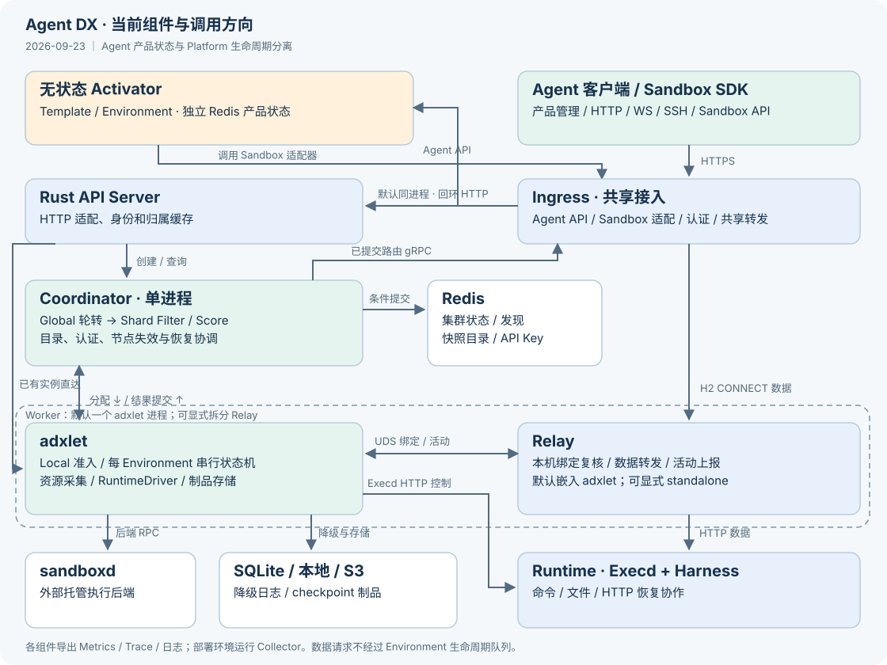

# Agent DX 当前目录与组件边界

核对日期：2026-10-29。此页描述当前源码布局；首次导入记录保留在 [迁移报告](../migration/2026-09-14-import.md)。[HTML 阅读版](repository-layout.html) 从本文件生成，架构图为仓库内 SVG。



## 分层与当前接入状态

| 层 | 职责 | 当前状态 |
|---|---|---|
| Agent 产品 `agent/` | Template、AgentBinding、无状态 Activator | Rust 产品 API 集成在 Gateway Ingress；AgentBinding 保存业务身份到稳定逻辑 Environment 的映射，首次访问按需激活 |
| 公开能力 `platform/sdk/environment` | Environment 生命周期、命令/文件、快照、放置约束 | Python SDK 已实现；客户端保留字段与新服务端支持范围不同 |
| 执行平台 `platform/` | 通用 Environment、调度、持久化、节点生命周期、Execd | Coordinator、adxlet、本地优先创建及 EROFS/OCI 运行环境已接入；沿用已有实现；本次验证见 [命名调整记录](../testing/environment-naming.md) |
| 共享接入 `gateway/` | Environment API Server、Ingress、Relay、反向代理与转发 | API Server 默认内嵌 Ingress；adxlet 默认内嵌 Relay；Agent API 装配于 Ingress，业务规则归 Agent 层 |

Agent API 在 Gateway Ingress 内处理产品请求。独立模式通过 ActivatorClient 调用远程 Activator，后者经 API Server Environment HTTP 接口访问平台；API Server 内嵌模式通过 LocalControl 调用同进程 Activator，直接复用 Environment 应用服务。两种模式均由 Activator 持久化 Template/AliasConfig/AgentBinding，公开 Alias GET/PUT 与模板管理共用 Ingress 的租户鉴权。Gateway 选择逻辑 Binding 身份，Activator 统一选择别名实际版本并校验服务协议/端口。文件入口从 Activator 一次读取 Binding 及其实际版本模板的只读快照，再由 Gateway 校验业务权限。Agent 执行规格先由 Activator 的共享 mapper 转为 Environment 请求；API Server 应用服务再统一校验、转换为 EnvironmentSpec 并注入 runtime。Gateway 与 Activator 均缓存不可变模板；Activator 的 AgentBinding 激活缓存采用有界 LRU，默认 200000 条、5 小时滑动 TTL，请求命中续期，过期检查只随请求发生。独立模式的数字版本及别名全热解析均只有一次 Activator RPC，Activator 不访问 Agent Redis 或 Environment API；嵌入式模式仅本地调用。bypass 在查询权威状态前失效旧绑定，发送前目标重试自动启用 bypass；HTTP/SSH 固定 generation，WS 在发送任何后端握手或业务字节前，可对权威确认的 Binding 删除/换代在原期限内刷新一次，缺失时复用本次初始化参数；删除中的并发请求允许成功或失败，缓存不代表实时健康。

独立 Activator 模式下，Gateway 按完整 AgentBinding scope 做 Rendezvous Hash 亲和路由；静态直达实例列表和 Redis 注册发现二选一。启用发现时，Activator 默认每 5 秒续租 15 秒成员租约，Gateway 约每 5 秒刷新本地列表；请求路径不访问注册目录。Gateway 只读取独立注册键，Template/AgentBinding 权威元数据仍仅由 Activator 访问。成员变化和故障转移重新分配请求亲和与别名收敛 owner，本身不迁移 Environment。别名配置变化由 Activator 准备新 Env、CAS 切换 current，再通过既有 Environment delete 清理旧引用；优雅退出为 Platform 能力缺口，本次不实现，Activator 不统计连接。启动、订阅重连和成员变化触发恢复扫描，无周期全量 Binding 扫描。Agent 不直接操作平台 Redis/SQLite 或 sandboxd。Activator 的生命周期访问只经 API Server：独立部署调用现有 HTTP 接口，嵌入部署调用应用服务；Ingress 不提供旧 Environment v2 管理入口。Jiuwen 通过 Ingress 通用文件能力读写 Environment，归属与 Running 状态经 API Server 查询，文件正文经 Relay/Execd 传输；Execd 凭据由共享数据面持有。用户 Harness 的 HTTP/WS/SSH 经共享数据面转发，业务协议由用户定义。

API Server 仍保留原有九条 `/api/agent` 兼容转发路由，由 `agent_address` 指向外部 Agent 服务；这是平台侧既有入口，不属于当前 Ingress Agent API／Activator 链路，本轮保持不变。

平台内部以 **Environment + Runtime** 建模。Environment 是跨节点、暂停恢复和故障接管期间保持不变的逻辑身份，持有期望规格、生命周期、归属和 checkpoint 引用；Runtime 是运行时后端在某个节点创建的一次物理执行，具有独立 `runtime_id`，重启、恢复或接管时可以替换。二者通过 `RuntimeIdentity { environment_id, runtime_id, ownership_generation }` 绑定，adxlet 只允许当前 generation 的 Runtime 对外提供服务。

Coordinator 在启动或权威写入恢复时从 Redis 载入记录；正常节点对账使用提交后同步更新的缓存，只比较归属、版本及制品引用。节点启动／会话恢复执行完整运行时接管。正常生命周期由 Execd 主动控制流、Relay 活动增量、后端退出通知及每实例截止时间推进；独立资源采样默认每 15 秒采集 CPU、内存，不推进生命周期。异常断流先等待重连，再按需确认后端状态；创建结果不明确时保留带退避的定向清理重试。部署要求配置 `runtime_control`，并同步更新 rootfs 中的 Execd。

Environment 自动暂停复用 idle timeout，策略为 delete/pause；匿名恢复点可按配置发布到共享对象存储。Ingress 认证首请求后与 API Server 手动 resume 共用 Coordinator `EnsureRunning`。Coordinator 持久化恢复意图、优先原节点准入，仅在明确资源不足或执行已失效时调度兼容目标；adxlet 执行恢复并提交 Running。节点失效保留 Paused，等待需求或到期/删除。Ingress 获得该执行的已发布路由后才转发业务字节。详见 [节点生命周期](../testing/node-lifecycle.md)。

公开 Environment 生命周期 HTTP 契约使用 `/api/environment/v1/environments` 与 `environmentId`，Python SDK 使用 `adx_environment.Environment` 与 `environment_id`；`/api/instances` 保留为目录查询入口。内部 Rust 类型、gRPC、持久化字段与 Metrics 使用 Environment/Runtime，执行设置位于 `EnvironmentSpec.execution`。详见 [命名与抽象](naming.md)。

AFS（Agent FS）是可选文件系统组件，源码、整体文档、构建、CI 和发布入口统一使用 `afs`。OwnerFs 与 DFS 是其内部平级模式；模式模块及 `ownerfs_*`／`dfs_*` 配置沿用各自名称。参见 [AFS 架构与关键时序图](afs.md)，其中包含 OwnerFs／DFS 总览、workspace bind 与远端路径、DFS 外部 S3 发布和读取流程。

## 实际目录

```text
agent-dx/
├── Cargo.toml / Cargo.lock / rust-toolchain.toml
├── Makefile / build.sh / VERSION / pytest.ini
├── assets/                       # Logo、设计语言与架构图的统一来源
│   ├── logo/                     # 黑白标志、独立图标和反相版本
│   └── architecture/             # 系统架构与当前组件调用图
├── agent/
│   ├── api/                       # Gateway 产品入口
│   ├── activator/                 # 无状态产品管理与按需激活
│   └── crates/                    # core 协议模型、store 产品状态；测试随各 crate 放置
├── afs/                           # 可选 Agent FS，ADX_WITH_AFS=1 显式启用
│   ├── src/node/vfs/ownerfs/       # OwnerFs workspace / Home 路径
│   ├── src/node/vfs/dfs/           # 与 OwnerFs 平级的 DistributedFs 路径
│   ├── client/                    # DFS 专用客户端 crate
│   └── common/                    # AFS 域内公共 crate
├── crates/                        # 跨 Gateway / Platform / Runtime 的横切库
│   ├── error/                     # 稳定错误码、重试与操作结果语义
│   ├── observability/             # 日志、Metrics、Trace 与进程日志捕获
│   ├── process/                   # 进程配置、退出信号和宿主资源准备
│   └── transport/                 # TLS、请求上下文和 deadline 传播
├── platform/
│   ├── coordinator/              # Rust Coordinator；Global + 内嵌 Shard
│   ├── adxlet/                   # Rust 本机生命周期和后端/存储适配
│   ├── crates/
│   │   ├── core/                  # Environment、资源、恢复点、调度纯类型
│   │   ├── protocol/              # gRPC 生成、转换与组件身份
│   │   ├── discovery/             # Redis 服务地址发现
│   │   └── scheduling/            # Filter / Score、快照与查询索引
│   ├── api/
│   │   ├── proto/environment.proto   # Coordinator / Node 管理服务
│   │   ├── proto/environment_types.proto # Environment / 资源 / 调度类型
│   │   ├── proto/snapshot.proto   # 快照目录与引用
│   │   ├── proto/credentials.proto # 认证和密钥管理
│   │   ├── proto/routes.proto     # 路由发布
│   │   ├── proto/node.proto       # Relay 绑定与活动
│   │   ├── proto/runtime_control.proto # Execd 主动控制连接
│   │   └── http/runtime-control.md
│   ├── runtime/execd/            # HTTP 数据操作与双向控制流
│   ├── deployment/                # 统一 adxctl / supervisor；管理控制面和数据面进程
│   └── sdk/environment/python/        # adx-environment / adx_environment
├── gateway/
│   ├── apiserver/                # Rust HTTP、认证缓存和 Environment RPC
│   │   ├── src/                   # contract、http、clients、operations
│   │   ├── tests/                 # HTTP 契约与校验
│   │   └── docs/                  # Environment HTTP 支持范围
│   └── src/
│       ├── common/                # Gateway 内部监听、路由与数据面协议
│       ├── ingress/               # Agent/Environment 适配、路由订阅、认证、连接池、反向代理
│       ├── node/                  # RelayService、绑定、活动、转发
│       └── bin/                   # Ingress、Relay、forwarder
├── tools/
│   └── admin/                     # adxadmin Python wheel；经公开 HTTPS 管理租户 API Key
├── third_party/sandboxd/          # 锁定后端协议、来源与许可证
├── build/
│   ├── ci/ / images/              # 本地检查、镜像配方
│   ├── config/examples/           # 统一部署 YAML 和按角色示例
│   ├── release/                   # 二进制、Execd、SDK、Redis 汇总与验证
│   ├── e2e/                       # 本地 Docker 公共 SDK 验收
│   │   ├── kubernetes/            # 基础 K8s 部署、证据与清理
│   │   ├── firecracker/           # 本地 FC；可选 K8s FC 驱动
│   │   └── example/               # 安装示例验收
│   ├── observability/             # 外部 Collector / Prometheus 示例
│   ├── docs/                      # 架构页生成与文档检查
│   └── dev/                       # 自动刷新本地进度页
├── .buildkite/                    # 独立 build / images / K8s E2E 步骤
└── docs/                          # 架构、部署、契约、验收和迁移记录
```

此树只展示主要已存在路径。语言构建输出与测试证据放在 `out/` 或显式外部缓存，`build/` 保存源码脚本。运行时数据库、日志与 checkpoint 使用部署配置的数据目录。

## 控制面内部模块

| 组件 | 现有主要模块 | 职责 |
|---|---|---|
| Coordinator | `lib.rs`、`shard.rs`、`queue.rs`、`journal.rs` | Global 轮转、Shard 内存队列、预留、增量调度视图；租户间轮转，租户内优先级/FIFO |
| Coordinator | `storage.rs`、`storage/`、`rpc.rs`、`rpc/` | Redis 条件提交、原子归属、目录、节点失效、快照克隆、共享恢复协调；不执行节点普通生命周期 |
| Coordinator | `auth.rs`、`routes.rs`、`metrics.rs` | API Key 摘要、路由发布、集群指标 |
| adxlet | `controller.rs`、`controller/{lifecycle,monitor,snapshots}.rs` | 每 Environment 串行任务、暂停/恢复/删除、空闲回收与重启 |
| adxlet | `runtime_router.rs`、`sandboxd.rs`、`jiuwenbox/` | 按 runtime class 创建、按执行归属分发；Jiuwenbox 从权威目录重建内存关联，复用独立 EROFS 和原生 ACL；后端源码不变 |
| adxlet | `runtime_control.rs`、`readiness.rs` | Execd 双向控制流／HTTP 协作与就绪 |
| adxlet | `checkpoint.rs`、`checkpoint/` | 可扩展 CheckpointStore、本地/S3、缓存引用和远端孤儿回收 |
| adxlet | `node_reconciliation.rs`、`reconciliation.rs`、`journal.rs` | 全后端共用启动和周期性权威对账、孤儿/晚到资源清理、准入及心跳协调；既有可选 SQLite 结果降级日志 |
| adxlet | `resources.rs`、`routes.rs`、`activity.rs`、`proxy.rs` | 容量源/准入、绑定同步、活动采集、代理进程组合 |
| Rust API Server | `contract.rs`、`http.rs`、`clients.rs`、`operations.rs` | HTTP 兼容字段到 Environment RPC；认证、版本化 Environment 目录订阅、入口节点轮转、直达节点、快照目录 |

`core` 不依赖 Redis/SQLite/tonic/sandboxd 客户端；`protocol` 不承载调度、状态机、证书文件读取或 TLS 构建。稳定错误语义、可观测、服务进程支持和传输机制位于根级 `crates/`。adxlet 可依赖 Gateway 的 node 库，Gateway 不依赖 Coordinator/adxlet 业务实现。Shard 当前与 Coordinator 同进程。

普通创建经 Global 轮转进入 Shard Filter/Score。启用 `create_mode=local_first` 时，API Server 轮转可用入口节点，adxlet 用同一 Admission 暂留资源，Coordinator 分配 generation 并同步内存预留，成功时原子发布唯一有效结果；独立开关 `persist_local_claim` 默认关闭，开启后才为普通请求提前持久化 Claim；受管卷保留提前持久化的授权执行身份，exclusive 占用与分配原子提交；本地不满足时使用同一 Environment ID 回退 Shard。带 `snapshotId` 的创建始终由 Coordinator 调度：共享制品默认弱亲和来源节点，先跨分片比较可用候选，原节点不满足时使用其他兼容节点；排队期间也可跨分片回退。显式放置规则覆盖默认偏好，local-only 保留来源节点硬约束。Coordinator 向 API Server 首次全量、后续增量发布活跃 Environment 目录；删除通过增量撤销并从 Redis 主目录移除，已有 Environment 操作命中本地目录后直达 adxlet。受管卷调度还会把卷可访问节点集合纳入选点，未分配的带卷请求可转移到有容量的可访问分片；exclusive 卷在下发节点前由 Coordinator 原子持久化执行分配与占用。本地与中心创建共享卷准入，节点不直接访问 Redis。

## adxlet / Relay 进程组合

| 模式 | 配置与装配 | 共同契约 |
|---|---|---|
| embedded（默认） | adxlet 省略 `proxy_mode` 或配置 `proxy_mode=embedded`，托管同一 RelayService；Proxy 环境项放到 adxlet 服务 | 仍走同一 UDS 和完整绑定同步，不绕过版本/身份检查 |
| standalone | 两个 supervisor 服务；adxlet 显式配置 `proxy_mode=standalone` | adxlet 经受保护 UDS 控制 RelayService |

Proxy 首次启动关闭 Environment 准入，adxlet 完成权威对账与全量绑定同步后开放。数据请求直接进入 Relay，不经过 Environment 生命周期队列。共进程共享进程和 Tokio 执行器，故障域与分进程不同。详见 [模式配置与验证](../testing/relay-process-modes.md)。

## API Server / Ingress 进程组合

| 模式 | 配置与装配 | 共同契约 |
|---|---|---|
| embedded（默认） | 部署文件保留 `apiserver` 与 `ingress` 两个逻辑角色；API Server 省略 `ingress_mode` 或配置 `ingress_mode=embedded`，渲染为一个 `adx-apiserver` 进程 | API 与 Ingress 保持各自监听端口、TLS 身份、路由订阅和认证缓存；Ingress 控制请求仍转发到 API 回环监听 |
| standalone | API Server 显式配置 `ingress_mode=standalone`，Supervisor 启动 `adx-apiserver` 与 `adx-ingress` | 两种模式复用同一 `IngressService`，不复制路由或转发实现 |

默认共进程时，Ingress 监听绑定失败会阻止 API Server 就绪，运行期监听异常会使整个进程退出并由 Supervisor 重启。详见 [模式配置与验证](../testing/api-ingress-process-modes.md)。

## Agent 首次访问与模板参数

通用 HTTP/WS 接入的 `X-ADX-Parameters` 使用 URL 表单编码。Ingress 将原始字节交给共享解析/激活流程，只有 Binding 不存在时才解析、校验并原子保存参数；已有 Binding 忽略新输入，包括格式错误。并发首次访问复用成功落库的 Binding。Template.env 和 mounts.host_path 使用持久化参数渲染，挂载参数仍受路径约束；Binding 参数当前明文保存。内置 Jiuwen 通过共享流程按需提供业务参数，不再有独立 prepare 阶段、私有 launch 快照或模型专用覆盖逻辑。参数 Header 在转发前移除。

模板发布定义不携带版本号；Agent 用同一持久化 CAS 事务推进 tenant/template 序列并保存数字版本快照。统一 template/binding URN 中的纯数字 reference 选择版本，非数字 reference 选择 Alias。内部 Scope 继续保存显式类型。Orbit 入口配置 `template_ref` 字符串并复用此解析，用户和 workspace 身份不变；其模板通过受管 Volume 挂载原目录。已有字符串模板转成同名 Alias 由独立的人工运维流程完成，不在运行时自动迁移。

## 协议与持久化

公开 HTTP 路由和请求响应由 Rust HTTP handler 实现，SDK 调用公开契约；`platform/api/openapi/environment.yaml` 与 `data-plane.yaml` 记录当前公开接口，但尚未用于生成服务端代码。参考 [HTTP 文档](../../gateway/apiserver/docs/environment-lifecycle-api.md)。

内部 gRPC 按 Environment、快照、凭证、路由及节点本地控制拆分，详见 [协议目录](../../platform/api/proto/README.md)。Execd 用户操作使用 HTTP。配置 `adxlet.runtime_control` 后，Execd 主动建立到节点的双向 gRPC 控制流，上报 Ready／checkpoint 状态并接收准备与完成命令；未配置时使用 HTTP 控制。共享类型在 `core/src/runtime.rs`，见 [运行时控制契约](../../platform/api/proto/runtime-control.md) 与 [部署配置](../deployment/runtime-control-stream.md)。

镜像继承入口可配置 readiness 与 healthcheck。Execd 在实例内执行探测，readiness 首次成功后才报告 Running；adxlet 直接等待该状态再绑定路由。Healthcheck 达到失败阈值后，通过现有串行控制器清理并应用既有恢复策略。Initializing 仅保留在运行时内存；最终 failure 元数据随现有 Environment 状态提交。暂停/恢复重新探测，内部探测不增加用户活动。详见 [SDK](../../platform/sdk/environment/python/README.md#workload-probes) 与 [Probe 契约](../../gateway/apiserver/docs/environment-lifecycle-api.md#workload-probes-on-image-startup)。

正常结果经 Coordinator 写 Redis；SQLite 只在提交不可用时保存待补交结果。Journaled 不发布 Ingress 路由。节点重启而 Coordinator 不可用时等待对账，不从不完整日志重建目录。快照制品走独立的本地/S3 存储抽象。Redis 使用 `environment:<environment_id>`，SQLite journal 使用 `environment` 字段；Coordinator 启动时仅将已删除且不占资源的旧 `capsule:*` 记录原子迁移为 `environment:*`。其他旧控制状态和节点 SQLite journal 不能据此视为兼容，升级前需要单独评估和迁移。详见 [持久化契约](../testing/coordinator-storage.md)和[节点契约](../testing/node-lifecycle.md)。

## 构建、部署和验收

Rust 共用根 Cargo workspace，Python 工具独立打包；外部 sandboxd 按其锁定版本构建。`adxctl` 是平台运维 CLI，支持 validate/render/run/start/status/stop；`adxadmin` 是只访问公开 HTTPS API 的平台无关 Python 管理 CLI。统一平台包带控制面、Gateway、`adxctl`、静态 Execd、Environment SDK、EROFS 运行环境和锁定 Redis；`adxadmin` 以独立 wheel 发布。平台可选择外部 Redis，sandboxd 始终由部署环境托管。运行环境也可使用不可变 OCI image；自定义用户镜像从同一环境只读挂载 `/__adx`。

普通进程与 Pod 内都使用相同组件和 supervisor。Buildkite 先构建，再发布不可变镜像，最后独立执行 K8s 八组用例及清理。[Buildkite #30](../testing/2026-09-18-runtime-environment-k8s.md) 已验证 Rust API Server、本地优先创建及 OCI default/runtime-only/custom 三种环境路径；两个 Pod 同宿主。本地 FC 与基础 K8s 分开统计，实际未完成项和后置项见 [路线图](../testing/control-plane-roadmap.md)。

## 可观测

Coordinator/adxlet 的 Environment 数、资源预留与使用量，Ingress/Relay 的连接、流量与请求指标由各自 `/metrics` 导出。Trace 由组件 OpenTelemetry SDK 经 OTLP/HTTP 发往外部 Collector；结构化 stdout 由 supervisor 滚动压缩，Collector filelog 采集。Pod 可部署 Collector sidecar，进程环境独立托管。统一实时 Trace 队列丢弃指标已后置，不能与已有导出失败计数混同。

Jiuwenbox 接入路径和验收边界见 [Jiuwenbox P0](../testing/jiuwenbox-runtime.md)。正常创建经 Jiuwenbox，Conch 原生 UDS 仅用于失联后的发现和清理。此驱动不提供 checkpoint；EROFS 先挂载到宿主，再通过 bind／virtiofs 暴露给沙箱。

## Checkpoint 存储边界

`platform/crates/checkpoint-storage/` 共享 local、S3+缓存和 AFS 文件适配。
adxlet 使用 `CheckpointAccess` 捕获和取得恢复目录；Coordinator 使用
`ArtifactReclaimer` 回收 S3/AFS。匿名恢复点属于 Environment，运行时文件使用独立保护；
可复用 Snapshot 通过引用被恢复使用，使用中删除直接返回 Sandbox 列表。
配置、流程和故障边界见[Checkpoint 存储](../testing/snapshot-storage.md)。
