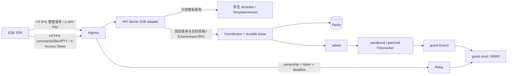
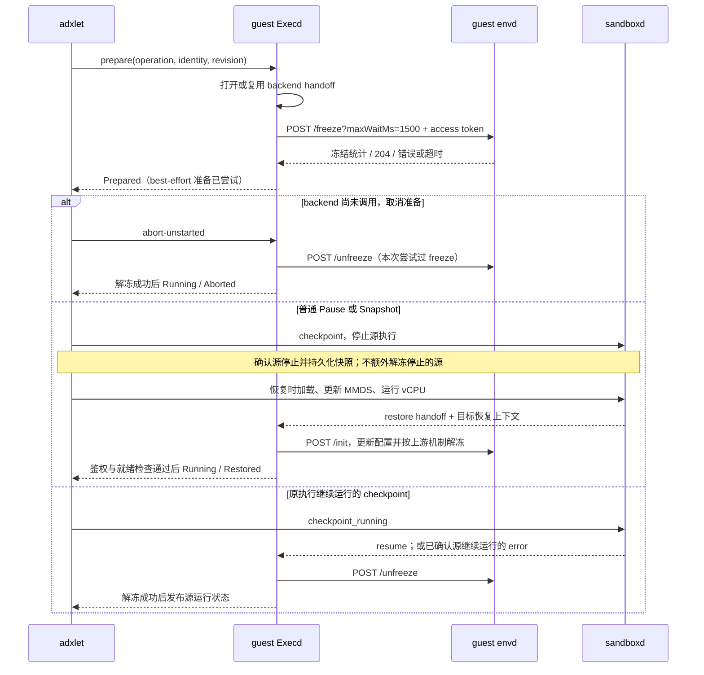

# E2B 兼容入口（实验版）

本版在 ADX 的 Environment 生命周期上提供 E2B SDK 入口；状态与调度仍由 Coordinator/adxlet 管理。envd 是固定版本的上游 guest 服务，由 Execd 管理。原生 ADX 请求继续使用原有接口。基础验证见 [CCE 记录](../testing/2026-10-10-e2b-compatibility.md)，检查点协作的验证范围见 [生命周期验证](../testing/2026-10-15-e2b-checkpoint-cooperation.md)，API Key/网络适配见 [接口验证](../testing/2026-10-15-e2b-key-network-adaptation.md)。

## 构建与启用

在原生 Linux 构建环境准备 `third_party/e2b/source.json` 指定的干净 infra checkout，将 `ADX_ENVD_SOURCE` 指向它，然后运行正常 release 或 Buildkite execd 组件构建。未设置此变量时不编译 envd。兼容 rootfs 包含固定 envd、真实 bash 及其动态库、默认 `user` 用户；发布包保存 `runtime/envd/LICENSE` 与 `manifest.json`。构建脚本校验源码版本、关键文件摘要、envd 版本及二进制摘要。

sandboxd 必须使用 `third_party/sandboxd/source.json` 的固定基线和 `patches`，不能复用未打补丁的缓存后端。`build/e2e/build_backend.py` 在临时副本打补丁并记录补丁摘要，原始 checkout 保持不变。Firecracker 恢复先 load（不运行），更新 MMDS 数据，再 resume；元数据写入失败时不 resume。

E2B 入口复用原生 Agent 模板。先在每个租户内通过现有 Agent 模板发布接口发布固定 `name/version`；镜像使用完整 OCI digest。API Server 设置已有 `ADX_AGENT_CONFIG`，可连接独立 Activator 或使用嵌入配置；未提供模板源时 E2B 启动失败。模板查询不会激活 AgentBinding，也不直接读取 Agent 存储。

`adxctl` deployment 的 API Server `config` 使用以下结构。`runtime_profile` 与节点部署共用；`e2b.templates` 只保存原生模板引用，不复制资源、用户、目录或能力白名单。示例摘要需要替换为发布制品的实际值。

```json
{
  "runtime_profile": {
    "rootfs": {"runtime_class": "runc", "type": "local", "path": "/opt/adx/e2b-v1/runtime/adx-runtime-rootfs.img", "readonly": false},
    "bootstrap": {"type": "erofs", "root": "/opt/adx/e2b-v1/runtime/adx-runtime-rootfs.img", "target": "/__adx", "entrypoint": ["/__adx/usr/local/bin/adx-execd"]},
    "env": {"ADX_ENVD_PATH": "/__adx/usr/local/bin/envd", "ADX_ENVD_SHA256": "REPLACE_WITH_BUILT_ENVD_SHA256", "ADX_ENVD_DEFAULT_USER": "user", "ADX_ENVD_DEFAULT_WORKDIR": "/home/user", "ADX_ENVD_ARGS": "[\"--isnotfc\",\"--no-cgroups\"]"}
  },
  "e2b": {
    "domain": "sandbox.example.com",
    "envdVersion": "0.9.0",
    "templates": {
      "base": {"name": "e2b-base", "version": "1"},
      "adx-e2b-base": {"name": "e2b-base", "version": "1"}
    },
    "requiredNodeLabels": {"adx.runtime.profile": "e2b-v1"}
  }
}
```

将匹配 profile 的 worker 注册标签配置为同一 `adx.runtime.profile=e2b-v1`。`requiredNodeLabels` 使用已有 required-node selector，可省略的前提是所有候选节点都使用同一可信 profile；节点仍检查 profile 内容一致。当前每个 worker deployment 只有一个 profile，标签不会自动安装 profile。Firecracker 部署选择对应 runtime class，并去掉 `--isnotfc`。

原生模板镜像提供用户 rootfs，可信 bootstrap 只读挂到 `/__adx`；不要求两者镜像相同。镜像需包含 envd 所需动态依赖、bash、配置的用户与可写目录。E2B 保留原生模板的镜像 ENTRYPOINT/CMD 继承语义，并继承普通环境变量、资源/limits、mounts、服务端口、init/readiness 和 pause policy；envVars 可覆盖普通变量，保留控制键禁止覆盖。模板挂载中必需的参数无法由 E2B 提供时明确拒绝，不能创建 AgentBinding 补齐参数。E2B 基础镜像应提供合适的常驻入口；入口立即退出、缺少依赖或探针依赖的服务未启动，仍按原生启动/就绪合同失败，不能因为 envd 单独可用就报成功。

Pause/Snapshot 不再受静态 `capabilities` 声明约束，是否支持由真实 backend 和 checkpoint storage 检查。手动与到期 Pause 使用实例保存的原生 pause retention、timeout 和 storage，支持已有 Forever/Shared 语义；缺省采用原生 PausePolicy。E2B 的绝对运行期限继续独立于 idle timeout，兼容实例不启用 idle 回收。

创建在通用 `EnvironmentSpec.template_identity` 保存租户及原生模板 name/version，另存实际规格与完整 profile；E2B 的公开 templateID 仅作为兼容协议 ID，不承担原生模板身份。修改别名只影响以后新建；Pause/Connect 与从 Snapshot 克隆不回查当前模板。克隆继承快照的镜像、资源、挂载、profile、pause policy 和节点约束，只更新新实例身份、独立凭据、运行期限、metadata及允许覆盖的普通 env/网络。旧 profile 对应的节点和制品必须继续可用，否则明确失败。

本次配置/控制记录变更按未上线系统更新，没有旧静态目录或 Redis control 记录的滚动迁移适配；升级测试环境应先清理旧测试实例/记录，再使用新配置与新发布模板。不要把新的必填字段直接用于未迁移的持久化环境。

E2B 专用 runc 或 runsc worker 还需要配置 sandboxd 的受信任 OCI 基线。发布包包含 [e2b-runc-oci-spec.json](../../build/config/examples/e2b-runc-oci-spec.json)，在固定 sandboxd 默认基线上增加 `CAP_SETUID`、`CAP_SETGID`、`CAP_CHOWN`、`CAP_DAC_OVERRIDE`，供 envd 切换命令子进程的用户及补充组，设置上传文件的用户归属，并允许作为 root 服务运行的 envd 访问目标用户的私有文件及目录。同时将初始 `oomScoreAdj` 设为 0。envd 的命令包装会将子进程调整为 100；不设置初值时，runc 会继承 Kubernetes Pod 的分数，非特权命令无法将高于 100 的分数降低。该基线不向 guest 增加 `CAP_SYS_RESOURCE`。原生 worker 继续使用原有基线。将以下路径加入 E2B worker 的 sandboxd TOML；该配置属于节点部署，不通过用户 envVars 或 MMDS 下发：

```toml
[plugin.runtime.basic_spec]
runc = "/opt/adx/current/etc/examples/e2b-runc-oci-spec.json"
# runsc worker 复用同一 OCI 权限基线（文件名沿用已有发布路径）：
# runsc = "/opt/adx/current/etc/examples/e2b-runc-oci-spec.json"
```

必须确认实际生成的 OCI bundle 已采用该基线；sandboxd 的旧加载器在基线文件加载失败时会回退默认配置。缺少用户切换或文件归属权限时，envd 可以初始化成功，但命令执行或文件上传会返回 `operation not permitted`。

Ingress（内嵌或独立）的环境变量设置 `ADX_DATA_PLANE_INGRESS_E2B_ENABLED=true` 与 `ADX_DATA_PLANE_INGRESS_PORT_HOST_DOMAIN=sandbox.example.com`；配置现有 HTTPS 证书、源地址 ACL、API Server 地址和 Relay 目标 CIDR。两种部署共用同一入口逻辑。沙箱管理请求通过 `X-API-Key` 校验 ADX 租户密钥；API Key 管理使用下述独立管理员认证配置。所有 E2B 管理请求实时验证凭据，不使用 API Server 的成功认证缓存。

## 组件与请求路径



创建和恢复要等 Execd 的运行状态与 envd 初始化、鉴权探测、实际版本校验都成功，再发布可用路由。实际版本取自上游 `/init` 的 `X-Envd-Version`；`/health` 不报告版本。E2B 沙箱在运行期持续检查 envd，即使没有配置原生空闲回收或可选健康策略；envd 退出或探测失败会触发 Failed、清理与路由撤销。guest checkpoint 事件先由既有 checkpoint 协议处理。仅 VM 启动或 Execd Running 不代表 E2B Ready。envd token 与应用流量 token 分开，每次创建/从 snapshot 克隆生成新凭据。节点注入受信任身份及 MMDS token 摘要；用户 envVars 不能覆盖 `ADX_`/`EXECD_` 配置。

数据面识别 `<port>-<sandboxID>.<domain>` 或 `E2b-Sandbox-Id`/`E2b-Sandbox-Port`，两者同时出现必须一致。Ingress 对 envd 校验 `X-Access-Token`；私有应用端口校验 `E2b-Traffic-Access-Token`。`/init`、Execd 50090 和保留控制端口不对 E2B 数据面开放。流式请求跟踪路由撤销、身份变更和到期；续期更新当前期限，不应误关闭仍被授权的连接。

## Guest 检查点协作

Execd 使用固定版本 envd 原有的接口，不修改 envd 源码。E2B profile 启用 envd 时，部署配置 `ADX_ENVD_FREEZE_ON_CHECKPOINT` 默认 `true`；节点仅从受信任 profile 注入此值，用户环境变量不能覆盖。设为 `false` 可禁用此准备动作。`--no-cgroups` 环境中的调用不能证明用户进程已冻结；真实 guest 仍须单独验证 cgroup 布局和权限。



freeze 请求整体限时 2 秒。Execd 区分未请求、已确认、未确认；只有完整正向统计才标记已确认，204、no-op、部分冻结及超时均不能作为完整冻结证明。准备保持上游 best-effort 语义，失败会告警，但不阻止 VM checkpoint。发送前记录尝试，因此响应丢失后仍能清理可能已发生的冻结。

每个新的 prepare operation 都重新执行准备；重复同一请求复用结果。abort 后保留 handoff reader，但不会跳过下次 freeze。已接受的准备和回滚独立于 HTTP/stream 调用方的连接寿命；guest 协作串行执行，不持有运行状态锁等待网络。

未开始检查点的回滚和明确的源继续执行，都等待 `/unfreeze` 成功才报告 Running；失败报告 Failed。固定 sandboxd 的 `error` handoff 只在源 VM 已成功恢复执行后发送，检查点结果仍为 Failed。handoff I/O 错误、未知结果不授权解冻或重做 capture。恢复沿现有 `/init` 路径，保留 envd 进程和命令表；初始化失败不发布可用路由。这里不承诺上游以外的 guest 执行屏障、时钟校准或 KVM 验收结果。

## Firecracker恢复时间与工件配套

Firecracker恢复的内部checkpoint消息带上host在handoff前新采样的可信时间，guest PID1在释放Execd handoff前用Settimeofday校准CLOCK_REALTIME；设钟失败则恢复失败。CLOCK_MONOTONIC不改变，envd仍为原版。必须使用同一固定sandboxd revision及补丁集合重建host和initrd，并创建fresh guest/checkpoint；不能将旧initrd与新sandboxd混装，也不承诺旧快照升级兼容。

外部Firecracker kit manifest必须包含按顺序匹配`third_party/sandboxd/source.json`的`sandboxd_patches`，以及绑定同一revision、patches、initrd SHA的`initrd_provenance`；旧清单会在打包前被拒绝。具体字段见[kit说明](../../build/e2e/firecracker/README.md)。宿主不支持Direct I/O对齐时，固定sandboxd允许配置`writable_io_engine="Sync"`；启用前须在空worker验证。

历史物理 KVM 验证使用 SDK `2.52.0`，覆盖 Pause/Connect、跨节点恢复、双 clone、凭据隔离与时钟恢复。后续定向验证已确认两条回收路径：持久 source-session fence 的 Deleting Reusable Snapshot 可由同 scope、完成对账的节点接管；Deleted outbox 中已捕获且 backend 已停止的 artifacts 可委派清理。非 Deleted、未登记 foreign-owner 对象仍保守保留。已复现的 Relay CONNECT 504 路径归因于 snapshot clone 后 TAP/FDB 漂移并在定向用例修复。该证据不等同于主线整合后的 KVM 验收，也不覆盖所有网络/VMM 时序；详见[检查点记录](../testing/2026-10-15-e2b-checkpoint-cooperation.md)。`full_stage3_accepted=false`。

## 管理接口与语义

| 接口 | 行为 |
| --- | --- |
| `POST /v2/sandboxes` | 解析预配置模板/别名或本租户 E2B snapshot，创建并等待联合就绪 |
| `GET /sandboxes/{id}` | 返回 E2B 字段、RFC3339 时间、当前状态和凭据 |
| `GET /v2/sandboxes` | 原始数组 + `X-Next-Token`；支持 state、metadata、limit、nextToken |
| `POST /sandboxes/{id}/timeout` | 设置从当前时刻计算的运行期限；0 表示立即到期 |
| `POST /v2/sandboxes/{id}/connect` | 运行态只延长期限；暂停态先设置下一次期限再恢复；memory 省略或 true，false 显式拒绝 |
| `DELETE /sandboxes/{id}` | 复用 ADX 删除与持久化确认 |
| `POST /sandboxes/{id}/pause` | 空请求、memory 省略或 true 均为内存暂停；false 显式拒绝 |
| `POST /sandboxes/{id}/snapshots` | 可复用 snapshot；可选 name，memory 省略或 true，false 显式拒绝 |
| `GET /snapshots` | 本租户 E2B Ready snapshots，支持 name、sandboxID 和分页 |
| `DELETE /templates/{id}` | 删除可复用 snapshot，独立于源 sandbox |
| `PUT /sandboxes/{id}/network` | 替换 IPv4/CIDR 出站策略，保留原生入站、DNS 与 traffic mode；成功 204 |
| `POST /api-keys` | 在管理员所属 tenant 创建命名的普通 key；201 返回原文一次 |
| `GET /api-keys` | 原始数组，列举同 tenant 有 metadata 的 key，不返回原文 |
| `DELETE /api-keys/{uuid}` | 同 tenant 原子撤销；204，缺失/已撤销/其他 tenant 为 404 |

用户 metadata 由平台通用能力管理：创建输入通过 `CreateEnvironmentRequest.user_metadata`（local-first 认领同时透传）首次原子写入 `StoredEnvironment.user_metadata`，不依赖 E2B compatibility。详情使用内部 `GetEnvironmentMetadata`；平台通用 `ListEnvironmentMetadata` 不含 E2B 范围字段。E2B 列表通过薄适配 RPC `ListE2bEnvironmentMetadata` 选择本入口实例，再复用同一平台查询处理 state、metadata、响应预算和分页；范围在分页前应用，API Server 不全量读取后筛选。原生 HTTP metadata 入口和更新接口暂未开放。

metadata 不进入执行规格、control、调度 labels、guest env 或快照模板；同一实例暂停恢复保持不变，节点结果不能覆盖。从 Snapshot 新建只保存本次请求 metadata，省略则为空。同 ID 创建重试必须提交相同 metadata。最多128项，键256 bytes、值4096 bytes，总计64KiB。列表每页1–100项，并受约1MiB响应预算约束；nextToken 是绑定租户、入口范围及状态/metadata过滤条件的版本化游标，不能作为权限凭据，不接受旧 offset。并发创建/删除下是实时分页，不承诺历史快照。

当前通用查询使用原子存储条目上限4096后再扫描，没有 metadata 索引；容量超限明确拒绝，不截断成完整列表。上限包含同一 Coordinator 存储 hash 的其他条目，扩容需后续索引/存储分页设计。该实现有界但仍为线性扫描，不声明大规模列表性能。

Redis 的 StoredEnvironment 保存独立 EnvironmentControlRecord。运行期限从首次联合 Ready 开始，到期不随命令或文件活动自动顺延。续期、到期 claim 和节点结果提交通过现有持久化 CAS 协调；claimed 到期不能再续期。Coordinator 重启保留期限，节点的迟到结果不覆盖新期限。显式暂停清除运行期限；Snapshot 内部暂停不清除期限。恢复后建立新期限，普通 generation 更新不延长旧期限。

创建时 `autoPause: true` 且省略 `autoPauseMemory` 按上游默认的内存模式处理，实际支持范围由原生 backend/checkpoint storage 判断。显式 `autoPauseMemory: false` 不受支持。Connect 与 Snapshot 使用各自的严格请求类型，不能把磁盘模式选择静默当作内存恢复执行；这些 DTO 检查不代表对应 backend 已通过生命周期验收。

创建时 `network: {}` 保留模板默认的 `allowPublicTraffic`，出站默认允许；出站字段转换与动态更新共用下述映射。Connect 的 timeout 省略时为 300 秒，允许 1～86400 秒；单独的 setTimeout 接口继续允许 0，表示立即到期。

有意保留的差异：运行期限最多 86400 秒；暂停恢复点默认保留 90000 秒，可由模板配置，不是原装 E2B 的无限保留；不支持磁盘暂停、自动恢复、网络代理/域名及转换规则、IAM、卷挂载、MCP 或 Code Interpreter 高层能力；未知字段/未实现能力显式报错。模板构建管理也未接入，首版使用预配置模板映射。CCE runc 验证中，SDK 覆盖直接位于 sticky `/tmp` 下的用户文件会返回上游 permission denied；默认 `/home/user` 工作目录及非 sticky 子目录的私有文件读写、覆盖和目录操作可用。本版保留该环境限制，不修改共享宿主机的文件保护策略。错误是 E2B 原始 JSON `{code, message, error_code?}`，不使用 ADX data envelope。

## API Key 管理配置

本版的 `POST/GET/DELETE /api-keys` 使用 ADX 管理员凭据：`X-Admin-Token` 或 `Authorization: Bearer <ADX administrator key>` 二选一，且 `X-Team-ID` 必须与已认证管理员的 tenant 完全相等。普通 `X-API-Key` 不授予 key 管理权。这是 ADX 兼容配置，不实现认证提供方 JWT；尤其固定 E2B 的 POST 只声明 AuthProvider 认证，本版沿用 ADX 管理员认证是明确差异。跨团队 `/admin/teams/...` 与 PATCH 重命名未实现，PATCH 返回 501。

创建请求只有 `{ "name": "ci-key" }`，name 非空、最多 256 个非控制字符；未知字段 400。同名允许存在，创建不是幂等操作。返回 `id` 为公开 UUID，`createdAt` 为 RFC3339，`mask` 包含 `prefix`、`valueLength`、`maskedValuePrefix` 和 `maskedValueSuffix`。prefix 使用真实的 `adx_`，valueLength 是去掉类型前缀后的随机值长度；创建响应另有一次性 `key`，列表无此字段。`createdBy` 与 `lastUsed` 为 null。成功响应使用 `Cache-Control: no-store`。

本版按未上线 schema 更新部署，Coordinator、adxlet 和 API Server 使用同一版本；先清理旧测试记录，再切换服务和配置。旧组件不能承接新的模板身份或 metadata 合同；Key 的 public-ID 模式也需要新版 Coordinator。内部网络更新 RPC 沿用原有协议。

Coordinator 的 CredentialService 复用原有 digest 索引、expiry 与撤销 tombstone，增加可选 metadata；原文不持久化。旧原生 key 缺少 metadata，继续用于原生认证/管理，不出现在兼容列表中。原生 `/api/admin/v1/keys` 的 hash ID 与全局管理员语义保持原有行为。公开 UUID 撤销在同一 Redis 脚本内校验 active 记录、tenant 和 UUID，再写 tombstone、删除 active 记录。

E2B 管理 API 的下一次请求会实时校验已撤销 key。原生入口、Ingress 独立认证缓存和已建立连接未增加广播失效；撤销平台 key 不删除沙箱，也不撤销独立 envd/应用访问 token。

## 出站网络策略

运行时前置条件：固定 sandboxd 默认关闭 ACL，需在没有存量沙箱的专用测试 worker 上设置 `[plugin.network] enable_network_acl = true`。该版本明确拒绝 runc 的非空网络策略和动态网络更新；之前的 runc 基础互通不能作为 ACL 证明。runsc 支持 ACL，其默认 systrap 平台不需要 `/dev/kvm`。2026-10-15 已在 cn-north-4 的隔离部署上验证 E2B REST 管理入口、SDK 2.52.0 的命令/文件与 IPv4/CIDR ACL 的真实放行、阻断、替换和沙箱隔离；详见[验证记录](../testing/2026-10-15-e2b-key-network-adaptation.md)。该环境使用上面的受信任 OCI 基线；guest envd 配置 `--isnotfc --no-cgroups`，sandboxd 的宿主 cgroup 管理仍开启，不构成 guest 冻结或内存检查点证明。Firecracker 则另需可用 KVM。

先采用默认 iptables 后端，核查 iptables/ip6tables/ipset、bridge netfilter、conntrack 及管理规则的权限。sandboxd、bridge/TAP、ACL hooks 与实际流量须位于同一可管理网络命名空间；`hostNetwork: true` 不是唯一部署方式。bpfnat 的文档基线为 Linux 5.17+、TC eBPF 和可写 bpffs，不能仅凭有 `/sys/fs/bpf` 就视为满足。完整宿主要求见固定 sandboxd 的 `doc/network-acl.md`；启用前不要直接改动有存量沙箱的 worker。

创建的 `network.allowOut` / `network.denyOut` 及顶层 `allow_internet_access`，与 `PUT /sandboxes/{id}/network` 的同名字段共用转换。规则限 IPv4 地址或 CIDR：allow 优先级 200、deny 100，allow 覆盖 deny；默认出站允许，`allow_internet_access:false` 改为默认拒绝。域名、通配符、IPv6、egressProxy、rules、maskRequestHost、httpsPorts 显式拒绝；未知字段/错误类型返回 400。`allowPublicTraffic` 仍是创建时的网关访问设置，动态出站接口不接受它。

更新是出站配置替换：`{}` 清除旧出站规则并恢复默认允许，同时保留原生入站默认值、入站规则、DNS 和全局 stateful/stateless mode；Both 规则只保留其 Ingress 投影。API Server 读取并合并权威记录，再用同一个 revision 调用 EnvironmentService。期间版本改变返回 409；节点继续用 expected revision 和 operation ID 防止并发覆盖。仅 Running 沙箱可更新，后端执行失败不返回 204。

链路为 `Ingress → API Server → EnvironmentService → adxlet → sandboxd`，不调用 envd。原生节点继续添加平台控制流量例外，客户端规则不能覆盖它们。现有连接和连接跟踪行为继承原生后端；单元/HTTP mock 测试不证明真实节点上的网络阻断或已有 TCP 断开。

## 客户端与验证入口

验证目标固定为 Python E2B SDK 2.52.0、envd 0.9.0。使用 HTTPS API URL；无通配 DNS 时可显式传 sandbox_url，让 SDK 用路由头选择目标。不要开启 debug 模式，它会直连本地 envd。

```python
import os
from e2b import Sandbox

sandbox = Sandbox.create(
    "base", api_key=os.environ["E2B_API_KEY"],
    api_url="https://adx.example.com", sandbox_url="https://adx.example.com",
    timeout=60, metadata={"purpose": "compatibility-smoke"},
)
try:
    assert sandbox.commands.run("printf ready").stdout == "ready"
    sandbox.files.write("/home/user/check.txt", "ok")
    assert sandbox.files.read("/home/user/check.txt") == "ok"
finally:
    sandbox.kill()
```

独立组件验证（不代表真实 VM 创建/恢复）：

真实 envd 的命令包装会将子进程的 `oom_score_adj` 设置为 100。若在 Kubernetes Pod 内直接运行组件测试，继承的分数高于 100 时需要测试容器具备 `CAP_SYS_RESOURCE`，否则命令会在执行前失败。该权限是组件测试环境的要求；真实 guest 的 OOM 初始值和运行权限需单独验证。

```sh
ADX_TEST_ENVD_BIN=/absolute/path/to/envd ADX_TEST_E2B_PYTHON=/absolute/path/to/python \
cargo test -p data-plane-gateway --test e2b_envd -- --ignored --nocapture
ADX_TEST_ENVD_BIN=/absolute/path/to/envd \
cargo test -p adx-execd real_envd_initialization -- --ignored
ADX_TEST_REDIS_SERVER=/absolute/path/to/redis-server \
cargo test -p adx-coordinator --test storage e2b_ -- --ignored
```

真实 envd-only 部署验证可运行 `build/e2b/smoke.py`，传入 HTTPS Ingress、测试租户与另一个租户的 key 文件、测试 CA、输出 JSON 路径。它使用 SDK 2.52.0，验证创建/详情、commands/files/PTY、metadata 筛选、鉴权与控制端口隔离、Connect/续期、活动期间绝对到期、envd 退出后的路由撤销。它会创建并删除自身测试沙箱，应使用独立验证部署及已发布的原生模板，运行时和存储按各自真实能力验收。凭据不写入输出。

检查点协作可使用 `build/e2b/checkpoint.py`：它针对隔离部署执行 Pause、Resume、snapshot 和 clone 的基础检查，并清理自身创建的沙箱。它不替代共享对象接管、宿主重启、长期压力或完整阶段三验收。控制面重启、网络故障和跨节点回收应使用对应的部署级验证流程，而不是把客户端 smoke 当作可用性证明。

真实 Firecracker 验收还必须覆盖：内存变量和进程恢复、snapshot 克隆的新凭据与旧凭据拒绝、MMDS 更新失败不运行、恢复后路由归属、期限竞争、节点/Coordinator 重启与资源释放。没有 KVM 的节点不能用于这些验收。
