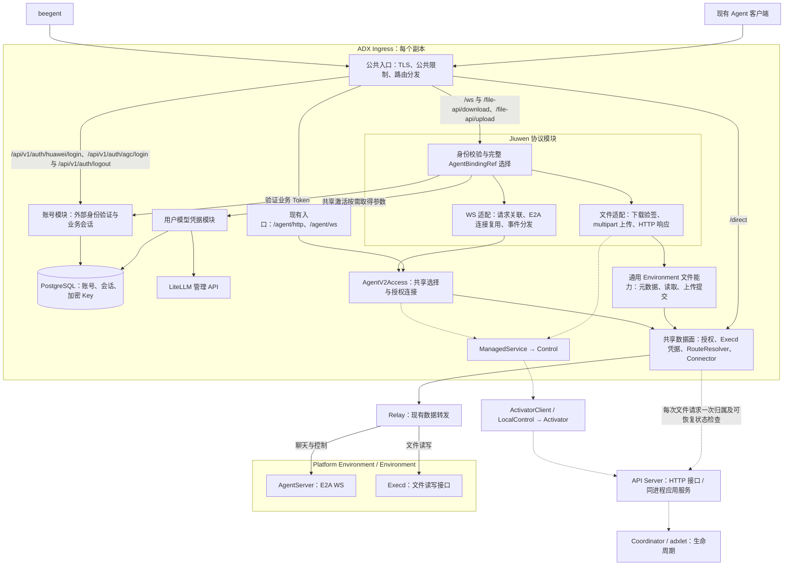
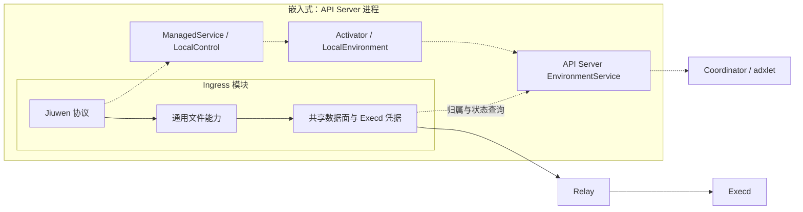
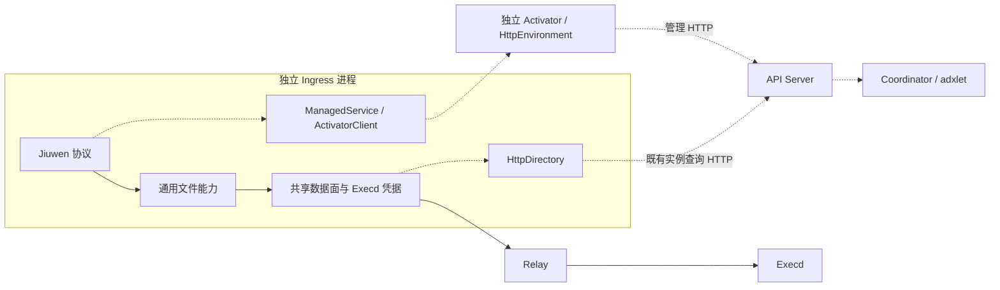

# beegent 接入 ADX Ingress 的 Jiuwen 协议模块设计

状态：已实现 Jiuwen 协议适配、华为 Account Kit 与 AGC Auth 登录、共享业务会话、用户级 LiteLLM 凭据、通用模板参数注入和 AgentServer 端口 readiness 配置。真实华为授权码登录、真实 AGC 换票、鸿蒙双账号隔离、实机及生产额度控制仍待验收。固定身份 local_fixed 已移除。账户接入契约和验证边界统一记录在本文。

## 1. 范围

ADX Ingress 新增独立的 Jiuwen 协议模块，对 beegent 暴露 Jiuwen `/ws` 和它需要的附件下载入口。云侧请求不经过 Python Jiuwen Gateway；Python AgentServer 仍运行在 Platform Environment（Environment）内，保留 E2A 业务协议。Agent 层的业务映射统一称为 AgentBinding，Environment 专指 Platform 的稳定运行环境。

WS 请求不按 method 名称做 Gateway 白名单过滤；方法名和参数经通用 E2A 通道转发，由 AgentServer 判断是否支持。`session.list`、`session.create`、`session.get_metadata`、`history.get`、`chat.send`、`chat.interrupt`、`chat.user_answer`、`chat.swarmflow_reply` 保留已实现的参数、ACK 和事件兼容映射；其他方法按请求的 `is_stream` 走通用响应映射。唯一的旧版边界例外是 `health_check.get_conf`：仅当 AgentServer 的连接 ACK 为 `status=ready`、由 `agentserver` 持有 heartbeat 且缺少显式 `readiness` 时，DigitalMateGateway 模块返回等价的 `AGENT_READY` 快照，避免旧版单进程实现把原本由 Python Gateway 处理的健康请求误送入模型执行；带显式 `readiness` 的新 AgentServer 仍自行处理该请求。客户端实际消费的连接确认、聊天流、运行时确认、历史、交互、工具、子任务、文件等事件和字段仍按对照样例验证。

附件范围包括 `GET /file-api/download?token=...`、`POST /file-api/upload` 和下载链接。上传采用 multipart 表单，使用业务 Bearer 会话选定当前用户的 Environment，`token` 查询参数不参与处理；`dir` 和文件名组合出的目标路径限定于模板声明的 Environment workspace，文件经 Relay 写入当前用户绑定的 Environment；客户端消息内自带 Base64 的附件不需要 Gateway 文件读取。其余 `/file-api/*`、网页、TUI/IM 等入口不在本轮范围；配置、项目、渠道、Cron 和 Git 等 AgentServer E2A 方法可走同一 WS 通用转发，但它们的业务语义仍由 AgentServer 决定。

本轮不修改 AgentServer；Platform／Execd 仅包含用户明确授权的 Execd entrypoint 子进程监控锁作用域修复及回归测试，其余平台改动后置。不新增 Redis 连接互斥或 Relay 按目标限流。所需平台能力尚不满足的部分列为待完善，不通过降低校验标准或绕过能力边界完成验收。

兼容原则：系统尚未上线，只有此前明确确认保留的接口承担兼容要求，不能因为接口或字段已经存在就推导出兼容义务。本方案中已确认保持的 beegent/Jiuwen 对外协议和 AgentServer E2A 契约继续保留；其余重构直接采用目标命名和结构，不为旧版本增加路由别名、字段双读写或存量数据迁移。

## 2. 模块与依赖



图中实线表示入口或数据调用，虚线表示管理依赖；Activator 可独立部署或嵌入部署。Jiuwen 使用业务会话鉴权，AgentV2Access 负责共享目标选择和授权连接。上传、下载通过通用 Environment 文件能力，底层与 `/direct` 共用 Execd 授权配置、路由和 Relay；Jiuwen 不取得 Execd token。API Server 只提供管理操作与租户隔离的实例查询，不承载文件正文。verified 的底层读取差异仍见第 5、6 节。

公共入口负责监听、TLS、公共限制和路由分发。DigitalMateGateway 模块负责身份、`/ws` 帧和事件协议、请求与会话关联、E2A 转换及附件 HTTP 语义。它与现有 `AgentApi` 平级，不导入 `agent_api.rs` 的 HTTP handler，也不经公网地址回环调用 `/agent/ws`。当前 Ingress 支持按 `<environment-id>-<port>.<domain>` 的 Host 优先选择直连路由；部署时必须为 Jiuwen 公共入口使用不会命中该规则的 Host，并验证 `/ws` 与附件路径不会被直连路由截获。

Agent v2 内部访问能力是两种入口的共用依赖。保持 `ManagedService → Control → ActivatorClient/LocalControl` 边界，以及 RouteResolver、Connector、Relay 的转发职责。DigitalMateGateway 模块通过 ManagedService 解析 AgentBinding，不直接调用 Platform。公共数据面持有部署注入的 Execd 凭据；Jiuwen 仅提供网关固定 tenant、已授权 Environment ID、文件路径和期限，内部凭据不返回客户端、不写入日志。

## 3. Agent v2 内部接口

`AgentV2Access` 已在 `gateway/src/ingress/agent_service.rs` 实现，由 `AgentApi::service_access()` 提供共享 ManagedService 的访问句柄，供现有 Agent 入口及 Jiuwen 内部连接使用。选择与建连分两步，保留现有 HTTP 连接池：

```text
select(context, Scope { tenant, template, version, binding_id },
       ServiceSelector { protocol, port }) -> ServiceSelection
connect_service(ingress, ServiceSelection) -> IngressStream
```

Scope 中的 tenant 由调用入口的可信上下文确定：通用 Agent 使用已认证的 Platform 租户，DigitalMateGateway 使用模块固定配置。`ServiceSelection` 是字段不公开的目标选择结果，携带原始 deadline、绑定 generation 及一次未发送重试预算。选择阶段复用 ManagedService 完成 Template 和服务校验、绑定解析及目标激活；建连阶段复用 Ingress 的路由授权、RouteResolver、Connector 与 Relay。调用方不取得 Activator 凭据、Relay 地址或 Execd token。

现有 `/agent/ws` 已走共享建连方法；`/agent/http` 使用相同的目标选择和 generation 重试实现，同时保留 BackendHttpPool，避免将 HTTP 改成每次新建连接。Jiuwen 的 connection.rs 消费共享选择结果，通过 connect_service_when_ready 取得授权 Relay 流，在流上执行受原始 deadline 限制的 WebSocket 握手；不经公开 HTTP/WS 路由回环。握手完成后接入连接内驱动，路由撤销覆盖握手及整个驱动生命周期。同一 binding 可以建立多条独立连接，并发会话语义由业务处理；入口按已验证业务用户选择目标。连接失败保留 Agent 或 Ingress 的类型化错误，租户不匹配、认证拒绝及 draining 不触发目标重新激活。原始 deadline 覆盖 WS 的目标选择与建连，建立后的业务流不使用该短期 deadline。Jiuwen 对尚未监听的业务端口在同一 deadline 内每 250 ms 重试 TCP 建连；这发生在发送 WebSocket 握手和业务字节之前，不重复查询或激活目标。认证拒绝、draining 和握手失败不进入该等待。
目标失效重试沿用原请求 deadline。HTTP/SSH 固定绑定 generation；WS 在尚未发送后端握手或业务字节时，若权威元数据确认 Binding 已删除或换代，可重新解析一次，缺失时复用本次初始化参数，已有绑定忽略新参数。Deleting、鉴权失败、draining 和同 generation 的冲突不触发重选。若已开始向后端写入，传输中断、绑定删除或重新创建导致目标变化时直接报错，不自动重放。建立后的业务流由连接本身管理。

文件读写由 `gateway/src/ingress/environment_files.rs` 的 `Files` 统一实现：文件元数据、限量读取、上传暂存与提交。Jiuwen `download_runtime::Reader` 保留下载 token 和资产登记验证，上传 handler 保留 multipart、workspace 和用户检查。两者调用通用文件能力；`Environment` 生命周期接口不再提供 runtime 凭据读取。`PlatformEnvironment` 与 `EnvironmentRequestMapper` 已删除。

通用文件能力在每个上传／下载 HTTP 请求首次访问 Execd 时，经 API Server 校验一次租户归属及 Running/Pausing/Paused/Resuming，随后通过共享 Gateway EnsureRunning 等待已提交路由。该请求共用一个 Files 上下文，密钥／登记／元数据读取、下载的所有分块、multipart 内全部文件的上传和提交均复用准入结果；失败结果也仅在本请求内保留，新请求重新查询。下载 handler 在完整传输期间保留同一个 Reader。

Files 固定首次准入的运行路由，每次后端操作继续检查本地路由有效性，并保留操作间隙的路由变更事件。目标变化、删除或事件丢失时终止；即使路由恢复也不能续用旧上下文。连接不会自动切换到替代执行实例；错误不自动重放，调用方重新请求时重新准入。业务会话、下载 token、资产登记、期限及在途撤销检查保持。文件请求不经过 Activator 激活，也不创建 Binding 或 Environment。

Jiuwen 下载适配负责所需的文件及校验元数据读取，执行现有租户授权检查，处理请求超时、Range、流式响应和错误映射。普通及 verified 下载均基于现有 Execd 实现；后者保留 token 与资产登记校验，底层文件打开和并发读取语义沿用 Execd，不宣称与原 AgentServer 读取实现完全等价。

创建侧复用 `EnvironmentSpec.runtime_profile`：Platform 已支持部署侧 rootfs、bootstrap 和环境配置。独立 Activator 通过 API Server 既有 HTTP 接口创建，嵌入式 Activator 使用 API Server Environment 应用服务；runtime 注入归 API Server 部署配置。Agent 模板不再提供 entrypoint/working_dir，创建时启用 `inherit_entrypoint`，由 Platform 提取业务镜像的 ENTRYPOINT/CMD/WORKDIR/USER，生成进程配置供 Execd 执行。业务镜像无需预置 Execd 或额外 JSON。模板已支持 Local mounts 与 Binding 参数渲染，Jiuwen 提供跨版本稳定工作区参数，见[工作区设计](user-workspace-volumes-design.md)。工作目录覆盖和工作区独占接管仍未实现；节点可按挂载的 create_if_missing/create_options 创建缺失目录，真实 SFS 持久化待验收。Inline HTTP 兼容入口已移除。节点 profile 匹配及 Execd 实际端口/token 需通过真实创建验证。此项属于创建适配，与文件数据面访问分离。

### 通用运行环境文件访问与管理查询

创建侧继续由 Activator 把 CreateEnvironment/ExecutionSpec 转成 Environment 请求，API Server 的 prepare_create/create_request 负责自己的请求校验及 runtime 注入。API Server 不接收 AgentBinding 或 ExecutionSpec。

文件侧无需新增返回 Execd token 的接口。独立 Ingress 的 `HttpDirectory` 调用既有 `GET /api/instances?instance_id=...`，使用对应 tenant 的管理 API Key，要求返回恰好一个元素的数组，并检查该元素的 ID 及 Running/Pausing/Paused/Resuming；嵌入式注入 API Server `EnvironmentService` 实现的 `EnvironmentDirectory`，复用 inspect 及租户校验。查不到、越权、创建中或失败/删除状态均拒绝；暂停状态仅通过身份准入，实际恢复仍由共享转发路径负责。查询只用于访问准入，不提供文件流或凭据。

`ADX_ENVIRONMENT_FILES_CONFIG` 指向数据面的文件访问配置。公共 `ExecdAccess` 从其中的 `token_env` 环境变量引用加载凭据，`port` 必须等于 Ingress 的 default_direct_port。独立配置同时声明 API Server URL、CA 与租户管理 Key 的环境变量名；嵌入式使用注入的目录服务，不配置 HTTP 目录或管理 Key。示例见 [独立配置](../../gateway/examples/environment-files.json) 和 [嵌入式配置](../../gateway/examples/environment-files-embedded.json)。Jiuwen 配置不包含 Execd token；业务下载签名密钥仍遵循模板或 Environment 文件的原协议。

部署必须将同一 Execd 端口及 Secret 注入 API Server runtime profile、节点和公共数据面。节点 env 可覆盖 runtime_profile.env，当前实例查询无法证明节点最终配置；实现不自动校验跨进程配置一致性。不同节点独立凭据及单侧轮换不在当前模式支持范围内。不能从用户 env 猜测凭据，也不保留旧 spec.env 查询回退。更换配置后必须通过真实新建 Environment 的上传下载验证。

两种部署只改变管理调用的传输方式，文件正文均经过 Ingress → Relay → Execd：





本地组件验证覆盖两种目录实现、租户隔离、新创建规格不含旧 env 凭据、公共 direct 与 Jiuwen 上传下载。2026-10-10 的独立部署验证覆盖真实新建 Environment、跨副本上传下载和真实模型调用；嵌入式创建另有此前真实容器验证及 2 MiB 工作线程栈回归。合入最新上游后的版本通过本地回归，未再次部署云端。

## 4. AgentBinding 与唯一的 Environment 语义

ADX 当前入口认证获得的是租户身份，不等于终端用户 `user_id`。DigitalMateGateway 模块应在 WS 与附件 HTTP 请求上取得相同的已验证 `user_id`，由服务端将 `(tenant, user_id, 固定 Agent 类型)` 映射到稳定的业务 binding_id，再结合模板及版本选择 AgentBinding。客户端不能指定其他用户的绑定或 Environment，也不能持有 ADX 租户 API Key。

Agent 层业务对象已统一称为 `AgentBinding`，完整业务身份为 `(tenant, template, version, binding_id)`，保存目标 `environment_id`、绑定 generation 和删除意图。`environment_id` 就是 Platform Environment ID；只有 Platform Environment 拥有运行状态、调度、暂停恢复和 Runtime 替换语义。AgentBinding 是业务地址到该环境的映射，允许先提交绑定身份再发起平台创建，并不是另一套运行环境或平台状态机。

代码中的 `Scope.binding_id` 是业务绑定 ID，不是 Platform Environment ID。Agent 的类型、方法、API 路径、target URN、请求响应及持久化字段已统一到 AgentBinding 命名：业务字段使用 `binding_id`，管理路径改为 `/api/agent/v2/templates/{name}/versions/{version}/bindings/{binding_id}`（列表路径省略最后一段），目标 URN 使用 `urn:adx:binding:{name}:{version}:{binding_id}`。同步修改调用方、测试、文档及开发约定；不保留旧名称的兼容别名、序列化映射或存量数据迁移。此命名变更已实现并通过聚焦测试；Platform 的 Environment 类型保持不变。

同一业务 binding_id 在不同模板版本下形成不同 AgentBinding，分别绑定不同 Platform Environment。绑定删除后重建仍使用新的 generation 和 Environment ID，保留多副本创建幂等、未知结果沿用原身份、旧请求不能影响新绑定的约束。DigitalMateGateway 模块预置模板版本，临时代行 App 的版本选择；修改预置版本属于业务版本切换，不是平台自动升级。后续由 App 选择并由服务端校验版本，数据迁移、兼容性和回滚由业务负责。本轮保留现有身份与生命周期行为，不实现同一个 Environment 跨版本升级。

### 业务账号与用户模型配置

Ingress 新增账号模块：华为 Account Kit 授权码兑换可信 UnionID，关联内部 userId，签发默认 7 天的不透明业务 Token。用户与会话存储在共享 PostgreSQL，支持多个 Ingress。Jiuwen 的 `/ws` 和下载入口只从业务会话取得身份；ADX 管理及内部服务保持独立鉴权。

`ADX_JIUWEN_CONFIG` 顶层配置网关固定 tenant，平级的 jiuwen/orbit 各自配置目标和请求期限；Jiuwen 协议限制位于 jiuwen 块，配套 `ADX_ACCOUNT_CONFIG` 配置账号存储与 LiteLLM。不再配置固定 user_id 或 local_fixed。Jiuwen 不检查传输层 TLS 状态；HTTP 与 HTTPS 监听共享相同业务鉴权，不存在鉴权失败回退。公网 HTTPS/WSS 可在 ELB 终止，内部通过 HTTP/WS 回源。原有 Ingress TLS 与内部 mTLS 能力保留，网络开放范围由部署层控制。客户端须在 WS 握手及附件请求中携带业务 Token。

binding_id 为紧凑 JSON 数组 `[tenant,userId,agent_type]` 的 SHA-256 小写十六进制加 `jiuwen-` 前缀。模板版本只进入完整 Scope。请求的身份字段不能改选目标；`/ws` 忽略客户端查询参数 `user_id` 的值，所有身份与实例路由仍取自业务会话。下载中的 user_id 仅做一致性核对。

登录不创建实例或调用 LiteLLM。首次 WS 的共享解析/激活流程按需向 Jiuwen 业务参数提供方取得用户模型 Key、推理地址和工作区参数，原子创建 Binding，并使用 parameters 渲染 Template.env 和 mounts。热绑定复用持久化参数，不再请求模型管理入口。独立 Activator 与内嵌 Activator 使用同一激活契约；独立 prepare 接口和 Binding 私有 launch 快照已移除。parameters 当前明文保存，后续模型凭据加解密由业务 Gateway/AgentServer 承担。

详细接口、数据库 schema、凭据签发重试、加密与密钥部署、会话撤销和验证范围见本文第 8 节。退出不销毁绑定或更换模型 Key。密钥热轮换、账号禁用到 LiteLLM 的自动联动后置。

## 5. Jiuwen 协议和附件

`/ws` 接收 `{type:"req", id, method, params}`。模块验证 beegent 方法与参数，向 AgentServer 发送 E2A envelope，并维护客户端请求 ID、E2A 请求 ID、用户、会话和连接的对应关系。必须区分请求 ACK、`runtime.accepted`、业务最终事件和 `chat.interrupt_result`；服务端主动推送仅发给有权接收的连接。历史分页、事件顺序、断线后的结果未知状态以 beegent 与当前 Jiuwen Gateway 的对照样例为准。

源码核对还确认：`session.get_metadata.is_processing` 在原 Gateway 中由本地 busy 状态补充，并非 AgentServer 元数据提供的权威运行快照。模块须跟踪本副本收到的处理状态与中断事件；跨副本重连后的准确状态恢复未获现有协议保证。AgentServer 在所拥有的 E2A 连接断开时会尝试取消在途工作（部分后台任务除外），不能承诺断连续流。客户端按结果待确认处理，禁止自动重放。客户端兼容行为由协议、会话及响应映射回归测试覆盖。

连接行为：一个前端 WS 复用到目标 AgentServer 的一条 E2A 连接，不按方法、会话或业务消息重新建连。多个前端可以同时连接同一个 binding，包括其他前端仍在握手或已运行时；每个前端拥有独立的 E2A 流和驱动状态。网关不再按 binding 占用连接或返回 `409 ALREADY_CONNECTED`，也不抢占旧连接。并发请求、会话冲突及业务侧连接策略由 AgentServer／业务自行处理。关闭一条连接只释放其自身资源；租户鉴权、路由撤销、期限和传输层资源保护继续生效。

后端握手沿用 Environment 内 AgentServer 的根路径，Host 为 `127.0.0.1:<service-port>`、Origin 为 `http://127.0.0.1:<service-port>`；地址仅用于已授权流上的 HTTP 握手，不用于额外拨号。启用 AgentServer Origin 检查的镜像需将该后端 Origin 主机加入允许列表；不得透传客户端凭据。本地验收镜像及后端握手已验证；正式部署仍需配置相应 Origin 允许规则。

附件保持 `GET /file-api/download?token=...` 对外协议，内部改为 `Jiuwen 下载适配 → 通用 Environment 文件能力 → 共享数据面与 Relay → Execd`。上传增加 `POST /file-api/upload`，先用当前业务会话选定 AgentBinding，再校验 multipart 表单中的用户、相对目录和文件名；有界读取整个表单后经同一 Relay 路径写入 Environment workspace。上传查询参数 `token` 被忽略，本阶段没有上传文件令牌的签发和验签。通过 AgentBinding 确定目标 Platform Environment，任意 Ingress 副本独立处理下载，不查找聊天所在副本，不为下载新建或复用 AgentServer E2A 连接。到 Execd 的额外流与到 AgentServer 的 WS 是不同目标，不涉及 AgentServer push 连接抢占。

Jiuwen 下载适配负责用户和环境绑定、token 签名及有效期规则、verified 资产登记校验、文件名与 Content-Type、Range 和错误映射。普通 token 和 verified token 分别实现其签名及声明校验，不混用授权语义。verified 校验不仅是 HMAC 验签，还依赖环境内资产登记状态、路径、大小和摘要字段；底层读取差异按下一段处理。下载配置以所选 Jiuwen AgentServer 模板版本的 env 为唯一来源，模板负责向 AgentServer 注入，Ingress 的 DigitalMateGateway 模块读取同一配置；具体规则见下文。不能将未验签路径直接交给 Execd。beegent 当前将 WS 和下载设为不同端口，云端地址与 TLS 配置也需要同步调整。

DigitalMateGateway 模块和 Jiuwen AgentServer 模板由同一业务部署管理，共用配置，无需在 Ingress 再维护一份密钥或路径配置。现有 `TemplateVersion.env → ExecutionSpec.env` 已支持向 Environment 传递这些变量；DigitalMateGateway 模块通过共享 ManagedService 获取所选租户、模板、版本的同一不可变 TemplateVersion，继续遵守 Activator 访问边界。`download_config.rs` 已实现从模板解析下载配置，以及通过 ManagedService 按作用域读取同一模板；这一步不创建 AgentBinding 或 Environment。`download_token.rs` 已实现密钥内容解析、原始 token 验签、声明与资产登记检查；`download_runtime.rs` 保留 Jiuwen 下载的验签和资产登记逻辑，通用 `environment_files.rs` 执行管理准入、数据面授权、Relay 建连与 Execd HTTP 读写。正文限制、原始 deadline、路由撤销及取消释放保持不变；此分层不增强 Execd 原有文件打开的一致性保证。

| 模板 env 配置 | AgentServer 与 DigitalMateGateway 模块的共同用法 |
| --- | --- |
| `JIUWENSWARM_WORKSPACE` | 模板显式设置 Environment 内绝对路径；未配置有效的显式签名密钥时，AgentServer 在该目录下 `config/.file_download_secret` 读取或生成密钥，DigitalMateGateway 模块通过 Execd 只读获取当前 Environment 的同一文件 |
| `JIUWENSWARM_FILE_DOWNLOAD_SECRET` | 可选；配置有效值时，两端直接使用同一值，不要求额外落盘，也不读取自动生成的密钥文件 |
| `JIUWENSWARM_DOWNLOAD_ASSET_ROOT` | 模板显式设置 Environment 内绝对路径；AgentServer 写入交付文件及 `<asset_id>.json`，DigitalMateGateway 模块在需要资产登记校验时通过 Execd 读取同一目录 |

共享配置不改变 Environment 文件隔离：采用文件密钥时，不同 Environment 在同一路径拥有各自的密钥文件；Ingress 按当前已授权目标读取。模板显式填写路径，避免依赖镜像 HOME、UID 或临时目录推导。DigitalMateGateway 模块不执行运行时环境探测、不扫描 AgentServer 进程、不自行创建或替换密钥；镜像启动逻辑应遵守模板注入配置。配置解析已拒绝缺少路径、相对路径、父目录跳转及非空但少于 32 个字符的显式密钥；空或缺省密钥选择文件模式。显式密钥保留原始值，资产目录按 AgentServer 规则去除首尾空白，路径仅做词法规范化，不在 Ingress 宿主机解析。Debug 隐去密钥值。后续文件读取若失败，下载返回错误，不另生成密钥。密钥只用于内部校验，不进入公开响应、业务事件或日志。模板版本选择同时决定 AgentServer 与下载模块使用的配置，切换版本遵循既定业务升级语义。

下载校验实现分为两步：`DownloadVerifier::verify` 先对原始 Base64URL 文本进行 HMAC-SHA256 校验，再解析路径、会话、有效期及 verified 声明；返回的 SignedDownload 尚不代表资产已获准读取。`check_file` 再次检查有效期，要求普通文件；verified 还校验模板资产目录边界、登记 ID、staged/committed 状态、路径、到期时间、大小、摘要及实际文件大小，成功后返回 CheckedDownload。普通与 verified 共用后续文件读取链路；摘要与登记值比较，不重新计算整个下载内容的散列。

普通无 exp token 仅接受原签发器允许的 path/sid 或 path/sid/download_http_base 两种完整 schema；带 exp 的普通 token 按原校验函数的整数秒边界判断，verified 同时采用资产登记的精确到期时间。download_http_base 只作为已签名的兼容字段接受，不参与目标路由。其他 purpose/kind 不作为普通文件 token 接受。可选会话约束由可信请求上下文提供，文件 token 本身不证明用户身份。

token 输入上限为 16 KiB，密钥及登记内容各为 64 KiB。显式密钥保留原值，密钥文件内容按 AgentServer 规则 trim 后使用；缺失、非 UTF-8 或过短的文件密钥均失败，不生成替代密钥。内部下载准入已通过 Execd HTTP 契约读取密钥、登记及元数据，并在读取结束后重新检查有效期；读取全程共用请求 deadline，监听路由撤销，调用取消时释放 HTTP 连接和会话，不遗留后台连接任务。读取上限按实际响应体执行，不依赖 Content-Length。此前已有真实 Environment 下载验收；本轮另外验证业务会话准入和撤销；内部 HTTP 适配已实现分块读取、逐块重新准入、有效期／撤销检查、Range 和错误映射；公开用户认证与目标 binding 装配已实现，生产联调待验收。

内部 HTTP 响应保持原两分支行为：verified 支持单段 Range、206/416、Accept-Ranges 及 inline；普通附件忽略 Range/inline 并返回完整 200 附件。两者支持 HEAD、空文件、Content-Length、no-store、UTF-8 文件名与按扩展名推断 MIME（未知类型使用 application/octet-stream）。对 Execd 以不超过 64 KiB 的区间请求按需读取，核对 206、Content-Range、总大小及实际正文长度；后端忽略 Range、返回错误区间、短读或超长正文均为上游错误。首次正文读取成功后才返回成功响应头，已缓冲首块在消费前再次准入，后续每块也重新验证密钥、token、登记与元数据，并在读取完成后重查到期时间。消费端背压不会触发后台预取，取消会丢弃当前读取 future；传输沿用调用方的整个请求 deadline。响应头已发送后的错误中止正文，不静默返回截断成功文件；不保证文件内容快照或同描述符读取。

本轮以已验证用户对其 Environment 的访问权限为主要安全边界，附件 HTTP 请求仍必须校验用户归属；下载继续校验文件 token，上传使用 multipart 表单且不校验上传 token。不新增仅凭链接匿名分享的访问方式。现有 Execd 的 fs_get_info 使用路径元数据并单列最终符号链接，适配层拒绝该类型；/download 自身仍跟随符号链接，路径元数据检查与文件打开分离；原 verified 的 `O_NOFOLLOW`、打开后 `fstat` 及同一描述符检查/读取语义不在本轮补齐。此差异作为已确认的实现限制，不单独阻塞普通或 verified 下载实施及本轮功能验收，不回退 E2A。目录或文件并发替换时不保证登记对象与实际读取对象一致，也不保证内容快照；需要复现原读取约束或引入单文件分享权限时再评估增强。验收必须通过用户隔离、签名、有效期和资产登记等已承诺校验，并明确记录上述限制，不宣称完整复现原 verified 安全语义。

## 6. 待完善能力与本轮边界

| 能力 | 当前处理 |
| --- | --- |
| 业务启动与就绪检查、路由可达保证 | Agent 模板把 `readiness_probe` 透传到 Platform；Jiuwen SFS 模板以 3 秒初始延迟、3 秒周期和 2 秒单次超时探测 TCP 18092，30 秒初始化期限内成功后才发布 Running 和绑定路由。AgentServer 在内部 Runtime warming 前即监听，因此该配置只保证前端端口可连接；业务请求仍使用现有 warming、失败及超时事件，周期 healthcheck 尚未接入模板 |
| 部署侧 runtime profile 与启动配置 | Platform 已有能力；本轮接通 Agent/Gateway 创建映射，覆盖独立及嵌入式 Activator，验证业务镜像和进程配置；仅额外包含用户授权的 Execd 启动锁修复，超出现有契约的能力另列待完善 |
| 挂载、数据持久化与恢复 | 明确历史、文件、资产登记和密钥的位置及实际保留范围；稳定 ID 不代表 Environment 重建后数据可恢复，不承诺尚未验证的恢复能力 |
| verified 底层读取增强 | 本轮不改 Execd 文件读取；保留用户归属、token 与资产登记校验，接受并明确记录符号链接及检查/打开竞争差异，不以此单独阻塞下载功能验收 |
| 同一 Environment／binding 的业务连接并发 | 由业务自行处理，Jiuwen 不设置单连接限制，不新增 Platform 按目标连接上限；现有传输资源保护保留 |
| 创建取消、期限传递与删除确认 | 沿用当前 Platform 契约，超时不能被解释为未执行，不用新 ID 重建掩盖结果未知 |

其中 runtime profile 的 Agent/Gateway 创建适配属于本轮实现任务；列为待完善的平台能力不在本轮修改。若必需用例依赖尚缺能力，应记录未完成验收及依赖，不能通过 Gateway 临时脚本绕过。

## 7. 验证限制

此前 Python Gateway→ADX 的本地端到端结果不证明新模块可用。尚无分段性能数据证明 Python Gateway 是主要延迟来源；环境冷启动、AgentServer 和模型耗时需分项测量。验收分别记录模拟客户端、真实 ADX Environment 和 beegent 实机的结果，不混写为同一种证据。

## 当前验证证据

此前真实容器验收已通过独立/嵌入式 Activator 创建、镜像 ENTRYPOINT/CMD/WORKDIR/USER 继承、Execd 控制响应、WS 协议、跨副本普通/verified 下载和模拟模型最终回复。API Server 栈溢出与默认规格冲突已经修复。

2026-10-10 的独立部署完成 13 项内部检查和 6 项公网检查，覆盖测试会话认证、冷启动与热连接、跨副本上传下载、Range/HEAD、签名和跨用户隔离，以及通过 LiteLLM 的真实 DeepSeek 对话。冷启动样本使用已缓存镜像，不代表所有冷启动场景或容量压测已通过。2026-10-15 在 `adx-jiuwen-test` 发布 `jiuwen/cce-readiness-20261015`，真实创建一次性 Binding/Sandbox；实例内 `ADX_WORKLOAD_PROBES` 与模板的 TCP 18092、3/3/2 秒及 30 秒初始化期限一致，18092 可连接，缓存解析返回相同 Sandbox，随后已删除临时 Binding 和 Sandbox。该证据验证配置透传、启动门控和端口可达，不证明 Jiuwen 内部 Runtime 完整 warming。真实华为授权码登录、真实 AGC 换票与双账号隔离、鸿蒙实机、生产额度拦截、文件检查与打开竞态及内部 Runtime 完整就绪仍未完成验证。

## 8. 账户接入与部署契约

### 两层安全边界

Jiuwen 的 `/api/v1/auth/huawei/login`、`/api/v1/auth/agc/login`、`/api/v1/auth/logout`、`/ws`、`/file-api/download`、`/file-api/upload` 使用业务账号体系。客户端提交华为 Account Kit 授权码或当前 AGC Auth 用户 access token；Ingress 验证外部身份后签发同一种不透明业务 Token。WS、上传和下载只从已验证会话取得 userId；tenant、Agent 类型、模板与版本来自服务端配置。

ADX 管理 API、内部 Activator、Platform 和 Relay 继续使用原有租户／服务认证，业务 Token 不授予这些管理权限。多个业务用户可以属于同一 ADX tenant；Jiuwen 按 `(tenant,userId,agent_type)` 派生 binding_id，并结合 template/version 选择完整作用域。客户端不能通过查询参数或消息中的用户字段改选其他 Environment。

已移除 `local_fixed` 配置与入口回退。测试身份只通过测试中的 BusinessAuth / IdentityProvider 实现注入，不提供生产模拟身份开关。DigitalMateGateway 模块不感知监听器的 TLS 状态，也不依据 X-Forwarded-Proto 授权。HTTP 与 HTTPS 监听使用相同业务认证。公网 TLS 由部署入口负责，可由 ELB 终止后使用 HTTP 回源，或使用 Ingress 原有 TLS 监听器；HTTP 回源端口仅在受控内部网络开放。

### 接口

| 接口 | 请求 | 结果 |
| --- | --- | --- |
| POST /api/v1/auth/huawei/login | application/json；authorizationCode；首次注册需 agreementVersion | userId、token、tokenType=Bearer、expiresIn；Cache-Control: no-store |
| POST /api/v1/auth/agc/login | application/json；agcAccessToken；首次注册需 agreementVersion | 服务端验证项目、UID、有效期与撤销状态后签发相同格式业务会话；Cache-Control: no-store |
| POST /api/v1/auth/logout | Authorization: Bearer 业务 Token | 幂等撤销当前会话，204；不删除 Binding 或模型 Key |
| GET /api/v1/auth/quota | Authorization: Bearer 业务 Token；无查询参数 | 与 jiuwenswarm 相同的 `ok/available/quota` 结构；读取当前用户 Key 的 max_budget/spend，1:1 显示积分；不创建 Sandbox |
| GET /ws | Authorization: Bearer 业务 Token；标准 WS Upgrade；可省略 user_id，传入则忽略其值 | 认证后选择用户 Binding；允许多条独立连接，并发策略由业务负责 |
| POST /file-api/upload | Authorization: Bearer 业务 Token；multipart/form-data | 写入用户已有 Binding 的 workspace；请求体最多 64 MiB、最多 20 个文件；不创建实例 |
| GET/HEAD /file-api/download | Authorization: Bearer 业务 Token；原下载 token 查询参数 | 独立验证用户和下载 token，读取用户已有 Binding；不存在返回 404，不通过下载创建新实例 |

ADX 的 `/api/v1/auth/huawei/login` 是授权码兑换入口，`/api/v1/auth/agc/login` 是 AGC 用户凭据换票入口。当前 Ingress 直接匹配带 `/api/v1` 前缀的完整路径，不存在另一个内部 `/auth/agc/login` 路由；端侧 `authBaseUrl` 已含 `/api/v1` 时只追加 `/auth/agc/login`。原 jiuwenswarm 虽也有 `/api/v1/auth/logout`，但其 Cookie／`X-Auth-Session` 会话和 JSON 响应与 ADX 的 Bearer 会话、204 响应不同；仅路径相同，不构成客户端兼容。

`/ws` 的 URL 查询参数 `user_id` 不参与身份验证、Binding 选择或后端用户身份构造；传入不同、空或重复的值均忽略。身份始终取自业务 Token 对应的会话。其他查询参数及超过 1024 字节的查询串返回 `400 INVALID_QUERY`；未携带有效 Token 仍返回 401。下载入口的独立 token 与 user_id 一致性校验保持原契约。

登录示例：

```json
{"authorizationCode":"<Account Kit code>","agreementVersion":"1"}
```

```json
{"userId":"<internal UUID>","token":"<opaque business token>","tokenType":"Bearer","expiresIn":604800}
```

请求不接受 clientId、clientSecret、userId、tenant 或 apiKey 等客户端身份覆盖字段。Code 原样经表单编码兑换，不自动重试已发送的兑换；超时或结果不明时客户端重新获取 Code。首次注册缺少正确协议版本返回 403 / AGREEMENT_REQUIRED。无效或过期会话返回 401，账号不可用或身份与资源不匹配返回 403，依赖不可用返回 503；503 不要求客户端清除仍可用的 Token。

AGC 请求为 `{"agcAccessToken":"<user token>","agreementVersion":"1"}`，不接收手机号、验证码、UID、ownerId 或业务 userId。Ingress 使用固定中国区 AGC Server REST 地址和部署持有的 API client 凭据，先取得服务端访问凭据，再为每次登录调用 `api/oauth2/third/v1/verify-token`。远端成功结果的 productId 和 UID 必须与配置项目及 token 的 `aud`/`sub` 一致；同时核对 `iss=https://agc.developer.huawei.com/<projectId>`、`exp`。JWT 中的 `agc.sign_in_provider` 不作为账号类型判断依据，因为它不等同于客户端 SDK 的匿名账号标记。远端调用覆盖签名、到期和撤销检查；用户 token 与验证结果不缓存。无效、过期、撤销和错误项目返回 401 / INVALID_AGC_ACCESS_TOKEN，上游或 API client 授权故障返回 503 / AUTH_UNAVAILABLE。

业务 Token 为 32 字节密码学随机值的 Base64URL 编码，数据库仅保存 SHA-256 摘要。默认绝对期限 7 天，可配置 60..604800 秒，不滑动续期。不保存或下发华为 Access Token、Refresh Token。华为 ID Token 使用官方 OIDC discovery/JWKS，验证 RS256/PS256 签名、kid、iss、aud、exp、nbf 和非空 sub；JWKS 有界缓存，端侧仍须自行严格核对登录 state。

WS 在握手前验证会话，连接建立后每 30 秒复查；业务消息不逐条查询账号库。退出立即拒绝新连接；已建立的 WS 在下次复查或会话绝对到期时关闭，复查查询最多等待 10 秒。下载流也监控会话到期和撤销。当前不通过跨副本通知即时切断所有连接。鉴权失败／存储不可用时关闭流，不匿名放行，不重放业务请求。

### 数据与模型凭据

#### 透明业务 WebSocket

配置顶层的可选 `orbit` 块与 `jiuwen` 平级，固定 template、version、backend_path 和 service_port，启用独立的 `GET /orbit/ws`。两者共用顶层 tenant 与账号登录；业务与共享账号入口均不按 Host 或 Origin 限制准入，域名及路径的访问范围由部署层控制。透明入口保留客户端原始 Host 和 Origin，后端应用仍可自行校验页面来源。会话没有新增应用 audience；user_id 取自已验证会话，tenant 取自网关固定配置。绑定内部 ID 为 `orbit-` 加 `SHA256(JSON([tenant,user_id]))` 的十六进制全长摘要；模板及版本是 Scope 的其他组成部分。客户端不再选择 binding_id，也没有 Binding ID 响应头。同用户在固定 Scope 内始终复用一个绑定，不同用户隔离，不新增用户归属字段或映射表。

新入口复用 AgentV2Access 的模板 service 校验、激活、冷启动就绪等待，以及共享 Gateway HTTP Upgrade 和双向字节转发；没有独立 Relay 客户端。握手前清除网关消费的认证请求头和内部路由头；只替换后端路径，query 原样保留，不解析、重编码或按名称过滤，不增加专属 query 长度限制。查询参数不参与网关目标选择，由 Orbit 解释。不解析业务帧、不做 Jiuwen 协议转换、不重放已发送请求。激活、连接、连接后会话复查和握手共用原 admission deadline，会话 watcher 在各阶段持续有效，取得后端流后同时监听路由撤销；deadline 到期为 504。握手前会话失效为 401，路由撤销为 502 ROUTE_REVOKED；握手后两者均关闭连接。完整查询参数与错误契约见 [Gateway README](../../gateway/README.md#transparent-business-websocket)。

缺少 Binding 时复用账号模型服务注入 model_api_key/model_api_base，并与 Jiuwen 共用 workspace 生成逻辑：`w-` 加 `SHA256(JSON([tenant,template,user_id]))`，这里 template 使用 Orbit 的固定模板。模板通过 `${workspace}` 声明工作区挂载；非 root 镜像可通过挂载的 `create_options` 声明新目录的 UID/GID/mode；Orbit 示例为 10001/10001/0700，仅改变新目录，不修改已有目录。该能力要求包含实现的 adxlet，当前仅完成本地组件验证，尚未部署到测试环境。原 `/ws` 仍使用原模板、`jiuwen-` 加 `SHA256(JSON([tenant,user_id,agent_type]))` 的 ID 和原工作区初始化。通用 `/agent` 保持租户 API Key、tenant + target、实际 Binding ID 响应与 TLS 要求；账号接口由 DigitalMateGateway 装配。

PostgreSQL 独立 schema `adx_accounts` 保存：

- users：内部 user_id、provider、provider scope（沿用列名 developer_scope）、client_id、大小写敏感外部 ID（沿用列名 union_id）、status、注册协议版本与时间；`(provider,scope,external ID)` 唯一约束防止并发重复创建用户。AGC 使用 project ID 和验证 UID，Huawei 使用原 developer scope 和 UnionID；两种 provider 不自动关联。
- sessions：Token 摘要、user_id、绝对到期时间、撤销时间。
- model_credentials：每个 user_id 一份随机模型 Key 的加密值、凭据版本、签发完成状态。

内部 userId 不等于 Huawei UnionID 或 AGC UID。LiteLLM user_id 是 tenant/userId 的稳定、无歧义散列标识；API Key 是独立随机 `sk-...` 值。每个业务用户复用一个有效模型 Key，多个 Binding 和登录会话共用该用户额度。

登录不依赖 LiteLLM，也不创建 Environment。首次 WS 需要新 Binding 或首次查询额度时，先在 PostgreSQL 原子保存候选 Key，再调用 LiteLLM `/user/info`、`/user/new`、`/key/info`、`/key/generate`。每次重试使用同一已保存 Key；未知结果通过 key/info 对账，不换 Key。管理 API 使用受保护的管理凭据，密钥查询使用 Key 的 SHA-256，不将可用 Key 放在查询 URL。用户 Key 指定 user_id、llm_api 类型、模型白名单、max_budget 和 RPM/TPM；budget_duration 为 null 时 Key 预算不重置，配置周期后按 LiteLLM 周期重置。额度接口按 Jiuwenswarm 的结构返回 quota.total、balance、used、low_balance、exhausted、reset_period、reset_at；max_budget/spend 按启动配置 points_per_budget_unit（默认 1）换算为积分，底层仍是 LiteLLM 的预算记账，不是独立的精确 token 计数。剩余积分最低返回 0，已用积分及 LiteLLM 消费记录不截断；无法读取额度时，total/used 的未知值仍返回 -1，balance 返回 0 且不会仅因此标记 exhausted。账号示例使用 15 个预算单位、倍率 2、1d 周期；当 LiteLLM 按人民币计价时，即每日 15 元预算显示为 30 积分。模型价格和预算重置时区由 LiteLLM 部署配置决定，并发调用仍可能超额。已有 Key 的预算需通过管理 API 单独更新。生产需选用支持这些 API 参数的 LiteLLM 版本并真实验收。

Jiuwen 将工作区和用户模型访问值提供为通用 parameters：workspace、model_api_key、model_api_base。Template 通过 mounts.host_path 和 env 占位符声明使用方式。共享解析/激活流程在缺少 Binding 时取得这些值、校验并原子保存；已有 Binding 不解析或校验新的参数，继续使用持久化值。并发首次创建以落库成功的记录为准。参数以明文保存并出现在 Binding 元数据中，模型 Key 后续保护由业务 Gateway/AgentServer 负责，不提供独立 launch 存储或 prepare 接口。

Activator 对参数做通用模板渲染，再调用已有 Environment 能力。独立及嵌入式模式共用实现。热实例访问不查询 LiteLLM 管理服务；用户模型 Key 和 API_BASE 的值通过模板 env 注入，而非额外覆盖模板配置。用户可以在自己的 Environment 中取得自己的模型 Key；管理密钥和上游共享密钥不注入。

退出仅撤销当前业务会话。将账号设为 disabled/deleted 会拒绝登录和业务访问，但不会自动调用 LiteLLM 撤销已发 Key；若需要同时停止独立模型调用，运维需在 LiteLLM 阻断该 Key。自动账号状态联动不在本期实现中。

### 部署

配置示例：[Jiuwen](../../gateway/examples/jiuwen.json)、[账号](../../gateway/examples/accounts.json)。

部署前由数据库 schema 所有者执行 [schema.sql](../../gateway/src/ingress/accounts/schema.sql)。Ingress 数据库角色仅需 schema USAGE、表 SELECT/INSERT/UPDATE，不需创建 schema 权限。PostgreSQL 可与 LiteLLM 共用实例，使用独立 schema 和角色；ADX 不读写 LiteLLM 内部表。

Ingress 环境配置：

```text
ADX_JIUWEN_CONFIG=/etc/adx/jiuwen.json
ADX_ACCOUNT_CONFIG=/etc/adx/accounts.json
ADX_AGENT_CONFIG=/etc/adx/agent.json
ADX_ENVIRONMENT_FILES_CONFIG=/etc/adx/environment-files.json
HUAWEI_OAUTH_CLIENT_ID=<应用 Client ID>
HUAWEI_OAUTH_CLIENT_SECRET=<应用 Client Secret>
ADX_AGC_API_CLIENT_SECRET=<AGC 中国区项目 API client secret>
ADX_ACCOUNT_DATABASE_URL=<PostgreSQL URL>
ADX_LITELLM_ADMIN_KEY=<LiteLLM 管理凭据>
ADX_CREDENTIAL_KEY_FILE=/run/secrets/adx-account-credential-key
```

ADX_CREDENTIAL_KEY_FILE 仅供内置账号模块保护 PostgreSQL 中的用户模型凭据，所有账号模块副本使用相同的 32 字节密钥（64 位十六进制文本）。独立 Activator 不读取该文件；Binding.parameters 不加密，不再有独立私有启动快照。

PostgreSQL 默认强制 TLS 并验证证书，database_ca_file 可增加内部 CA；database_allow_plaintext 仅用于明确受信的隔离网络。LiteLLM 默认要求 HTTPS，allow_plaintext 仅用于同类内部网络。华为 Account Kit 与 AGC 中国区目标地址固定，不接受请求覆盖。配置 AGC 后缺少 API client secret、其他生产凭据缺失或数据库 schema 不匹配时启动失败，不回退到本地身份。

业务模块不配置 Host 白名单，不校验浏览器或原生客户端的 Origin。Environment 端口直连域名路由保留原有优先级。既有 Ingress 客户端 ACL 仍生效。公网负载均衡仅发布 Jiuwen 所需路径，内部管理与基础组件保持网络隔离。

会话表需运维定期清理过期记录。日志不记录授权码、业务 Token、模型 Key、下载链接或管理密钥。数据库备份包含密文，仍按敏感账号数据保护。

### 客户端接入与验证范围

鸿蒙客户端需完成 Account Kit 主动登录/state 校验或 AGC 当前用户 token 获取、业务 Token 安全保存及退出处理；WS 握手与所有上传下载路径都携带 Authorization。外部身份凭据和业务 Token 不进入 URL。在线退出后关闭 WS、取消下载并清理当前用户缓存；迟到登录结果不能恢复已退出会话。客户端修改与真机验证单列，ADX 后端验证不替代它们。

本地验证使用真实 PostgreSQL、模拟 Huawei/AGC 身份提供方和 LiteLLM HTTP 服务，并独立测试华为签名/声明校验及 AGC Server REST 请求、声明绑定和撤销错误。云端另已验证经 LiteLLM 的真实 DeepSeek 对话；真实华为 Code 兑换、真实 AGC 换票与双账号隔离、生产 LiteLLM 用量拦截及手机 UI 仍需联调，不宣称已通过。

参考：[华为凭证接口](https://developer.huawei.com/consumer/cn/doc/doccenter-references/api/account-api-obtain-user-token)、[AGC 用户 token 服务端验证](https://developer.huawei.com/consumer/en/doc/appgallery-connect-Guides/sever-rest-verifytoken-0000001323246818)、[AGC 验证结果](https://developer.huawei.com/consumer/en/doc/appgallery-connect-references/auth-serversdk-authaccesstoken-0000001055124700)、[LiteLLM 虚拟密钥](https://docs.litellm.ai/docs/proxy/virtual_keys)。

### 账号存储与固定网关租户

账号配置和 Principal 不含 tenant，用户身份按 `(provider,developer_scope,union_id)` 唯一，用户主键及模型凭据主键均为 user_id。存储 SQL 不读写 tenant 列。DigitalMateGateway 固定 tenant 继续参与原有 Binding、workspace、LiteLLM owner 和模型密文 AAD 派生；保持配置值和加密密钥不变，不迁移既有身份或目录。

schema_version 保持 1，无运行时探测、旧 SQL 回退或双写，应用不执行 DDL。
